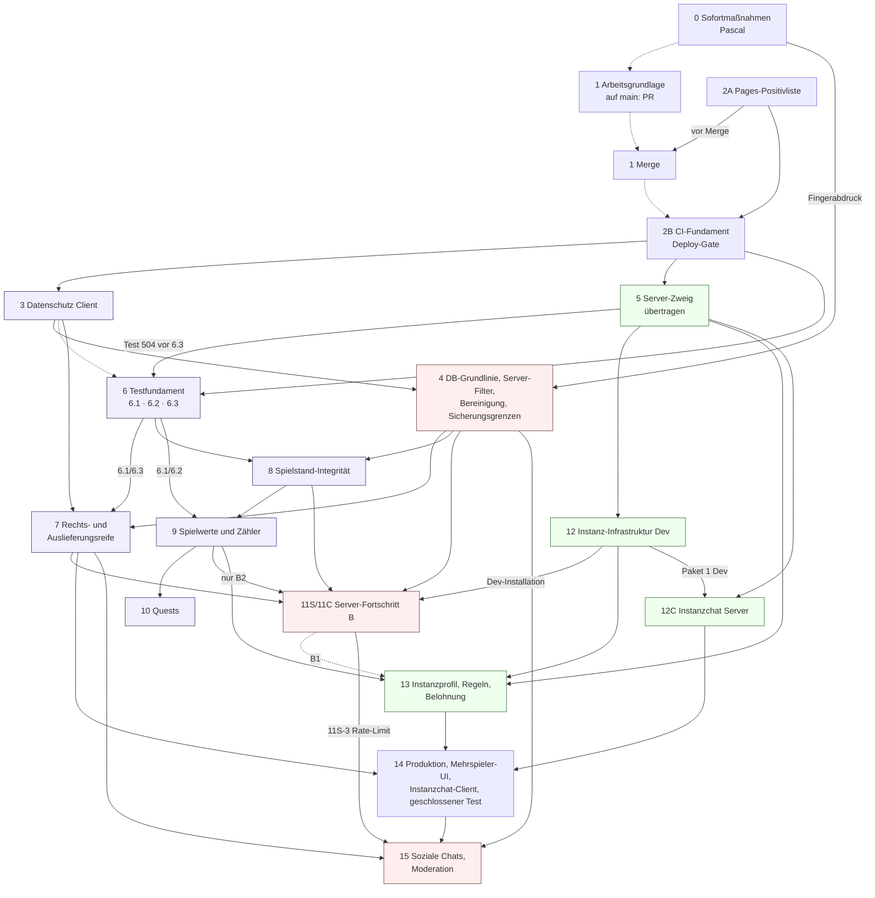

# Ruin Walk – Entwicklungsroadmap

- **Stand:** 19.11.2026, **Fassung 2.1** (Fassung 2 + Chatsystem + Korrektur der Übernahme). Grundlage: `docs/analyse/GESAMTANALYSE_2026-11-19.md` (Code-Stand `main` @ `ed05927`).
- **Versionsverlauf:**
  - Fassung 1 (Commit `22a8722`, **überholt, nicht übernehmen**)
  - Fassung 2 (kritische Abschlussprüfung)
  - Fassung 2.1 (diese)
- **Art:** reine Planung. Nichts davon ist umgesetzt.
- **Prüfung:** Fassung 1 wurde von `rw-architekt`, `rw-backend-security`, `rw-instanzkampf` und `rw-qa` unabhängig gegengeprüft. Alle Einwände sind eingearbeitet. Selbst nachgeprüfte Befunde sind mit ✔︎ markiert.
- **Präfixe gegen Verwechslung:**
  - `RM-T…` = technische Entscheidung dieser Roadmap
  - `E…` = Entscheidung Pascal
  - `F…` = Freigabe Pascal
  - `V2-P-D1…D5` = Entscheidungen aus `INSTANZKAMPF_ARCHITEKTURBERICHT_V2.md` Abschnitt P
  - `README-D1…D3/T1/T2/H2/E1/B1/W1` = offene Kampfregeln in `server/instance/README.md`
  - `O.3` = eingefrorene Architekturteile
- **„Phase 2“ ohne Zusatz** meint Phase 2A und 2B zusammen.
- **Zweige:**
  - „Server-Zweig“ = `nacht/operator-edge-function`
  - „Arbeitszweig“ = `ccr-2e014f58-1i6nm4`
- **Kennzeichnung der Abhängigkeiten:**
  - **[MUSS]** muss vorher abgeschlossen sein
  - **[SOLL]** sollte sinnvollerweise vorher erfolgen
  - **[PARALLEL]** kann parallel erfolgen
  - **[SPÄTER]** erst zu einem späteren Zeitpunkt erforderlich
  - **[E/F]** braucht eine Entscheidung oder Freigabe von Pascal

---

## Änderungen in Fassung 2.1 (gegenüber Fassung 2)

| # | Änderung | Grund |
|---|---|---|
| 1 | **Phase 1 korrigiert:** Commit `22a8722` (Fassung 1) wird **nicht** übernommen; stattdessen ein eigener Commit mit dem Dateistand dieser Fassung. `6837661` wird **ohne** seine interne `ARBEITSSTAND.md` übernommen (Cherry-Pick ohne Commit, neutrale Fassung eingesetzt), damit die interne Fassung nie in der `main`-Historie steht | Prüfung vom 19.11.: `22a8722` enthält Fassung 1; `6837661` legt `ARBEITSSTAND.md` mit lokalen Pfaden, Dev-SHA, Probe-/Vault-Hinweisen und Instagram-Zeitplan an |
| 2 | **Neue Phase 2A „Pages-Positivliste“ (vorgezogen aus Phase 2)**; der **Merge** des Phase-1-PR wartet darauf **[MUSS]** | Pages veröffentlicht heute alles außer `.git`/`.github` (Action `upload-pages-artifact` v3.0.1). Ohne Positivliste käme mit dem Merge die Gesamtanalyse (Cheat-Wege, Datenschutzlücken) auf die Spiel-Domain |
| 3 | **Neues Chatsystem** (Abschnitt B.C, Phasen **12C** Instanzchat-Server und **15** soziale Kanäle; Ergänzungen in Phase 7, 11S, 14) | Auftrag Pascal 19.11.2026 |
| 4 | **Kanalstruktur:** statt Stadt/Region/Land/Welt nur **Instanz** (deckt die Gruppe ab, solange Gruppe = Instanz), **Welt** und später **Landstrich** (≈ 32 km, k-Anonymität); **kein freier Nähe-Chat** | Gruppe ist in `rwi` dieselbe Einheit wie die Instanz (`04_gruppe.sql:140`); Stadt/Land gibt es in der Spielwelt nicht (Weltregel „keine echten Orte“); kleine Ortskanäle verraten den Wohnbereich |
| 5 | **Rate-Limit-Infrastruktur nur einmal:** Phase 11S-3 baut die gemeinsame Zählertabelle; soziale Kanäle (Phase 15) nutzen sie; der Instanzchat prüft unter seiner eigenen Kanalsperre | Doppelarbeit vermeiden |
| 6 | **Neue Entscheidungen C1–C9** (Chat) in F; Matrix, Diagramm, Risiken, Umsetzungsreife und DoD ergänzt | – |
| 7 | Kleinkorrektur: Region = 12×12 Zellen ≈ **2×2 km** bei 48° Breite (der Code-Kommentar „2×3 km“ stimmt hier nicht) | Nachrechnung `DLAT/DLON` |

---

## Änderungsübersicht Fassung 2 (gegenüber Fassung 1)

| # | Korrektur | Grund (Befund) |
|---|---|---|
| 1 | **Phasen neu nummeriert (0–14)**; Zuordnung alt → neu am Ende dieser Tabelle | Fassung 1 hatte „3a“ als Client-Phase neben der Server-Phase 3 (verwirrend) und zu große Phasen |
| 2 | **Übertragung des Arbeitszweigs als eigene Phase 1**, mit genauer Commit- und Dateiliste, nur ausgewählte Commits, **ohne `kunst/**`** und ohne veraltete Arbeitsstände | Fassung 1 sah einen pauschalen Merge vor („nach Paket 3“ war zudem ein falscher Paketbezug; die Positivliste war Paket 4) |
| 3 | **Phase 0 → 1 jetzt „empfohlen“, nicht zwingend**; Diagramm unterscheidet zwingende (durchgezogene) und empfohlene (gestrichelte) Kanten | Widerspruch: Diagramm zwingend, Text „parallel“ |
| 4 | **Deploy-Gate ergänzt:** Schutz vor Rennen (nur deployen, wenn der getestete Commit noch der aktuelle `main`-Stand ist), `workflow_dispatch` nur für getestete Commits, **eine gemeinsame Dateiliste** für Pfadfilter und Positivliste, Prüfskript läuft im Deploy vor dem Hochladen, Lockfile/`npm ci` vorgezogen | QA: Gate war umgehbar, Pfadfilter und Positivliste konnten auseinanderlaufen, `npm test` wird durch das Gate deploy-relevant |
| 5 | **Datenschutzkorrektur grundlegend erweitert:** alle **5** Upload-Wege ✔︎, `syncHash` mit gleicher Ausblendung und Hash-Version (sonst Endlos-Senden oder Fehlkonflikte ✔︎), lokale Daten bei Übernahme behalten, **Server-Filter** als Garantie, Bereinigung aller Sicherungsarten in fester Reihenfolge, Update-Sicherungen lebender Charaktere zeitlich begrenzen ✔︎ | Fassung 1 nannte nur 2 Wege und übersah, dass Update-Sicherungen lebender Charaktere **nie** ablaufen und der Sicherungs-Trigger bei der Bereinigung neue Altkopien erzeugt |
| 6 | **Neue Phase 4 „Datenbank-Grundlinie und Serverhärtung“**: Nachtrag der Migrationen `perf_fixes`/`s1` **vor der ersten** Live-Migration, feste Migrationsreihenfolge m0…mN mit Vorgänger-Prüfung, Server-Filter, Bereinigung, Sicherungsgrenzen | Fassung 1 setzte den Nachtrag erst vor Phase 8 an, die erste Live-Migration kam aber früher; mehrere Phasen ändern dieselbe Funktion `save_character` |
| 7 | **Server-Zweig: Übertragung per Dateistand in 4–5 Themen-Commits statt Cherry-Pick-Kette**; vollständige Commit-Einordnung; `d627058` und `2cd72e5` verwerfen; `dev-test.yml` mitnehmen, aber nicht starten | `main` hat `server/` und `supabase/` seit dem Abzweig nicht geändert; die Commit-Kette in Fassung 1 war unvollständig (u. a. fehlte der digest-Fix selbst); „konfliktfrei“ stimmte nicht (5 Commits ändern CI) |
| 8 | **Prüfsummen-Manifest `rollback_dev.sql`** wird nach jeder Schemaänderung neu erzeugt (fester Schritt in jeder Schema-Phase) | Sonst wird `installation.mjs` nach jeder Schemaänderung rot |
| 9 | **Phase 3 Paket 6 (Sperre `technical_end`) gestrichen** und durch einen Konfigurationsschalter für `terminate_stuck` in Phase 12 ersetzt | V2 erlaubt `technical_end` in Freigabephase 1; die Datenbank kennt keine Freigabephasen; `abort_instance` setzt es auch bei regulären Abbrüchen |
| 10 | **„O.3 unverändert“ als Abnahme ersetzt** durch „V2-Fassung 2.2 mit den bereits bestehenden Abweichungen, von Pascal freigegeben“ | Der Server-Zweig weicht schon von V2 ab (L.3/L.4, A.5, A.6 Nr. 4); die Abnahme wäre sonst unerfüllbar |
| 11 | **Testfundament (alt 3a) in drei Teile geteilt**, mit Tabelle, welches Paket was blockiert; Leaflet, CSP, Rechtstexte brauchen es nicht | Fassung 1 machte das ganze Testfundament zur Voraussetzung, nötig sind nur Teile |
| 12 | **CSP-Hash im Repo erzeugt und per Test geprüft**, nicht beim Deploy | Sonst wird ein ungetestetes Artefakt ausgeliefert, und `pages.yml` müsste in Phase 7 erneut geändert werden |
| 13 | **Server-Fortschritt geteilt** in Server-Teil (parallel möglich) und Client-Import (im Client-Strang) | Fassung 1 nannte die Phase „parallel zu Quests“, obwohl der Import-Weg `index.html` ändert |
| 14 | **Belohnungsabnehmer laut V2 C festgelegt** (`S.rcl` im Client); B2 ist keine Voraussetzung fürs Instanzprofil, B1 nur empfohlen | Fassung 1 ließ den Abnehmer „offen“ und verlangte B2; beides widerspricht V2 |
| 15 | **Neue Voraussetzung vor dem geschlossenen Test:** Installation von `rwi` auf der Produktion **mit Rückbau-Skript** | V2 O.2: Freigabephase 2 läuft im Echtprojekt; ein Produktions-Rollback existiert nicht |
| 16 | **Entscheidungen den Phasen zugeordnet**, mit spätestem Zeitpunkt; neue Entscheidungen ergänzt (u. a. V2-Fassung 2.2, A1/A2, README-T2/H2, Übergangsfrist, Probe-Reste); `V2-P-D2` vor die ersten Dauerläufe vorgezogen | Fassung 1 behandelte E1–E11 gleichzeitig, `V2-P-D2` stand zu spät (Phase 10 statt vor Freigabephase 1) |
| 17 | **RM-T7/T8 (Messschwellen) als Empfehlung zur Bestätigung** markiert; RM-T13 als Vorgabe (keine Entscheidung) | V2 P nennt Pascal als Entscheider für D3/D4; Freigabephase 2 ohne Gegenstände ist eingefrorene Vorgabe |
| 18 | **Matrix korrigiert**: `schema.sql` und `10_tests.sql` getrennt, Workflows bei allen Phasen mit neuen ausgelieferten Dateien, eigene Spalte für das Prüfsummen-Manifest | Mehrere Konflikte fehlten (u. a. Server-Zweig und Testfundament an `10_tests.sql`) |
| 19 | **Definition of Done präzisiert**: Ausnahmen (Deno nur CI, Dev-Tests nur lokal mit Freigabe), Wiederholungsläufe nur für schnelle Suites, Referenzspielstände ab Phase 3, Spielstand-Migration nur vorwärts, nicht umkehrbare Bereinigungen ausdrücklich freigeben | QA: Fassung 1 hatte Widersprüche zwischen Phasen-Tests und Abschnitt H |
| 20 | **Umsetzungsreife je Phase** als eigene Tabelle (G) | Auftrag |
| 21 | Kleinere Korrekturen: `kunst/` hat **23** Dateien (nicht 18); Phase 3 ermöglicht nicht Phase 8, sondern 9/10 (Kante P3→P10 ergänzt); Phase 11 braucht Rechtsreife; Abnahme „≥ Summe der Tests“ → „≥ Vereinigung“; Lasttest mit Zahl | einzelne Belege der Prüfer |

**Zuordnung alt → neu:**

| Fassung 1 | Fassung 2 |
|---|---|
| 0 | 0 |
| 1a | 1 |
| 1b–6 | 2 |
| 2 | 3 (Client) + 4 (Server) |
| 3 | 5 |
| 3a | 6 |
| 4 | 7 |
| 5 | 8 |
| 6 | 9 |
| 7 | 10 |
| 8 | 11 (11S/11C) |
| 9 | 12 |
| 10 | 13 |
| 11 | 14 |

---

## A. Zusammenfassung

**Ausgangslage:** Ruin Walk hat ein spielbares, gut getestetes Solo-Spiel und einen lokal stark getesteten Mehrspieler-Prototyp, der nirgends angebunden ist.

**Ablauf:**
1. **Arbeitsgrundlage und Auslieferung (Phase 1–2):** gültige Teamregeln auf `main`, ein Deploy-Gate, das nur getestete Stände ausliefert.
2. **Datenschutzkorrektur (Phase 3–4):**
   - Der Cloud-Spielstand enthält heute eine **grobe Bewegungsspur der letzten 13 Stunden** und die Heimatregion ✔︎. Rasterzellen von ca. 165 m mit Zeitstempel stehen in `S.cd` (`index.html:1137-1150`, `:1461`, `:1587`).
   - Die Daten gehen auf **5 Wegen** in die Cloud ✔︎ (`:2391`, `:2449`, `:2523`, `:2578`, `:2636`).
   - Sie liegen in bis zu 10 Update-Sicherungen je Charakter, die bei lebenden Charakteren **nie ablaufen** ✔︎ (`schema.sql:198-216` räumt nur Sicherungen gelöschter Charaktere).
   - Die Korrektur verlangt Client, Server-Filter und Bereinigung in fester Reihenfolge.
3. **Danach zwei Stränge:**
   - **Client:** Testfundament → Rechtsreife → Spielstand-Integrität → Spielwerte → Quests.
   - **Server:** Server-Zweig übertragen → Instanz-Infrastruktur auf Dev.
4. **Zusammenführung:** Die Stränge treffen sich beim serverseitigen Fortschritt (Variante B), beim Instanzprofil und beim geschlossenen Mehrspieler-Test.

**Chatsystem (neu in 2.1):**
- Der **Instanzchat** kommt als Server-Teil (Phase 12C, parallel zur Instanz-Infrastruktur) und als Client-Teil (Phase 14) vor den geschlossenen Test, per Polling und ohne jede Wirkung auf den Kampf.
- **Weltkanal**, Moderation und optional ein grober **Landstrich**-Kanal folgen in Phase 15. Ein Nähe-Chat ist aus Datenschutzgründen nicht geplant.

**Umsetzungsreif sind heute:** Phase 0, Phase 1 (PR-Erstellung; Merge erst nach 2A), Phase 2A und 2B. Alle späteren Phasen haben in G benannte Lücken, meist eine fehlende Entscheidung.

---

## B. Entwicklungsphasen

Jede Phase nennt: Ziel · Warum hier · Behandelte Probleme · Betroffen · Voraussetzungen · Arbeitspakete · Abhängigkeiten · Tests · Abnahme · Rückweg · Ermöglicht.

### Phase 0 – Sofortmaßnahmen (Pascal, ohne Code)

- **Ziel:** Das größte laufende Risiko eindämmen und den Ist-Zustand der Produktion belegen.
- **Warum hier:**
  - Die Registrierung beim Live-Supabase ist offen, ohne Datenschutzerklärung und ohne Kontolöschung im Spiel.
  - Vor der **ersten** Live-Migration (Phase 4) muss feststehen, dass die Produktion `schema.sql` entspricht.
- **Behandelt:** Widerspruch „Spiel nicht öffentlich“ gegenüber offener Registrierung; unbelegter Live-Stand; mögliche Testpersonendaten auf der Produktion (`D3_PRUEFBERICHT.md` §6).
- **Betroffen:** Supabase-Dashboard, GitHub-Ruleset, Bericht unter `docs/` (Ablage nach Phase 1).
- **Voraussetzungen:** keine.
- **Arbeitspakete:**
  1. **E1** entscheiden. Bei „aus“ oder „Einladung“: Registrierung im Dashboard schließen, Datum festhalten.
  2. Ruleset `protect-main`: Pflicht-Statuschecks `determinism`, `database`, `bestehende-tests` setzen **[F5]**.
  3. **Lesender Live-Abgleich [F2a]:**
     - `supabase/tests/fingerprint.sql` gegen die Produktion, verglichen mit dem lokalen Fingerabdruck aus `schema.sql`
     - Advisors (Sicherheit, Leistung)
     - Auth-Einstellungen (`disable_signup`, CAPTCHA, SMTP, Passwortregeln, JWT-Laufzeit)
     - Tarif und Aufbewahrung der Plattform-Backups ablesen (nötig für Phase 4)
  4. Bereinigung der Testdaten mit Personendaten (Wegwerfkonto 2, `d3b_test_evt`) **[F3]**: vorher Zählung, Löschung über `delete_account`, danach Zählung. **Nicht umkehrbar (gewollt).**
  5. Die 5 offenen Dependabot-Zweige nicht mergen; sie werden in Phase 2 neu gebündelt.
  6. **E4** anstoßen (Angaben für die Rechtstexte), wegen Vorlaufzeit.
- **Abhängigkeiten:** keine. Paket 3 ist **[MUSS]** für Phase 4. Paket 1 ist **[MUSS]** für Phase 7 (Pakete 6–8).
- **Tests:** keine Code-Tests. Nachweise sind Ausgaben bzw. Berichte.
- **Abnahme:**
  - `gh api repos/LuckyOne2k/ruinwalk/rulesets/<id>` zeigt die 3 Pflichtchecks.
  - Auth-Einstellung `disable_signup` lesend belegt (kein Probe-Signup auf der Produktion).
  - Fingerabdruck-Diff = 0, oder die Abweichungen sind aufgelistet.
  - Advisors-Liste abgelegt.
  - Testdaten-Zählung nachher = 0.
- **Rückweg:** Dashboard-Schalter wieder umstellen. Bereinigung bewusst ohne Rückweg.
- **Ermöglicht:** Phase 4 (Live-Migrationen), Phase 7.

### Phase 1 – Arbeitsgrundlage auf `main` (Auswahl aus dem Arbeitszweig)

- **Ziel:** Agentenregeln, Abgleich-Hook, Kontextsicherung und die Analysen gelten auf `main`, **ohne** Grafikentwürfe und veraltete Arbeitsstände.
- **Warum hier:**
  - Alle späteren Arbeitszweige entstehen von `main`. Dort fehlen heute `rw-pixelart`, `rw-projektpflege` und die Abgleichpflicht in `schutz.js` (0 Treffer für „Abgleich“).
  - Ohne diese Phase gelten für den CI-PR (Phase 2) die alten Regeln.
  - Ohne `kunst/` ist die Übertragung unbedenklich: `.claude/`, `docs/`, `marketing/` liegen schon heute auf `main` und damit auf Pages.
- **Behandelt:** veraltete Teamregeln auf `main`; Arbeitszweig ist 14 Commits vor, 2 hinter `main`.
- **Betroffen:** `.claude/**`, `CLAUDE.md`, `.gitignore`, `docs/analyse/**`, `docs/ki-team/**`.

#### Übersicht des Arbeitszweigs (vs. Abzweig `8de59a8`)

| Commit | Inhalt | Einstufung |
|---|---|---|
| `f23a864` | KI-Team: ständige Erlaubnis, Wissensbasis Supabase-Integration | **übernehmen** (erforderlich) |
| `ace4106` | Projektpflege-Agent, Abgleichpflicht (`schutz.js`), Schutz laufender Arbeit | **übernehmen** (erforderlich) |
| `6837661` | Kontextsicherung (`kontext-sicherung.js`, `settings.json` mit PreCompact/SessionStart-Hooks und `env CLAUDE_AUTOCOMPACT_PCT_OVERRIDE=80`, `.gitignore`, `team-check.js`) **plus** `ARBEITSSTAND.md` mit internem Inhalt | **kontrolliert übernehmen:** Cherry-Pick ohne Commit, `ARBEITSSTAND.md` vor dem Commit durch eine neutrale Fassung ersetzen. Die interne Fassung erscheint so nie in der `main`-Historie |
| `9fb5d22` | Agent `rw-pixelart` + Skill `ruinwalk-pixelart` (inkl. `pixel.py`) | **übernehmen** (Pascal hat Agent und Skill beibehalten) |
| `9144136` | `docs/analyse/GESAMTANALYSE_2026-11-19.md` | übernehmen (Doku) |
| `22a8722` | `docs/analyse/ENTWICKLUNGSROADMAP_2026-11-19.md` in **Fassung 1** (überholt) | **nicht übernehmen**; stattdessen eigener Commit mit dem Dateistand der aktuellen Fassung |
| `985864b`, `5c2c735`, `9cf1973` | nur `docs/ki-team/ARBEITSSTAND.md` (Zwischenstände, interne Pfade, Dev-SHA, Token-Ablauf) | **ausschließen** |
| `9f60981`, `5e6af77`, `de359d3` | `kunst/entwuerfe/**` – **23 Dateien** (11 PNG, 2 `.py`, Raster, Notizen), nicht freigegeben | **ausschließen** (würden auf Pages veröffentlicht) |
| `8f00e57`, `a37e62f` | Instagram Teaser 001: Freigabestatus, `LOG.md` | **standardmäßig ausschließen**; laut `CLAUDE.md` arbeitet Marketing auf dem Arbeitszweig. Übernahme nur nach **E12** |

#### Dateien, die nach `main` kommen

- `.claude/agents/{rw-backend-security,rw-pixelart,rw-projektpflege}.md`
- `.claude/hooks/{schutz.js,kontext-sicherung.js}`
- `.claude/settings.json`
- `.claude/skills/{ruinwalk-ablauf,ruinwalk-db-aenderung,ruinwalk-pixelart/**,ruinwalk-projektpflege/**,ruinwalk-projektwissen/**,ruinwalk-tests}`
- `.claude/tests/team-check.js`
- `.gitignore`
- `CLAUDE.md`
- `docs/analyse/*`
- `docs/ki-team/{SKILL_BEWERTUNG,UEBERSICHT}.md`
- `docs/ki-team/ARBEITSSTAND.md` (neu gefasst)

**Ausdrücklich ausgeschlossen:**
- `kunst/**`
- alte Fassungen von `ARBEITSSTAND.md`
- `marketing/freigabe/**` (bis E12)
- `docs/quests/BESTANDSAUFNAHME.md` (bleibt ungetrackt bis zur Freigabe; Verweise darauf in dieser Roadmap gelten bis dahin nur lokal)

#### Voraussetzungen und Pakete

- **Voraussetzungen:**
  - **[F5]** PR nach `main`.
  - **E13** (Analysen öffentlich im Repo?) ist **nicht blockierend**: Das Repo ist öffentlich, beide Analysen sind schon über den Arbeitszweig lesbar.
- **Arbeitspakete** (Reihenfolge = ursprüngliche Reihenfolge, weil `6837661` und `9fb5d22` beide `team-check.js` und `UEBERSICHT.md` ändern):
  1. Neuer Zweig von `origin/main`.
  2. Cherry-Pick `f23a864`, dann `ace4106` (sauber anwendbar, `main` hat nur `.github/*` geändert).
  3. `6837661` **ohne Commit** übernehmen. `ARBEITSSTAND.md` durch eine neutrale Fassung ersetzen (ohne lokale Pfade, SHAs, Dev-, Probe-, Vault- und Secret-Hinweise, Instagram-Zeitplan). Dann mit Abgleich-Zeile committen.
  4. Cherry-Pick `9fb5d22`, dann `9144136`.
  5. Eigener Commit: Roadmap im Dateistand der aktuellen Fassung (vom Arbeitszweig). **Kein** `22a8722`.
  6. Eigener Commit: Kopfzeile der Gesamtanalyse an den tatsächlichen Ablageort anpassen (übriger Inhalt unverändert).
  7. **`team-check.js` nicht abschwächen:** Es verlangt `ARBEITSSTAND.md` und `env …=80`, beides bleibt enthalten.
  8. **Der Merge wartet auf Phase 2A** (Pages-Positivliste), siehe dort.
- **Abhängigkeiten:**
  - **[SOLL]** nach Phase 0.
  - **PR erstellen [SOLL]** vor Phase 2B (der CI-PR soll unter den neuen Regeln entstehen; in Claude-Sitzungen mit dem Arbeitszweig als Projektordner gelten sie schon).
  - **PR mergen [MUSS] erst nach Phase 2A** (Pages-Positivliste), weil der Merge einen Pages-Deploy auslöst.
- **Tests:**
  - `node .claude/tests/team-check.js` grün.
  - Hook-Test: `schutz.js` mit JSON-Eingabe eines Commits an `.github/` ohne Abgleich-Zeile ergibt eine Verweigerung.
- **Abnahme:**
  - `git diff --name-only origin/main <pr>` entspricht exakt der Dateiliste oben.
  - Kein Pfad unter `kunst/` oder `marketing/freigabe/`.
  - `git log origin/main..<pr>` enthält weder `22a8722` noch eine Fassung 1 der Roadmap; die Roadmap im PR trägt den aktuellen Versionsstand.
  - `git log -p origin/main..<pr> -- docs/ki-team/ARBEITSSTAND.md` enthält keine lokalen Pfade, SHAs, Dev-, Probe-, Vault- oder Secret-Hinweise und keinen Instagram-Zeitplan.
  - Suche nach Zugangsdaten (Tokens, Schlüssel, Passwörter) im PR-Diff ohne Treffer.
  - CI des PR vollständig abgewartet und dokumentiert.
  - team-check grün, Hook-Test grün.
  - Hinweis im Bericht: Der Hook wirkt nur in Claude-Sitzungen, er ist kein Git-Hook.
- **Rückweg:** Revert-PR.
- **Ermöglicht:** Phase 2.

### Phase 2A – Pages-Positivliste (vorgezogen, klein)

- **Ziel:** Die Spielwebsite liefert nur noch die Dateien aus, die Spiel und Landingpage brauchen.
- **Warum hier:**
  - `upload-pages-artifact` v3.0.1 (`path: '.'`) schließt nur `.git` und `.github` aus ✔︎.
  - Heute und nach dem Merge von Phase 1 würden deshalb auch `.claude/`, `docs/` (inkl. `docs/analyse/` mit Cheat-Wegen und Datenschutzbefunden), `marketing/` (inkl. `meta/config.json` mit Konto-IDs), `server/`, `supabase/`, `tests/` und `tools/` auf der Spiel-Domain ausgeliefert. Das sind 290 von 1.105 Dateien, im Spiel nicht benötigt.
  - Das Repo ist öffentlich, die Spiel-Domain soll aber nicht als zweiter Verbreitungsweg für interne Unterlagen dienen.
- **Benötigt fürs Spiel** (Verweise in `index.html:230-250` und `landingpage.html`; `status/` und `figs/`/`items/` werden zusätzlich dynamisch geladen):
  - `index.html`, `landingpage.html`
  - `sprites.js`, `sprites_*.js`, `pxdom.js`
  - `figs/**` (inkl. `manifest.js`), `items/**` (inkl. `manifest.js`), `status/**`, `assets/**`
- **Nicht betroffen:** Instagram-Bilder laufen über `raw.githubusercontent.com` (`meta-api.js:94-103`), nicht über Pages.
- **Betroffen:** `.github/workflows/pages.yml`, neue Datei mit der gemeinsamen Pfadliste, Prüfskript.
- **Voraussetzungen:** **[F5]** PR nach `main` und Merge (= Deploy).
- **Arbeitspakete:**
  1. Gemeinsame Pfadliste (identisch mit Phase 2B Paket 1).
  2. Im Deploy: Staging-Verzeichnis nur aus der Liste, Prüfskript **vor** dem Hochladen. Es bricht ab, wenn interne Pfade enthalten sind oder ein `src`/`href` aus `index.html`/`landingpage.html` fehlt.
  3. Keine weiteren Änderungen (kein Gate; das folgt in 2B).
- **Tests:**
  - Prüfskript lokal gegen `main` (grün) und mit absichtlich ergänztem `docs/` (rot).
  - Smoke-Test des Spiels gegen das Staging-Verzeichnis.
- **Abnahme:**
  - Artefakt-Dateiliste im Deploy-Log = Pfadliste.
  - Abruf von `/.claude/settings.json` und `/docs/analyse/GESAMTANALYSE_2026-11-19.md` auf der Pages-URL ergibt 404 (Abruf durch Pascal; diese Sitzung erreicht `github.io` nicht).
  - Spiel und Landingpage laden vollständig.
- **Rückweg:** Revert von `pages.yml`.
- **Ermöglicht:** Merge von Phase 1; Phase 2B baut darauf auf.

### Phase 2B – CI-Fundament und Deploy-Gate

> Die Pakete 1 (gemeinsame Pfadliste) und 6 (Staging-Verzeichnis, Prüfskript) sind mit Phase 2A erledigt. Hier bleiben Pfadfilter, Gate, Testuhr, Lockfile, Smoke-Test und Dependabot.

- **Ziel:** Nichts geht ungetestet live. CI ist einmal vereint, damit die Übertragung des Server-Zweigs keinen CI-Konflikt mehr erzeugt.
- **Warum hier:**
  - Jede folgende Phase ändert Code.
  - Heute deployt jeder Push auf `main` sofort, auch bei roten Tests (`pages.yml:3-5`, ohne `needs`).
- **Behandelt:**
  - Deploy ohne Gate, ganzes Repo auf Pages.
  - Grafik-Pushes ohne CI.
  - Flackernder Status-Test (Testuhr nur auf dem Server-Zweig).
  - `playwright:*` ohne Lockfile, System-Chrome statt Playwright-Chromium (`tests/harness.js:12`).
- **Betroffen:**
  - `.github/workflows/{instance-tests,pages}.yml`, `.github/dependabot.yml`
  - `tests/cases/status.js`, `tests/harness.js` (Browserwahl)
  - `package.json` + `package-lock.json`
  - neue Datei mit der gemeinsamen Liste ausgelieferter Pfade
  - neues Prüfskript für das Pages-Artefakt
- **Voraussetzungen:** **[MUSS]** Phase 2A; **[SOLL]** Phase 1 (gemergt); **[F5]**.
- **Arbeitspakete:**
  1. **Gemeinsame Liste ausgelieferter Pfade** (eine Datei) als Quelle für den Push-Pfadfilter **und** die Positivliste des Artefakts:
     - heute: `index.html`, `landingpage.html`, `sprites*.js`, `pxdom.js`, `figs/**` (inkl. `manifest.js`), `items/**`, `status/**`, `assets/**`
     - reserviert: `vendor/**`, Rechtstexte
     - Das Prüfskript gleicht beide ab.
  2. `instance-tests.yml` in der `main`-Fassung plus Pfade aus Paket 1. Der md5-Reproduzierbarkeitsschritt bleibt.
  3. Testuhr in `status.js` (Inhalt wie Commit `d627058` des Server-Zweigs; dort wird `d627058` später verworfen).
  4. **Lockfile:** feste Playwright-Version, CI auf `npm ci`, Harness nutzt Playwright-Chromium. Vorgezogen, weil das Gate `npm test` deploy-relevant macht.
  5. **Deploy-Gate in `pages.yml`:**
     - Auslöser `workflow_run` von `instance-tests` mit `conclusion=='success'`, `event=='push'`, `head_branch=='main'`.
     - Checkout auf `workflow_run.head_sha`.
     - **Vor dem Deploy prüfen:** `head_sha` ist noch der aktuelle `main`-Stand, sonst überspringen (Schutz vor einem älteren, später fertigen Lauf).
     - `workflow_dispatch` nur, wenn für den Commit ein erfolgreicher `instance-tests`-Lauf existiert.
  6. **Artefakt aus Staging-Verzeichnis** nach Paket 1. Das Prüfskript läuft **im Deploy vor dem Hochladen** und bricht bei Fehlern ab:
     - keine `.claude/`, `docs/`, `supabase/`, `server/`, `marketing/`, `tests/`
     - jedes `src`/`href` aus `index.html` auflösbar
  7. **Smoke-Test:** Harness gegen das Staging-Verzeichnis. Heute serviert `harness.js:8` das ganze Repo und würde fehlende Dateien nicht bemerken.
  8. **Dependabot neu bündeln:** ein PR für die drei Pages-Actions mit Probe-Deploy, ein PR für checkout und setup-node.
- **Abhängigkeiten:**
  - **[MUSS]** vor allen Code-Phasen.
  - **[SOLL]** vor Phase 5 (CI dann nur noch um Server-Teile ergänzen).
- **Tests:**
  - Statische Prüfung der Gate-Bedingungen (Skript).
  - Prüfskript, Smoke-Test, `npm ci && npm test`.
  - **Dynamischer Nachweis, einmalig** **[F5]**: im Test-Repo, das Pascal anlegt, **oder** einmalig freigegeben auf `main`.
    - roter Stand → kein Deploy
    - grüner Stand → Deploy mit gleichem SHA
    - nur Grafik-Push → Tests laufen → Deploy
    - zwei schnelle Pushes → nur der neuere wird deployt
- **Abnahme:**
  - Alle vier dynamischen Fälle mit Lauf-IDs belegt.
  - Artefakt = Positivliste (Prüfskript grün).
  - `status.js` 3× stabil, `npm ci` in CI.
- **Rückweg:** Revert von `pages.yml`; bis dahin manueller Deploy über `workflow_dispatch` (nur getestete Commits).
- **Ermöglicht:** alle Code-Phasen; konfliktfreie CI-Ergänzung in Phase 5.

### Phase 3 – Datenschutzkorrektur im Client

- **Ziel:** Der Client sendet keine Bewegungsspur und keine genaue Heimat mehr, ohne Sync-Fehler.
- **Warum hier:**
  - Es ist ein laufender Datenabfluss.
  - Der Server-Filter (Phase 4) darf erst kommen, wenn der Client dieselbe Ausblendung beherrscht. Sonst entstehen falsche Konflikte ✔︎:
    - `syncHash` (`index.html:2016-2017`) blendet nur `last`, `played`, `lp`, `hp`, `en`, `gv` aus.
    - `syncAdopt` vergleicht damit (`:2499`).
    - `cloudStartPlan` vergleicht `baseHash` (`:2037-2039`).
- **Behandelt:** `S.cd`/`S.mh`/`S.home` im Cloud-Spielstand; Test `datenfluss.js` erkennt Zellschlüssel nicht.
- **Betroffen:** `index.html` (alle 5 Upload-Wege `:2391`, `:2449`, `:2523`, `:2578`, `:2636`; `syncHash`, `syncAdopt`, `cloudStartPlan`, Übernahme `:2657`, Ersetzen `:2041-2047`), `tests/cases/datenfluss.js`, `tests/fake_supabase.js`, neue Referenzspielstände `tests/fixtures/saves/`.
- **Voraussetzungen:**
  - **[MUSS]** Phase 2.
  - **E3** ist nur für `home` nötig; `cd`/`mh` brauchen keine Entscheidung.
  - **E14:** Monster erscheinen nach einem Gerätewechsel wieder. Empfehlung: annehmen.
- **Arbeitspakete:**
  1. **Eine Funktion `cloudSnap()`** für alle 5 Upload-Wege. Sie entfernt `cd`, `mh` und `home` (bzw. vergröbert `home` nach E3).
  2. `syncHash` nutzt dieselbe Ausblendung. **Hash-Version** im Sync-Meta: altes Format erkennen und neu berechnen, kein Fehlkonflikt bei Bestandsständen.
  3. Bei Übernahme bzw. Ersetzen eines Serverstands lokales `cd`/`mh` (und `home`) **behalten**. Sonst erscheinen Monster auf demselben Gerät wieder (Farm-Missbrauch).
  4. **Referenzspielstände** von `main@ed05927` unter `tests/fixtures/saves/`: frisch, Level 30 mit +10/Set, Pfadstufe 3, Testmodus, mit Cloud-Meta. Sie werden ab hier für alle Ladetests gebraucht.
  5. `datenfluss.js`: Bodies **aller** RPCs in der Attrappe prüfen (`create_character`, `save_character`, keepalive) auf Zellschlüssel (`m|n|g…_…`), `home`, Zeitstempel-Muster.
- **Abhängigkeiten:**
  - **[MUSS]** vor Phase 4 (Server-Filter und Bereinigung).
  - **[MUSS]** vor Phase 7 (Datenschutzerklärung muss stimmen).
  - **[PARALLEL]** zu Phase 5.
- **Tests:**
  - Datenfluss-Test, mit Mutationsprobe: Ausblendung entfernen → rot.
  - Nach erfolgreichem Sync `dirty=false` und kein Folge-Upload.
  - Bestands-Meta im alten Hash-Format ergibt keinen Konflikt.
  - Übernahme behält `cd`.
  - keepalive-Flush ausdrücklich.
  - Ladetest aller Referenzstände.
  - `npm test` 3×.
- **Abnahme:** In 5 von 5 Upload-Wegen 0 verbotene Schlüssel, 0 Fehlkonflikte, alle Referenzstände laden.
- **Rückweg:** Revert-PR. Das ist ungefährlich, weil der Server noch nicht filtert.
- **Ermöglicht:** Phase 4.

### Phase 4 – Datenbank-Grundlinie, Server-Filter, Bereinigung, Sicherungsgrenzen

- **Ziel:**
  - Saubere Migrationsgrundlage.
  - Serverseitige Garantie gegen Bewegungsdaten.
  - Bereinigung **aller** Kopien.
  - Zeitliche Grenzen für Sicherungen.
- **Warum hier:**
  - Die erste Live-Migration des Plans ist der Server-Filter.
  - Ein reines Weglassen im Client reicht nicht: offene Tabs laufen mit altem Code weiter, manipulierte Clients senden beliebig.
  - Update-Sicherungen lebender Charaktere laufen heute **nie** ab ✔︎.
- **Behandelt:**
  - fehlende Migrationsdateien `perf_fixes`/`s1`
  - keine Migrationskonvention
  - Bewegungsdaten in Zeilen und Sicherungen
  - unbegrenzte Update-Sicherungen
  - Lösch-Sicherungen ohne Obergrenze je Konto
  - fehlender Index `audit_log(account_id)`
  - `username_available` anonym abfragbar (bei geschlossener Registrierung)
- **Betroffen:** `supabase/schema.sql`, neue Migrations- und Rollback-Dateien, `supabase/tests/10_tests.sql`, Bereinigungsskript, Bericht.
- **Voraussetzungen:**
  - **[MUSS]** Phase 0 Paket 3 (Fingerabdruck), Phase 3 deployt plus **Übergangsfrist** (**E15**, Empfehlung 7 Tage).
  - **E3** vor Paket 3/4.
  - **[F3]** je Live-Schritt; Bereinigung ausdrücklich als nicht umkehrbar freigeben.
- **Arbeitspakete (feste Migrationsreihenfolge):**
  - **m0:** Migrations- und Rollback-**Dateien** für `perf_fixes` und `s1` nachtragen, ohne Live-Lauf.
    - Konvention: `supabase/migration_mNN_<thema>.sql` + `rollback_mNN_<thema>.sql`.
    - Jede Migration prüft zu Beginn den Fingerabdruck ihres Vorgängers.
  - **m1 Server-Filter:** `save_character` und `create_character` entfernen `cd`/`mh`/`home` (bzw. vergröbern `home`).
  - **Bereinigung je Charge in **einer** Transaktion:**
    - Erst `characters` **ohne Versionserhöhung**. Sonst übernehmen Clients den Serverstand und verlieren lokales `cd`.
    - Danach **alle** `character_backups` (auch `reason='delete'` und die, die der Trigger `backup_character` bei diesem UPDATE neu anlegt, `schema.sql:151-168`).
    - Bericht nur mit Anzahlen, kein Lesen von Inhalten, keine Vorab-Kopie.
  - **Plattform-Backups/PITR:** nicht per SQL löschbar. Ablaufdatum = Bereinigungsdatum + Aufbewahrung laut Tarif (Phase 0 Paket 3) dokumentieren. Logs: Inhalt nicht nachweisbar, gehört in die Datenschutzerklärung.
  - **m2 Sicherungsgrenzen:** maximales Alter für Update-Sicherungen (Empfehlung 30 Tage), Obergrenze für Lösch-Sicherungen je Konto, Index `audit_log(account_id)`, Aufräumfunktion für unbestätigte Konten (Aufruf manuell oder geplant **[F3]**).
  - **m3 (nur wenn E1 = aus):** `revoke execute on username_available from anon`, Test `10_tests.sql:503` anpassen. **Achtung:** E1 „Einladung“ kann die Funktion wieder brauchen.
  - Nach jeder Migration das **Prüfsummen-Manifest** neu erzeugen, sobald Phase 5 übertragen ist (sonst entfällt dieser Schritt).
- **Abhängigkeiten:**
  - **[MUSS]** seriell zu allen Phasen, die `schema.sql` schreiben (8, 11S, 13).
  - `10_tests.sql` seriell mit Phase 5 und 6.3: Phase 5 Test 504 **vor** 6.3 mergen.
- **Tests:**
  - Migration und Rollback lokal in beiden Rechte-Modi.
  - SQL: Speichern mit `cd` ergibt eine gespeicherte Zeile ohne `cd`.
  - Grenzen per Negativtest.
  - Bereinigungsskript lokal gegen Referenzdaten (Zählung vorher/nachher).
  - Vertragstest der Attrappe nachziehen, sobald 6.3 existiert.
- **Abnahme:**
  - Live: `select count(*) … where character_data ?| array['cd','mh','home']` = 0 in `characters` **und** `character_backups`. Erneut nach 7 Tagen = 0.
  - Fingerabdruck nach jeder Migration = `schema.sql`.
  - Ablaufdatum der Plattform-Backups dokumentiert.
- **Rückweg:**
  - m1–m3 über `rollback_mNN`.
  - Die Bereinigung ist **bewusst nicht umkehrbar**. Spielfolge gering, weil `cd` lokal bleibt.
- **Ermöglicht:** Phase 7 (Datenschutzerklärung beschreibt den echten Zustand), Phase 11S (B0).

### Phase 5 – Server-Zweig auf `main` übertragen (Server-Strang)

- **Ziel:** Ein Stand des Instanzkampfs auf `main`, Supabase-tauglich.
- **Warum hier:**
  - Der Server-Zweig enthält den digest-Fix, die Profilableitung, den Worker-Kern, Lösch-Trigger, die Dev-Installation und 26 Tests.
  - `main` hat seit dem Abzweig `8e423a3` **weder `server/` noch `supabase/` geändert** (Diff leer).
- **Behandelt:** `digest()` unqualifiziert (`01_proto.sql:93` u. a.), `eligible()` nur über `rwi.players`, Endlosschleife bei Engine-Fehlern, Zweig-Drift, überflüssiger Zweig `nacht/supabase-integration`.
- **Betroffen:**
  - `server/instance/**` (inkl. `worker/`, `fixtures/`)
  - `supabase/dev/**` (ohne das erzeugte `install_dev.sql`)
  - `supabase/functions/operator/{handler.mjs,index.ts,keys.mjs}`, `supabase/config.toml`, `supabase/tests/run.sh`
  - `.github/workflows/dev-test.yml`
  - Ergänzungen an `instance-tests.yml`, `10_tests.sql` (Test 504), `docs/*`
- **Voraussetzungen:**
  - **[MUSS]** Phase 2.
  - **[F1]**.
  - Ausschließlich `rw-instanzkampf`.
  - **E16** (V2-Fassung 2.2) muss bis zur Abnahme vorliegen.

#### Einordnung der 24 Commits des Server-Zweigs

| Einordnung | Commits |
|---|---|
| Inhalt übernehmen (SQL, Tests, Dev) | `2ff5b6a`, `ca46cba` (digest-Fix), `12f8504` (Lösch-Trigger), `28438a2`, `052a6b3` (report_failure), `4e85377`, `ea92d86`, `8744b31`, `668de0e`, `b53647d`, `ce29fd0`, `d49a417`, `f270633` |
| gemischt – `.github`-Teile herauslösen | `1a3f0e9`, `a35108a`, `afc5dfb`, `15f5d2e`, `4370b84` |
| Doku, nach Übertragung veraltet → aktualisieren oder archivieren | `673fded`, `7e3c99f`, `1e3e6ff`, `9e43c33`, `3414677` |
| verwerfen | `d627058` (Testuhr kam in Phase 2), `2cd72e5` (CI-Gegenstück zu `ee0e1e4`; nur SHA-Pins für `dev-test.yml` übernehmen) |

#### Pakete

- **Arbeitspakete:**
  1. **Verfahren:** Dateistand der Zweigspitze je Pfadliste übernehmen, in 4–5 Themen-Commits (SQL-Kern · Worker/Operator · Dev-Installation · Tests · Doku), jeder mit Abgleich-Zeile und Verweis auf die Zweig-SHAs.
     - Kein Cherry-Pick: Nur 3 von 24 Commits tragen eine Abgleich-Zeile, und `cherry-pick --continue` umgeht den Hook.
  2. **CI ergänzen** (nicht ersetzen): PG-16/17-Matrix, `run-all-db.sh` **mit md5-Schritt**, Pfade `supabase/dev/**` und `supabase/functions/**`, `deno check …/operator/index.ts` und `operator-index.bun.mjs` (verlangt von `operator-korrekturen.mjs:40`).
  3. **Ausschließen:** `tests/cases/status.js` des Zweigs, `dependabot.yml` und `pages.yml` des Zweigs, `functions/operator/config.toml` (auf dem Zweig schon gelöscht).
  4. **`dev-test.yml` mitnehmen, aber nicht starten** (nur `workflow_dispatch`). Beim ersten Start würde GitHub das Environment ohne Schutzregel anlegen. Das Environment wird erst mit Prüfer angelegt (Phase 12, F4).
  5. Strukturtest `10_tests.sql:504` mit den `group_*`-Wrappern abstimmen, getrennt nach Live-Erwartung (ohne Wrapper) und Dev-Erwartung (mit Wrapper). Sonst bricht der Live-Fingerabdruck.
  6. Neuer Test: Löschung gegen Watchdog-Sweep (Sperrreihenfolge K.2). `loesch-trigger.mjs` existiert bereits.
  7. Port-Doppelung `eventende.mjs`/`produktion.mjs` (54397) beheben.
  8. `CLAUDE.md` und Projektwissen anpassen: Mit `supabase/config.toml` ist „kein Supabase-CLI-Projekt“ nicht mehr wahr.
  9. Doku: Nachtbericht und Checklisten aktualisieren. Stichtagsberichte (DEV_FREIGABE_*, K6_…, DEV_INSTALLATIONS*, K2_DEADLOCK) über `rw-projektpflege` archivieren.
  10. Zweig `nacht/supabase-integration` aufgeben **[F1]**.
- **Abhängigkeiten:**
  - **[PARALLEL]** zu Phase 3 und 6.1/6.2 (keine gemeinsamen Dateien).
  - **[MUSS]** seriell zu Phase 4 und 6.3 bei `10_tests.sql`: Test 504 zuerst.
  - **[MUSS]** vor Phase 12 (nur Pakete 1–5).
- **Tests:**
  - Testnamen vorher (beide Stände) und nachher als Diff; Anzahl nachher ≥ Vereinigung.
  - Volle Instanz-Pflichtliste, `run-all-db.sh` PG16 und PG17 (lokal oder als Ausnahme „nur CI“), Determinismus Node/Bun/Deno (CI), md5, `supabase/tests/run.sh` beide Modi.
- **Abnahme:**
  - Alle Suites grün, nichts übersprungen.
  - Pfadfilter für Spielcode und md5-Schritt nachweislich vorhanden.
  - **Abweichungen von V2 nicht „bereinigt“, sondern als V2-Fassung 2.2 dokumentiert und von Pascal freigegeben (E16):**
    - L.3/L.4: synchrone SQL-Ableitung statt `derive_jobs`
    - A.5/A.6 Nr. 3: kein automatisches stuck-Wiederholen, nur `resume_stuck`
    - A.6 Nr. 4: `terminate_stuck` → `aborted`
- **Rückweg:** Revert der Übertragungs-Commits. Keine Datenbankwirkung, `rwi` ist nirgends installiert.
- **Ermöglicht:** Phase 12, Phase 13.

### Phase 6 – Testfundament im Client (drei Teile)

- **Ziel:** Echter Spielablauf, Zufall und Zeit sind testbar; das Ist-Verhalten ist festgehalten; Attrappe und Schema stimmen überein.
- **Warum hier:** Die Phasen 7–10 ändern Kernlogik.
  - Heute setzt der Harness immer `__RW_TEST=true` (`tests/harness.js:22`). Dadurch sind Kontolöschung an, Tutorial aus und Sync-Zeiten verkürzt (`index.html:2297`, `:2894`, `:2468`).
  - Zufall (20× `Math.random`) und Uhr (87× `Date.now`) sind nicht steuerbar.
- **Betroffen:** `tests/**`, `index.html` (nur Testhaken-Vertrag und Einspeisung von Seed/Uhr), `tests/fake_supabase.js`, `supabase/tests/10_tests.sql`.
- **Voraussetzungen:** **[MUSS]** Phase 2; **[SOLL]** Phase 3 (gleiche Dateien `index.html`/`tests/`, deshalb nacheinander).

**6.1 Harness:**
1. **Live-Modus** = `__RW`-Exporte an, Funktionsschalter mit Produktionswerten (eigener Init-Parameter). Dazu ein Rauchtest ganz ohne Testhaken, nur über das DOM.
2. Seed und Uhr per `addInitScript`.
3. **Testhaken-Vertrag:** Liste der Exporte, Test „jeder Schlüssel definiert“, `useSkill` aufnehmen.
4. Harte Wartezeiten (11×) durch Uhr oder Zustandssignal ersetzen.

**6.2 Charakterisierung:** Ist-Verhalten-Tests für Quests, UPQ, `useSkill`, Kaufen/Reparatur, Aufstieg/`SECRET`, Monster-, Set- und Boss-Effekte (`reactDo`, `bossTick`).
- „Negativ“ heißt hier: Der Effekt fehlt, wenn die Bedingung fehlt.
- Abnahme über eine **Liste der Testnamen je Funktion**.

**6.3 Vertrag und SQL:**
1. Vertragstest Attrappe ↔ `schema.sql`, tabellengetrieben je RPC und Fehlercode, gegen lokales PG und gegen die Attrappe, **in CI** (`bestehende-tests`). Grenze dokumentieren: PostgREST/JWT bleibt ungeprüft.
2. `10_tests.sql:280` (`where false`) und `:409` (`or true`) reparieren.

**Welches Paket blockiert was:**

| Paket | blockiert |
|---|---|
| 6.1 Live-Modus | Phase 7 Paket 4 und 6 (Kontolöschung, Registrierungsmeldung); Phase 8 Paket 2 (Entwicklerwerkzeuge) |
| 6.1 Seed/Uhr | Phase 8 Paket 4 (Mehr-Tab); Phase 9 komplett (Korridore) |
| 6.1 Testhaken-Vertrag | neue Dateien nach RM-T5 (Phase 10, 14) |
| 6.2 | Phase 9, Phase 10 |
| 6.3 | Phase 7 Paket 7, Phase 8 Paket 3, Phase 11 |
| nicht blockiert | Phase 7 Pakete 1, 2, 3, 8 (Leaflet, CSP, Rechtstexte, Landingpage) |

- **Tests:** jede neue Schutzregel mit Mutationsprobe; `npm test` 3×.
- **Abnahme:**
  - 6.1: Rauchtest ohne Haken grün; Seed reproduziert Kämpfe bitgleich.
  - 6.2: jede Funktion der Liste mit mindestens einem positiven und einem negativen Test.
  - 6.3: Vertragstest grün in CI; die zwei SQL-Tests werden bei absichtlichem Fehler rot.
- **Rückweg:** Revert-PR (nur Tests und Testhaken).
- **Ermöglicht:** Phase 7–10.

### Phase 7 – Rechts- und Auslieferungsreife

- **Ziel:** Mindestanforderungen für Nutzer mit Konto.
- **Warum hier:** Braucht den echten Datenzustand (Phase 3/4) und für die Kontolöschung den Live-Modus-Test (6.1). Bestehende Konten verarbeiten auch bei geschlossener Registrierung weiter Daten.
- **Betroffen:** `index.html`, `landingpage.html`, `vendor/leaflet/`, Rechtstext-Seiten, `tests/harness.js` (Leaflet-Umleitung `:17-18`), gemeinsame Pfadliste (Phase 2).
- **Voraussetzungen:**
  - **[MUSS]** Phase 3 und 4 für Paket 3.
  - **[MUSS]** 6.1 für Pakete 4 und 6.
  - **[MUSS]** 6.3 für Paket 7.
  - **E4** für Paket 3.
  - **E1** für Pakete 6–8.
- **Arbeitspakete:**
  1. **Leaflet lokal** (mit Lizenz) unter `vendor/`, Pfadliste ergänzen, Harness im selben PR anpassen.
  2. **CSP-Meta-Tag:**
     - `connect-src` auf Supabase, Overpass und OSM-Kacheln begrenzen.
     - SHA-256 des Inline-Skripts **im Repo**, ein Test berechnet und vergleicht ihn.
     - `style-src 'unsafe-inline'` ist nötig (89 `style=`-Attribute), als bewusste Grenze dokumentiert.
  3. **Impressum und Datenschutzerklärung:**
     - Empfänger: OSM-Kacheln, Overpass, Supabase (Auftragsverarbeitung).
     - Plattform-Backups mit Ablaufdatum, Logs.
     - Sobald ein Chat geplant in Betrieb geht (Phase 14/15): Chat, Fristen, Moderation, Meldeweg ergänzen (Nachzug, kein Neubau).
     - Verlinkung aus Spiel und Landingpage, Dateien in der Pfadliste.
  4. **Kontolöschung im Spiel** (`DEL_ON`, `index.html:2297`). Live-Prüfung mit Testkonto, das nach dem Muster der vorhandenen Testkonten angelegt und wieder entfernt wird **[F3]**.
  5. Bis dahin: dokumentierter Ablauf für Löschanfragen von Hand.
  6. **Registrierung:** Formular ausblenden oder klare Meldung bei geschlossener Registrierung.
  7. Bei E1 = aus erledigt Phase 4 m3 den Rest; hier nur Attrappe und Vertragstest nachziehen.
  8. Spiel-Links auf der Landingpage nach E1 (`landingpage.html:37`, `:45`, `:71`).
- **Abhängigkeiten:**
  - **[MUSS]** vor jeder Öffnung für weitere Spieler und vor Phase 14.
  - **[SOLL]** vor Phase 11S B0.
  - `index.html` im Wechsel mit Phase 8 (nicht gleichzeitig).
- **Tests:**
  - Leaflet-Mutationsprobe (Stub entfernen → rot).
  - CSP: 0 `securitypolicyviolation` in allen Szenarien; ein eingeschleustes Skript wird blockiert.
  - Anfragen nur an Hosts der Positivliste.
  - Live-Modus-Test Kontolöschung mit Mutationsprobe (`DEL_ON` aus → rot).
  - Artefakt enthält Rechtstexte und `vendor/`.
  - Mobile-Prüfung.
- **Abnahme:** alle Tests grün; Rechtstexte über die Pages-URL erreichbar (Abruf durch Pascal); Kontolöschung im echten Ablauf belegt.
- **Rückweg:** Revert-PR. Die Kontolöschung kann über den Schalter wieder ausgeblendet werden.
- **Ermöglicht:** Öffnung (E1 b), Phase 14.

### Phase 8 – Spielstand-Integrität

- **Ziel:** Versionierte Spielstände. Test- und Cheat-Stände sind serverseitig erkennbar. Entwicklerwerkzeuge sind für Spieler nicht erreichbar.
- **Warum hier:** Vor den Wertänderungen (Phase 9), die Migrationen alter Stände brauchen. Vor B0 (Phase 11S), sonst werden Cheat-Stände beobachtet.
- **Behandelt:**
  - kein Versionsfeld; `sanitize` reicht unbekannte Felder durch (`:844`)
  - Cheats über Testmodus bzw. `?dev=1` (`:571`, `:1924`, `:1942`)
  - `S.test` wird beim Ausschalten zurückgesetzt (`:2910`)
  - kein Mehr-Tab-Schutz lokal (`:2746`)
  - `stunId` nicht gespeichert, Pfadprüfung in `sanitize` fehlt
- **Betroffen:** `index.html`, `supabase/schema.sql` (Merker-Spalte), `tests/fake_supabase.js`, Tests.
- **Voraussetzungen:**
  - **[MUSS]** 6.1, 6.3, Phase 4 (Migrationsreihenfolge).
  - **E2** (Testmodus für Spieler; spätestens vor Paket 2).
- **Arbeitspakete:**
  1. **Versionsfeld und Migrationsregister.** Migration **nur vorwärts**. Eine zurückgerollte Client-Fassung muss eine höhere Version ohne Datenverlust laden (unbekannte Version: Daten unverändert behalten, nicht verwerfen).
  2. Entwicklerwerkzeuge **nur mit Testhaken oder auf localhost** (RM-T4). Testmodus selbst nach E2.
  3. **Merker als Spalte, die nur der Server setzt** (nicht im JSON). `save_character` setzt ihn bei Testmodus-Ständen und hebt ihn nie wieder auf (Migration m-nächste).
  4. **Mehr-Tab-Schutz** für lokale Plätze, an derselben Stelle wie das Versionsfeld.
  5. `stunId` mit `S.stun` speichern; `sanitize` prüft, ob der Pfad zur Klasse passt.
- **Abhängigkeiten:** **[MUSS]** vor Phase 9 und 11S.
- **Tests:**
  - Ladetests mit allen Referenzständen sowie ohne Versionsfeld, mit unbekanntem Feld, mit zu hoher Version.
  - „Zurückgerollter Client lädt v+1 ohne Verlust“.
  - Cheat-Aktion ohne Freischaltung wirkungslos (Mutationsprobe).
  - Merker: `false` nach `true` bleibt `true`, auch für fremde und anonyme Aufrufer (SQL, beide Modi).
  - Mehr-Tab mit zwei Seiten im selben Kontext.
- **Abnahme:** alle Tests grün; Merker live per Zählung belegt.
- **Rückweg:**
  - Client: Revert. Wegen „nur vorwärts“ kein Datenverlust (Test).
  - Merker: `rollback_mNN`; die Merker-Spalte geht dabei verloren (im Bericht nennen).
- **Ermöglicht:** Phase 9, Phase 11S.

### Phase 9 – Spielwerte und Fortschrittszähler

- **Ziel:** Stabile Werte. Messbare lokale Zähler.
- **Warum hier:** Quest-Belohnungen (Phase 10) und Ledger-Deckel (Phase 11S B2) bauen darauf auf. Eine spätere Änderung würde beide nachziehen.
- **Behandelt:**
  - XP-Umkehr (`mobOf`, `:1111` ✔︎)
  - Verkaufswert +40 % je Stufe (`:1106` ✔︎)
  - Diebstahl 6 % (`:1355` ✔︎)
  - Reparatur teurer als Neuware
  - Gebietsboss solo kaum schaffbar
  - Heiler-Pfade schwach
  - 8 reine Verkaufsmaterialien, Lücke Level 25–44
  - tote Daten
  - falsche Texte (q3, Respawn, Klassenwechsel, Konflikt-Hilfe `:2473`)
- **Betroffen:** `index.html`, Balancing-Export, Tests, `docs/balancing/KORRIDORE.md` (neu).
- **Voraussetzungen:**
  - **[MUSS]** Phase 8, 6.1 (Seed), 6.2.
  - **E5** (spätestens vor Paket 3).
  - **Korridore** in `docs/balancing/KORRIDORE.md`, von `rw-gamedesign` erstellt und **von Pascal freigegeben vor Beginn** **[F6]**.
- **Arbeitspakete:**
  1. Maschinenlesbare **Delta-Liste** je Wertänderung. Der JSON-Diff des Exports darf nur in gelisteten Pfaden abweichen; das wird automatisch geprüft.
  2. XP-Formel, Verkaufswert, Diebstahl-Obergrenze, Reparatur.
  3. Gebietsboss und Heiler nach E5; geheime Bedingungen nach E5.
  4. **Lokale Zähler** in `S.stats` (Siege je Monsterart, Gebietsstufe, Lebensraum) mit Startwerten, `checkQuests` nach `craftGear`. Felder über das Migrationsregister. **Kein Ledger-Format** (RM-T11).
  5. Texte, tote Daten.
- **Abhängigkeiten:** **[MUSS]** vor Phase 10 und vor 11S B2.
- **Tests:**
  - Export (Befehl aus Skill `ruinwalk-balancing`) vorher und nachher, Diff als Artefakt.
  - Korridore als Tests.
  - Invarianten: Rüstung und Krit ≤ 75 %; Verkaufswert nach Upgrade < Kaufpreis.
  - Charakterisierungstests nur entlang der Delta-Liste angepasst.
  - Referenzstände laden.
- **Abnahme:** alle Korridore grün; Diff außerhalb der Delta-Liste = 0.
- **Rückweg:** Revert. Werte werden aus Basis-IDs neu berechnet, gespeicherte Items bleiben gültig. Neue Zählerfelder bleiben dank „nur vorwärts“ erhalten.
- **Ermöglicht:** Phase 10, Phase 11S B2, Belohnungsrahmen Phase 13.

### Phase 10 – Quests

- **Ziel:** Spielfortschritt nach q4.
- **Warum hier:** Braucht Zähler und stabile Werte (Phase 9).
- **Betroffen:** neue Datei für Quest-Daten (RM-T5), Einhängepunkt in `index.html`, Pfadliste, CSP-Hash, Tests.
- **Voraussetzungen:**
  - **[MUSS]** Phase 9.
  - **E6** (vor Paket 1).
  - Inhaltsfreigabe von Pascal nach Skill `ruinwalk-ki-inhalte` **[F6]**.
  - `docs/quests/BESTANDSAUFNAHME.md` freigegeben und im Repo.
- **Arbeitspakete:**
  1. Einsteigerkette ab q5 (Pfad 1 des Quest-Entwurfs).
  2. Kleine UI-Punkte, wenn nicht parallel an `index.html` gearbeitet wird: Tippflächen ≥ 40 px, Gebietsname sichtbar, Tutorial-Text, Wake Lock, Logogröße.
  3. Wiederkehrende Aufgaben **[SPÄTER]**: nach E6, mit Serverzeit erst nach Phase 11S.
- **Abhängigkeiten:** **[PARALLEL]** zu 11S (nur Server-Dateien); **nicht** parallel zu 11C.
- **Tests:**
  - je Quest: Ablauf, Fall „erfahrener Charakter“ (Startwert), doppelte Abgabe, Belohnung im Korridor
  - Prüfskript des Skills `ruinwalk-ki-inhalte`
  - Mobile-Prüfung bei 320, 360, 390 und 412 px: 0 Befunde und 0 Hinweise < 40 px für neue Elemente
- **Abnahme:** alle Tests grün; Inhalte freigegeben.
- **Rückweg:** Revert. Quest-Fortschritt bleibt dank „nur vorwärts“ gespeichert, wird aber von der alten Fassung nicht angezeigt (im Bericht nennen).

### Phase 11 – Serverseitiger Fortschritt (Variante B) – 11S Server, 11C Client

- **Ziel:** Der Server kennt einen **anerkannten** Fortschritt (Level, Klasse, Pfad, Stufe) und begrenzt Missbrauch.
- **Warum hier:**
  - Braucht saubere Daten (Phase 3, 4, 8).
  - B2 braucht stabile Werte (Phase 9).
  - B0 ist eine neue Verarbeitung echter Daten und braucht den Rechtsrahmen (Phase 7).
- **Behandelt:**
  - Inhalt ungeprüft (Level 9999, `10_tests.sql:239`)
  - keine Ratenbegrenzung
  - `create_character` übernimmt freie Daten
- **Betroffen:**
  - 11S: `schema.sql`, Migrationen, `supabase/tests/`, `tests/fake_supabase.js`
  - 11C: `index.html` (Import-Weg), `tests/cases/`
- **Voraussetzungen:**
  - **[MUSS]** Phase 4, 7 (für B0), 8.
  - **[MUSS]** Phase 9 nur für B2.
  - **[MUSS]** Dev-Integrationstest möglich: Dev-Installation aus Phase 12 Paket 1 **[F2b, F4]**.
  - **[F3]** je Live-Schritt.
- **Arbeitspakete:**
  - **11S-1 B0 (beobachten):**
    - anerkannter Stand nur innerhalb der Datenbank, ohne Export, ohne Wirkung
    - Ledger mit Kaskade beim Löschen und Aufbewahrungsfrist
    - Stände mit Testmodus-Merker ausgeschlossen
  - **11S-2 B1 (Import):** Plausible Bestandscharaktere anerkennen (`source='imported'`). Auffällige werden nicht bestraft, nur nicht anerkannt.
  - **11S-3 Ratenbegrenzung** in Postgres, als **gemeinsame Infrastruktur** auch für die sozialen Chatkanäle (Phase 15):
    - Zählertabelle mit festen Zeitfenstern, Upsert auf (Schlüssel, Fenster), Aufräumen
    - für `anon` ist die IP aus den Request-Headern als Schlüssel unsicher, deshalb bevorzugt Revoke (Phase 4 m3)
  - **11S-4 B2 (Ereignisse):** Ledger-Format festlegen, auf die Zähler aus Phase 9 abbilden, XP-Deckel je Monsterstufe, Stundenrate. Konkrete Grenzwerte je Regel **vor** dem Bau festlegen.
  - **11C:** `create_character` mit Startstand **und** eigener Import-Weg für lokale Charaktere. Ohne Import-Weg bricht der Upload (`index.html:2391`, `:2449`).
- **Abhängigkeiten:**
  - 11S **[PARALLEL]** zu Phase 10.
  - 11C im Client-Strang **nach** Phase 10 oder davor, nie gleichzeitig.
  - **[SOLL]** B1 vor Phase 13 (V2 verlangt es nicht, empfohlen als Zugangssperre).
- **Tests:**
  - Migrationen mit Rollback in beiden Modi.
  - Missbrauchsfälle (Level 9999, Stufe 3 ohne Stufe 2, zu schnelle XP).
  - Ratenbegrenzung mit gesteuerter Uhr; je Regel ein Negativtest; Mutationsprobe.
  - Vertragstest nachziehen.
  - **Integrationstest gegen `ruinwalk-dev`** (PostgREST/JWT) vor jeder Live-Migration.
- **Abnahme:**
  - B0 → B1 → B2 je mit eigenem Bericht.
  - Gefälschte Testfälle sind nicht anerkannt.
  - Grenzwerte belegt.
  - Fingerabdruck nach jeder Migration = `schema.sql`.
- **Rückweg:**
  - B0: DROP ohne Wirkung.
  - B1/B2: `rollback_mNN` mit Verlust des Ledgers (im Bericht benennen).
- **Ermöglicht:** Phase 13 (Profil aus anerkanntem Stand), später Ranglisten.

### Phase 12 – Instanzkampf-Infrastruktur auf Dev (Server-Strang)

- **Ziel:** Kämpfe laufen auf `ruinwalk-dev` vollständig serverseitig mit Testcharakteren.
- **Warum hier:**
  - Unabhängig vom Client-Strang.
  - `derive_profile` arbeitet mit Testcharakteren.
  - Die Messungen entscheiden die Engine-Ablage.
- **Behandelt:**
  - kein Taktgeber (`dispatch_due`, Cron/pg_net, `resolve-round`)
  - keine Belohnungszustellung (Lease/ack)
  - keine Allowlist, keine Sperren, kein `ops_freeze_instance`
  - Messungen fehlen
  - Alarmzustellung offen (`STUCK_ABLAUF.md`)
- **Betroffen:** `server/instance/**`, `supabase/dev/**`, `supabase/functions/**`, `dev-test.yml`/Environment; ausschließlich `rw-instanzkampf`, nacheinander.
- **Voraussetzungen:**
  - **[MUSS]** Phase 5 Pakete 1–5.
  - **[F4]** Dev-Installation; Environment `dev-test` mit Prüfer anlegen, bevor `dev-test.yml` gestartet wird.
  - **E17** (Probe-Reste auf Dev: `rwprobe_secret`, zwei Probe-Migrationen) vor Paket 1.
- **Arbeitspakete:**
  1. Dev-Installation nach Checkliste C/D; echte Pfade gegen GoTrue/PostgREST.
  2. **Phase-0-Messungen.** Methodik festlegen: Erzeugung von ≥ 10.000 pg_net-Aufrufen, Tarifgrenzen. Bericht unter `docs/`.
     - Danach **V2-P-D3** mit den Schwellen aus RM-T7 **[E9 bestätigt]**.
     - Fällt die Wahl auf „SQL“, entfällt Engine-Arbeit in Edge Functions.
  3. **Erst nach** E7a (`V2-P-D2`), E10a (Grenzen der Dauerläufe) und E18 (A1/A2): Taktgeber mit automatischem `start_fight`, erste Dauerläufe (Freigabephase 1).
  4. Belohnungsmechanik Lease/ack (V2 C.2) mit **Abnehmer `S.rcl`** (V2 I.1 Nr. 7).
  5. Teilnehmer-Allowlist, Konto- und Instanzsperre, `ops_freeze_instance`.
     - **Konfigurationsschalter**, der `terminate_stuck`/`rw_ops_terminate` sperrt (für Freigabephase 2).
     - Alarmzustellung.
  6. Jede neue `rwi`-Funktion bekommt eine Rechteklasse in `05_produktion.sql`; Prüfsummen-Manifest neu erzeugen.
- **Abhängigkeiten:**
  - **[PARALLEL]** zu Phase 6–11 (keine gemeinsamen Dateien außer CI-Ergänzungen, nacheinander).
  - Paket 1 **[MUSS]** für den Integrationstest in 11S.
  - **[MUSS]** vor Phase 13.
- **Tests:**
  - Instanz-Pflichtliste, md5, Determinismus in 3 Laufzeiten.
  - Lease/ack: doppelte Zustellung, Absturzfälle.
  - Not-Aus als Befehl.
  - Dev-Tests nur lokal mit F2b, Protokoll im Bericht.
- **Abnahme:**
  - Gruppe → Kampf → Belohnungsanspruch → Zustellung auf Dev durchgelaufen.
  - Messbericht abgelegt, D3 begründet entschieden.
  - Not-Aus und Sperrschalter getestet.
- **Rückweg:** `supabase/dev/rollback_dev.sh` (Zielschutz: nur Dev).
- **Ermöglicht:** Phase 13.

### Chatsystem – Gesamtkonzept (Grundlage für Phase 12C, 14, 15)

Geprüft von `rw-backend-security` (Transport, Rechte, Daten, Kosten), `rw-instanzkampf` (Einbindung in `rwi`), `rw-mobile-ux` (Bedienung, Akku), `rw-welt-ki` (Kanalstruktur). Es gibt heute **keinen** Chat im Code und **kein** Realtime; Supabase wird per eigenem `fetch` angesprochen (`index.html:2092`).

**Kanalstruktur (bewusst schlank):**

| Kanal | Inhalt | Wann | Begründung |
|---|---|---|---|
| **Instanz** (Arbeitsname „Gefährten“) | alle Mitglieder einer Instanz; Phasenmarke je Nachricht (bereit, Planung, Auflösung, zwischen Kämpfen, Ende) | **vor dem geschlossenen Test** (Phase 12C + 14) | In `rwi` ist eine Gruppe dieselbe Einheit wie die Instanz (`04_gruppe.sql:140`); ein eigener Gruppenkanal ist erst sinnvoll, wenn Gruppen über Instanzen hinweg bestehen (E11, C5) |
| **Welt** (Arbeitsname „Weltfeuer“) | ein Kanal für alle, Deutsch | Phase 15 | wenige Spieler → ein Kanal statt vieler leerer; Gruppensuche (E11) |
| **Landstrich** | festes, grobes Gebiet ≈ 16×16 Regionen (≈ 32×32 km); sichtbar erst ab k ≥ 15 aktiven Konten in 14 Tagen, sonst Rückfall auf Welt; höchstens ein Wechsel pro Tag; prozedurale Fantasienamen | Phase 15, Stufe 2 (nach C6) | ersetzt Stadt, Region und Land, ohne echte Orte; schützt vor Ortung |
| ~~Nähe~~ | – | **nicht geplant** (C6) | eine Region ist ≈ 2×2 km; ein Nähe-Kanal verrät praktisch den Heimatbereich und widerspricht der Datenschutzkorrektur (Phase 3/4, E3) |

**Getrennt vom Kampfprotokoll:** eigene Tabelle und eigene RPC; keine Verbindung zu `round_results` oder `group_log`. In der Oberfläche getrennte Listen („Chat | Protokoll“), Protokollzeilen erhöhen nie den Chat-Zähler.

**Transport (RM-T18):**
- **Polling per RPC** für alle Kanäle in der ersten Ausbaustufe.
  - Instanz im Takt der Kampfansicht (heute geplant 2–3 s, `INSTANZKAMPF_ARCHITEKTURBERICHT.md:158`).
  - Soziale Kanäle alle 10 s bei offenem Chat, sonst alle 60 s nur für den Ungelesen-Zähler; im versteckten Tab nach 30 s aus.
- Begründung: keine neue Infrastruktur, keine CSP-Änderung (`wss`), kein neuer Client-Baustein, funktioniert mit dem vorhandenen `fetch`-Client; im Kampf wird ohnehin abgefragt.
- **Supabase Realtime (Broadcast, private Kanäle)** erst als spätere Ausbaustufe für soziale Kanäle ab etwa 500 täglich aktiven Spielern, und nur als „Klingel“: Der Server sendet nur `{Kanal, letzte ID}`, der Client holt den Inhalt per RPC. Clients bekommen **keine** INSERT-Policy auf `realtime.messages`; gesendet wird nur serverseitig.
- **Nicht verwenden:** Postgres Changes (skaliert schlecht) und Presence (verrät Anwesenheit in Gebieten).
- Mobilgeräte trennen WebSockets im Hintergrund, deshalb braucht auch die Realtime-Stufe Speicherung und Nachladen „seit ID“.

**Autorisierung und Schutz:**
- **Schreiben nur über RPC.** Den Absender setzt der Server (`auth.uid()` → `public.characters`, Name zum Sendezeitpunkt; kein Kontoname). Clients haben keine Tabellenrechte.
- **Instanzchat in `rwi`:**
  - Tabellen `rwi.chat_channels`, `rwi.chat_messages` mit lückenloser `seq` je Instanz, Wrapper `public.group_chat_send`/`group_chat_read` mit Rechteklasse in `05_produktion.sql`.
  - Lesen und Schreiben nur für aktive Mitglieder (auch besiegt oder abwesend).
  - `left`/`removed` verlieren den Zugriff sofort.
  - Nach Instanzende: 10 min schreiben, 24 h lesen, dann löschen (Testwerte; C4).
- **Unantastbar für den Kampf:**
  - kein Fremdschlüssel auf `rwi.instances` (Sperrkonflikt mit Claim/Commit)
  - keine Sperre auf `instances`/`members`/`fights`
  - **keine Erhöhung von `round_version`**
  - **kein Setzen von `last_seen_at`/`disc_since`** (Chat zählt nicht als Lebenszeichen und beeinflusst keine Fristen)
  - Engine liest nur `state` und `actions`
  - O.3 bleibt unberührt
- **Spam:**
  - Instanz: unter der Kanalsperre ≤ 5 Nachrichten pro 10 s, 1–200 Zeichen, kein gleicher Text in 30 s, ≤ 2.000 je Instanz.
  - Soziale Kanäle: gemeinsame Zählertabelle aus 11S-3; Vorschlag Welt 1 pro 30 s, Landstrich 1 pro 10 s, 300 pro Tag; Schreiben erst mit bestätigter E-Mail und Kontoalter ≥ 24 h.
  - Für alle: Steuer-, Bidi- und Zero-Width-Zeichen entfernen; Links, Zahlenfolgen und `@…`-Muster in sozialen Kanälen sperren; Wortfilter nur markierend; doppelte Zustellung über `client_msg_id`.
- **Moderation (Phase 15):** Blockieren, Melden (Ausschnitt ohne Ortsbezug), Ausblenden und Stummschalten durch Moderatoren (Rolle per SQL gepflegt, nie über `user_metadata`, kein `service_role` im Client). Im geschlossenen Test genügt Pascal über den SQL-Editor.

**Datenschutz:**
- **Keine Koordinate, Zelle oder Region** an Nachrichten. Der Landstrich wird lokal berechnet und nur als Kanalparameter gesendet.
- Nachrichten im Landstrich liegen in einem kurzlebigen Puffer, ohne dauerhafte Zuordnung „Konto ↔ Gebiet“. Ob die geplante Pseudonymisierung genügt, ist **juristisch zu prüfen**.
- **Aufbewahrung (Vorschlag, C4):**

  | Inhalt | Frist |
  |---|---|
  | Instanz | Ende + 24 h |
  | Welt | 72 h |
  | Landstrich | 24 h |
  | Meldungsausschnitte | 90 Tage |

- Konto- oder Charakterlöschung löscht Nachrichten, Blockierungen und eigene Meldungen per Kaskade bzw. eigenem Trigger (der bestehende Lösch-Trigger bleibt unverändert).
- Auskunft über eine eigene RPC. Die Datenschutzerklärung (Phase 7) nennt Chat, Fristen und Moderation.
- **Nur benannt, rechtlich zu prüfen:** Pflichten aus dem DSA (Meldeweg, Begründung bei Sperren), Vorsorge nach § 24a JuSchG, Grooming-Risiko → Mindestalter (C7). Direktnachrichten bewusst nicht geplant.

**Mobile Bedienung (Instanz):**
- Chat-Knopf (48 px) mit Zähler im Daumenbereich.
- Ticker mit den letzten 1–2 Zeilen über der Daumenzone.
- Panel nur im Mittelband (verdeckt Aktionen nicht).
- **Schnellrufe** (2×4 Chips ≥ 48 px, z. B. „Ziel: X“, „Heile mich“, „Bereit“; übertragen als Vorlagen-ID).
- Tastatur über `visualViewport`; Eingabe ≥ 16 px; Zustellstatus (wartet/zugestellt/fehlgeschlagen).
- Kein neuer Takt; höchstens 100 Nachrichten im DOM.
- Chat in eigener Datei `chat.js` (RM-T5).

**Kosten (Schätzung, Annahmen offen):**
- **Quellen:** Supabase-Seiten zu Realtime Pricing und Limits und die Preisseite, nur als Suchauszüge vom 19.11.2026. Vor einer Entscheidung auf supabase.com prüfen. Der Plan des Live-Projekts ist unbekannt.
- **Annahmen:** 18 Nachrichten je Spieler und Tag; Polling ca. 90 Abrufe pro Tag à 1 KB.

| Aktive Spieler | Polling: Anfragen/Tag | Polling: Datenmenge/Monat | Realtime-Nachrichten/Monat | Realtime-Mehrkosten (Pro-Plan) |
|---|---|---|---|---|
| 50 | ca. 5.000 | < 1 GB | ca. 0,14 Mio. | 0 |
| 500 | ca. 54.000 | ca. 2 GB | ca. 2,3 Mio. | 0 (innerhalb des Kontingents) |
| 5.000 | ca. 540.000 (Spitze ≈ 40/s) | ca. 18 GB | ca. 78 Mio. | ca. 180 $/Monat zzgl. Verbindungen (Spitze ≈ Pro-Grenze) |

- Polling verursacht bis 5.000 Spieler kaum Zusatzkosten, sofern die Rechenstufe reicht (Lasttest Phase 14).
- Der Weltchat treibt die Realtime-Kosten (Nachrichten × Mitleser).
- Speicherbedarf klein (bei 5.000 Spielern ca. 30 MB/Tag bei kurzen Fristen).

**Grobe Aufwandsschätzung (Personentage):**

| Teil | Server | Client | Summe |
|---|---|---|---|
| Instanzchat (Phase 12C + 14) | 5–6 | 7–9 (Grundgerüst `chat.js` 4–5, Instanz-Panel/Ticker/Schnellrufe 3–4) | **12–15** |
| Welt + Moderation, Blockieren, Melden (Phase 15 Stufe 1) | 5–7 (Annahme) | 4–5 | **9–12** |
| Landstrich (Phase 15 Stufe 2) | 2–3 (Annahme) | 1–2 | **3–5** |
| Realtime-Klingel (optional, später) | 2–3 (Annahme) | 2–3 | **4–6** |

Recht und Moderationsbetrieb sind nicht eingerechnet.

### Phase 12C – Instanzchat, Server-Teil (Server-Strang)

- **Ziel:** Chat je Instanz serverseitig fertig und auf Dev geprüft, ohne jede Wirkung auf den Kampf.
- **Warum hier:**
  - Muss vor dem geschlossenen Test stehen (Phase 14).
  - Braucht nur Phase 5 (Wrapper- und Rechte-Grundlage, Test 504) und für die Prüfung Phase 12 Paket 1. Engine und Golden-Referenz (Phase 13) werden **nicht** berührt.
- **Betroffen:** `server/instance/sql/` (neue Datei für den Chat), `05_produktion.sql` (Wrapper und Rechteklassen), `tests/produktion.mjs`, `tests/rechte-audit.mjs`, `supabase/tests/10_tests.sql:504` (Strukturtest), Prüfsummen-Manifest, `tests/fake_supabase.js` (Attrappe für den Client).
- **Voraussetzungen:**
  - **[MUSS]** Phase 5 Pakete 1–5.
  - **[MUSS]** Phase 12 Paket 1 für den Dev-Test.
  - **C1**, **C3** vor Beginn.
  - **C4** als Testwerte.
- **Arbeitspakete:**
  1. Tabellen `rwi.chat_channels`/`rwi.chat_messages` ohne Fremdschlüssel auf Instanzen. `seq` lückenlos unter kurzer Kanalsperre, `clock_timestamp()`, Phasenmarke, `client_msg_id`.
  2. `rwi.chat_send_for`/`chat_read_for` mit Mitgliedschafts- und Spam-Prüfung; Wrapper `public.group_chat_send`/`group_chat_read`; Rechteklassen in `05_produktion.sql`; Schnellrufe als Vorlagen-ID.
  3. Nachlauf nach Instanzende (`closed_at` beim ersten Aufruf nach Ende); `rwi.chat_sweep` als eigener Job; Lösch-Trigger für Charaktere als **eigener** Trigger.
  4. Strukturtest, Rechte-Audit und WR-Liste nachziehen; Manifest neu erzeugen.
- **Abhängigkeiten:**
  - **[PARALLEL]** zu Phase 12 Pakete 2–5.
  - **[MUSS] seriell** mit Phase 12 Paket 6 und Phase 13 Paket 3 bei `05_produktion.sql`.
  - **[MUSS]** vor Phase 14.
- **Tests:**
  - **Rechte, negativ:** anon, fremder Charakter, fremde Instanz, Wartende, `left`/`removed`, nach Nachlauf `chat_closed`; Absender per Parameter wirkungslos; keine Client-Rechte auf `rwi.chat_*`.
  - **Nebenläufigkeit:**
    - Eine fremde Sitzung hält die Instanzzeile `FOR UPDATE`, Chat geht trotzdem (`lock_timeout` 100 ms). Mutationsprobe: Fremdschlüssel → rot.
    - 8 parallele Sender: `seq` lückenlos.
  - **Spam** je Regel mit Mutationsprobe.
  - **Lebenszyklus:** Nachrücken, Austritt, Entfernung, Wiederverbinden (Verlauf vollständig), Sieg, Niederlage, Abbruch, Eventende während des Sendens, Löschung.
  - **Trennung vom Kampf:**
    - `round_version`, `input_hash` und `last_seen_at` identisch mit und ohne Chat.
    - Simulation `--seed 3/4/5` mit Chat-Last, md5 gleich.
    - Strukturtest: kein „chat“ in Claim/Commit/Engine/Worker.
  - Dev mit echtem `auth.uid()`.
- **Abnahme:**
  - Alle Suites grün auf PG16 und PG17.
  - p95 `group_chat_read` ≤ 200 ms unter der Last aus Phase 14 (Empfehlung).
  - Golden unverändert.
- **Rückweg:** Rückbau-Skript der Chat-Teile (Dev); auf `main` Revert.
- **Ermöglicht:** Chat-Client in Phase 14.

### Phase 13 – Instanzprofil, Kampfregeln, Belohnungsabnahme

- **Ziel:** Instanzkämpfe nutzen anerkannte Charakterwerte und vollständige Kampfregeln. Die Golden-Referenz wird **einmal** neu gebaut.
- **Warum hier:**
  - Braucht D3 (Phase 12 Paket 2) und Lease/ack (Phase 12 Paket 4).
  - Empfohlen: B1 (Phase 11S-2).
  - Alle Regeländerungen ändern die Referenzkämpfe und gehören deshalb in **ein** Bündel.
- **Behandelt:**
  - Client und Engine rechnen mit unvereinbaren Werten.
  - Das eingefrorene Profil (V2 B.2) sieht `lv` **und** Ausrüstung vor, die Umsetzung leitet nur Klasse, Pfad und Stufe ab; die Stufe fließt nicht in die Werte.
  - Offene Regeln README-D1–D3, B1, T1, T2, H2, E1, W1.
  - Herkunftsnachweis für Gegenstände (`item_seen`).
- **Betroffen:** `server/instance/engine/**`, `content.mjs`, `sql/05_produktion.sql`, Golden-Referenz, gegebenenfalls `derive_jobs` + Edge Function `derive-profile` (V2 L.3–L.5); `public.save_character` für `item_seen` (seriell in der Migrationsreihenfolge, `rw-backend-security`).
- **Voraussetzungen:**
  - **[MUSS]** Phase 12, Phase 9 (Export als Quelle für den Vertragstest).
  - **E8** (spätestens vor Paket 1, empfohlen vor Phase 12 Paket 3).
  - **E19** (README-T2, H2) vor Paket 2.
  - **E10b** (Belohnungsgrenzen, Testwerte zulässig) vor Paket 3.
- **Arbeitspakete:**
  1. Profil aus dem anerkannten Stand; Ausrüstung und Level nach E8 (bei „Ja“ laut V2 L.3–L.5).
  2. **Ein Regel-Bündel:** Formeln für Ausrüstung, Krit und Level **mit** README-D1–D3, B1, T1, T2, H2, E1, W1. Neue `ENGINE_VERSION`, Golden-Referenz bewusst neu, mit Freigabenachweis.
  3. Belohnungen laut Vorgabe V2 B.6/I.1 Nr. 7 (RM-T13): **nur Kampf-EP und Münzen mit Obergrenzen**, kein Wiederbelebungsitem; Wrapper `group_revive_use` (`05:87`) für Freigabephase 2 abschalten.
  4. Fingerabdruck `item_seen` (Entscheidungsgrundlage `V2-P-D5`, vor Freigabephase 3).
  5. Minimale Dungeon-Inhalte (Gegner je Kampf).
- **Tests:**
  - Neue Golden-Referenz mit Begründung.
  - Vertragstest Engine ↔ Client-Werte (Quelle: Balancing-Export).
  - Determinismus, Belohnungsgrenzen, `incompatible_engine` bei laufenden Kämpfen alter Version.
- **Abnahme:** Vertragstest grün; Golden versioniert und freigegeben; Grenzwerte laut E10b belegt.
- **Rückweg:** Die alte `ENGINE_VERSION` bleibt registriert. Bei geändertem `state_schema` werden laufende Kämpfe als `incompatible_engine` beendet (im Bericht nennen).
- **Ermöglicht:** Phase 14.

### Phase 14 – Produktionsinstallation, Mehrspieler-UI und geschlossener PvE-Test

- **Ziel:** Ein Gruppen-Dungeon ist im Echtprojekt auf dem Handy spielbar (Freigabephase 2).
- **Warum hier:** Erst jetzt sind Server, Profil, Regeln, Belohnungen und Recht belastbar.
- **Behandelt:**
  - `othersInFight(){return 0;}` (`index.html:1617` ✔︎)
  - `rwi` ist nicht auf der Produktion installiert
  - ein Produktions-Rückbau fehlt (`rollback_dev.sql` gilt per Zielschutz nur für Dev)
- **Betroffen:** neue Client-Datei Mehrspieler (RM-T5), Einhängepunkt in `index.html`, Pfadliste, CSP, Server-API für die Gruppenfindung (`rwi` + Wrapper + Rechteklasse), Migrationen Produktion.
- **Voraussetzungen:**
  - **[MUSS]** Phase 13, Phase 7, **Phase 12C** (Instanzchat-Server).
  - **C2** (Schnellrufe/Freitext) vor Paket 5.
  - **C4** endgültig vor Testbeginn.
  - **C7** (Mindestalter), falls Freitext im Test.
  - **E11** (vor dem Server-Teil).
  - **E7b** (`V2-P-D1`) vor Testbeginn.
  - **E10c** (Beobachtungszeitraum, endgültige Grenzen).
  - **E20** (erwartete Spielerzahl für den Lasttest).
  - **[F3, F4]** Produktionsinstallation.
- **Arbeitspakete:**
  1. **Produktionsinstallation** von `rwi` als Migration **mit eigenem Rückbau-Skript für die Produktion**, getestet auf Dev. Vorher Backup und Fingerabdruck.
  2. Messungen im Echtprojekt wiederholen (V2 I.1 Nr. 1).
  3. Gruppenfindung nach E11 (neue Funktionen, Wrapper, Rechteklasse, Tests).
  4. Client: Beitreten, Bereitschaft, Rundenplanung, Ansicht per Polling (`group_view`/`group_heartbeat`).
  5. **Instanzchat im Client** (`chat.js`, siehe Chat-Gesamtkonzept):
     - Chat-Knopf und Ticker, Panel im Mittelband, Schnellrufe, Zustellstatus
     - Trennung von Chat und Protokoll
     - Lesen per `group_chat_read` im selben Takt wie die Kampfansicht
     - Datenschutzerklärung nennt den Chat (Phase 7 Paket 3 nachziehen)
  6. V2 I.1 Punkt für Punkt abhaken: Backup, Allowlist, Bestandstests, Sperren, Not-Aus.
- **Tests:**
  - Vertragstest Client ↔ `group_*`, Polling-Tests, Mobile-Prüfung.
  - **Lasttest:** N gleichzeitige Gruppen à 4 über 30 min (N aus E20), p95 `group_view` ≤ 500 ms und `group_chat_read` ≤ 200 ms, mit Chat-Last (Empfehlung).
  - **Chat im Client:**
    - Mobile-Check mit Panel bei 320–412 px: verdeckt keine Kampfknöpfe, Tippflächen ≥ 40 px.
    - Tastatur-Attrappe über `visualViewport`.
    - 500 Nachrichten: ≤ 100 Knoten im DOM.
    - XSS-Text wird als Text angezeigt.
    - Offline-Warteschlange und Wiederverbinden.
    - Chat mit einem Tipp erreichbar, Schnellruf mit zwei Tipps.
  - Abweichungsmessung: Client-Protokoll gegen `round_results` mit Hash je Runde.
- **Abnahme:**
  - **Schwereklassen festgelegt** (S1 = Datenverlust, falsche Belohnung, Absturz; S2 = Funktionsfehler mit Umgehung; S3 = kosmetisch); 0 offene S1.
  - ≥ 20 Kämpfe mit 2–4 Spielern ohne Abweichung.
  - Jede Belohnung genau einmal zugestellt.
  - Not-Aus erprobt.
  - Rückbau auf Dev erprobt.
- **Rückweg:** Mehrspieler-Einstieg im Client per Schalter aus; Rückbau-Skript Produktion.

### Phase 15 – Soziale Chatkanäle und Moderation

- **Ziel:** Weltkanal mit Moderation, Blockieren und Melden; danach optional der Landstrich-Kanal.
- **Warum hier:**
  - Freie Kanäle für alle Spieler brauchen eine Gemeinschaft, Moderation, Rechtstexte, Ratenbegrenzung und den Datenschutzstand ohne Bewegungsdaten. Alles davon entsteht erst in Phase 4, 7, 11S und 14.
  - Vor dem geschlossenen Test ist ein Weltkanal nicht nötig (C1).
- **Betroffen:** `supabase/schema.sql` + Migrationen (eigenes Schema `chat` oder `public`), `tests/fake_supabase.js`, `chat.js` und Einhängepunkt in `index.html` (Kanalwahl, Blockieren/Melden), gemeinsame Pfadliste, CSP-Hash.
- **Voraussetzungen:**
  - **[MUSS]** Phase 4, 7, 11S-3 (gemeinsame Zählertabelle), 14 (Chat-Grundgerüst im Client).
  - **C5–C8**.
  - Für Stufe 2: E3 und k-Schwelle.
- **Arbeitspakete:**
  - **Stufe 1:**
    - Tabellen für Nachrichten, Blockierungen, Meldungen, Sanktionen, Moderatoren; RPCs `chat_send`, `chat_poll`, `chat_block`/`unblock`, `chat_report`, `chat_my_messages`, Moderations-RPCs mit Rollenprüfung.
    - Fristen und Aufräumen (geplanter Job nur mit F3).
    - Client: Kanalwahl, Blockieren/Melden (≥ 48 px, Bestätigung), Hinweis „Keine persönlichen Daten“.
  - **Stufe 2:** Landstrich mit k-Schwelle, täglich fester Zuordnung, prozeduralen Namen; Kurzzeit-Puffer ohne dauerhafte Gebietszuordnung.
  - **Optional später:** Realtime als „Klingel“, nur nach C9. CSP um `wss://<Projekt>.supabase.co` ergänzen; Client-Baustein unter `vendor/` (feste Version) oder eigener schlanker Client.
- **Abhängigkeiten:**
  - Datenbankteil seriell in der Migrationsreihenfolge.
  - Client im Client-Strang (nicht parallel zu anderen `index.html`-Phasen).
- **Tests:**
  - Beide Rechte-Modi.
  - **Negativfälle:** anon, fremdes Konto, gesperrtes Konto, Ratenbegrenzung, Überlänge, Bidi-Zeichen, Link, Duplikat, gelöschtes Konto mit altem Token, Moderations-RPC ohne Rolle, fremder Absender per Parameter.
  - Kaskade bei `delete_account`.
  - **Keine Region gespeichert** (SQL- und Datenfluss-Test).
  - Mutationsprobe je Schutzregel; Mobile-Check.
- **Abnahme:** alle Tests grün; Datenschutzerklärung aktualisiert; Moderationsablauf mit Fristen dokumentiert; Last mit Chat-Abruf geprüft.
- **Rückweg:** `rollback_mNN`; Client-Schalter „soziale Kanäle aus“.

### Bewusst zurückgestellt **[SPÄTER]**

| Thema | Frühester Zeitpunkt / Grund |
|---|---|
| Weltboss als Ereignis | nach Phase 14 |
| Handel, Ranglisten | nach Phase 11S (B2); für Handel ggf. Variante A oder `V2-P-D5` |
| Premium / Platz 3 mit Zahlung | nach Phase 7; Zahlungsanbieter, Rechnungsdaten in `payment_events` prüfen |
| Schutz gegen gefälschte Position | vor Ranglisten oder Weltboss mit Wettbewerb |
| NPCs, Geschichte, Orte/POIs, Attribute/Talente, Ziel nach Level 50 | nach Phase 10 |
| PWA, Offline | nach Phase 7 (CSP, Auslieferung) |
| Login über PKCE, Tokens nicht in `localStorage` | nach Phase 7 |
| Gesamt-Modularisierung von `index.html` | nicht geplant (RM-T5) |
| Dauerhafter Gruppenchat über Instanzen hinweg, Gildenkanäle | nach E11 bzw. mit Gilden (C5) |
| Direktnachrichten | sehr spät oder nie; höchstes Belästigungs- und Grooming-Risiko; wenn überhaupt nur zwischen Gefährten oder Gildenmitgliedern |
| Handelskanal | erst mit Handel und Anti-Cheat-Bewertung |
| Push-Benachrichtigungen für Chat | erst mit PWA/Service Worker |
| Emotes/Pixel-Symbole im Chat | nach Phase 15 (Aufgabe für `rw-pixelart`) |

---

## C. Abhängigkeiten

Durchgezogen = **[MUSS]**, gestrichelt = **[SOLL]**.

**Zwingende Reihenfolgen mit Begründung:**

| Vorher | Nachher | Art | Warum |
|---|---|---|---|
| 2A | Merge von Phase 1 | MUSS | Der Merge löst einen Pages-Deploy aus; ohne Positivliste kämen interne Unterlagen (u. a. Gesamtanalyse) auf die Spiel-Domain |
| 1 (PR) | 2B | SOLL | CI-PR soll unter den gültigen Teamregeln entstehen (Abgleichpflicht für `.github/`, `tests/`) |
| 5, 12 Paket 1 | 12C | MUSS | Wrapper-/Rechte-Grundlage und Dev-Prüfung |
| 12C | 14 | MUSS | Instanzchat muss vor dem geschlossenen Test fertig und geprüft sein |
| 4, 7, 11S-3, 14 | 15 | MUSS | keine Bewegungsdaten, Rechtstexte inkl. Chat, gemeinsame Ratenbegrenzung, Chat-Grundgerüst im Client |
| 2 | jede Code-Phase | MUSS | ohne Gate geht jede Änderung ungeprüft live |
| 0 (Fingerabdruck) | 4 | MUSS | erste Live-Migration nur auf belegtem Stand |
| 3 | 4 | MUSS | Server-Filter ohne Client-Anpassung erzeugt Fehlkonflikte (`syncHash`) |
| 3 + Übergangsfrist | 4 m1 | MUSS | offene alte Tabs würden sonst weiter Daten senden bzw. Konflikte erzeugen |
| 3, 4 | 7 Paket 3 | MUSS | Datenschutzerklärung muss den echten Zustand beschreiben |
| 6.1 | 7 Pakete 4, 6 / 8 Paket 2 | MUSS | Live-Verhalten nur im Live-Modus testbar |
| 6.3 | 7 Paket 7, 8 Paket 3, 11 | MUSS | Attrappe muss dem Schema entsprechen |
| 5 (Test 504) | 6.3 | MUSS | gleiche Datei `10_tests.sql` |
| 4 → 8 → 11S → 13 (Migrationen) | – | MUSS | dieselbe Funktion `save_character` wird mehrfach geändert; jede Migration baut auf der vorherigen auf |
| 8 | 9, 11S | MUSS | Migrationsregister; B0 darf keine Cheat-Stände beobachten |
| 9 | 10, 11S B2, 13 | MUSS | Belohnungen und Deckel bauen auf den Werten auf |
| 12 Paket 1 | 11S | MUSS | Dev-Integrationstest vor Live-Migrationen braucht eine Dev-Installation |
| 5 Pakete 1–5 | 12 | MUSS | digest-Fix, Profilableitung, Dev-Skripte nur dort |
| 12 Pakete 2, 4 | 13 | MUSS | D3 bestimmt die Engine-Ablage; Lease/ack für Belohnungen |
| 11S B1 | 13 | SOLL | V2 verlangt es nicht; als Zugangssperre empfohlen |
| E8 | 13 Paket 1 | MUSS | Profilfelder bestimmen die Golden-Referenz |
| 7, 13 | 14 | MUSS | Recht vor echten Spielern; Profil und Regeln vor dem Test |

**Gemeinsam entwickeln:**
- Deploy-Gate mit gemeinsamer Pfadliste und Lockfile.
- `cloudSnap()` mit `syncHash` und Hash-Version.
- Server-Filter mit Bereinigung (gleiche Freigabe).
- Leaflet lokal mit Harness-Anpassung.
- Versionsfeld mit Mehr-Tab-Schutz.
- `create_character`-Startstand mit Import-Weg.
- Alle Kampfregeln mit den Formeln für Ausrüstung, Krit und Level (eine Golden-Referenz).
- Ratenbegrenzung für Server-Fortschritt (11S-3) und soziale Chats (15): eine Zählertabelle.
- Instanzchat-Abruf im selben Takt wie die Kampfansicht (kein zweiter Takt).

---

## D. Parallelisierbare Arbeiten

**Drei Stränge:**
- **Client** (`index.html`, `tests/`): 3 → 6 → 7/8 (im Wechsel) → 9 → 10 → 11C.
- **Datenbank** (`schema.sql`, Migrationen): 4 → 8 (Merker) → 11S → 13 (`item_seen`) → 14. Streng seriell, `rw-backend-security`.
- **Server** (`server/instance/**`, `supabase/dev|functions/**`): 5 → 12 → 13. Nur `rw-instanzkampf`, nacheinander.

**Dateikonflikt-Matrix** (x = schreibt)

| Datei / Bereich | P1 | P2 | P3 | P4 | P5 | P6 | P7 | P8 | P9 | P10 | P11S | P11C | P12 | P13 | P14 |
|---|---|---|---|---|---|---|---|---|---|---|---|---|---|---|---|
| `index.html` | – | – | x | – | – | x (Haken) | x | x | x | x (Einhängepunkt) | – | x | – | – | x |
| `landingpage.html` | – | – | – | – | – | – | x | – | – | – | – | – | – | – | – |
| `.github/workflows/*`, Pfadliste | – | x | – | – | x | x (CI-Vertrag) | x | – | – | x | – | – | x | – | x |
| `tests/cases/**`, `harness.js` | – | x | x | – | – | x | x | x | x | x | – | x | – | – | x |
| `tests/fake_supabase.js` | – | – | x | x | – | x | x | x | – | – | x | x | – | – | x |
| `package.json`/Lockfile | – | x | – | – | – | – | – | – | – | – | – | – | – | – | – |
| `supabase/schema.sql` + Migrationen | – | – | – | x | – | – | – | x | – | – | x | – | – | x | x |
| `supabase/tests/10_tests.sql` | – | – | – | x | x (504) | x (280/409) | – | x | – | – | x | – | – | x | x |
| Prüfsummen-Manifest `rollback_dev.sql` | – | – | – | x* | x | – | – | x | – | – | x | – | x | x | x |
| `supabase/dev`, `functions`, `run.sh` | – | – | – | – | x | – | – | – | – | – | – | – | x | – | x |
| `server/instance/**` | – | – | – | – | x | – | – | – | – | – | – | – | x | x | x |
| `.claude/`, Wissensbasis | x | – | – | – | x | – | – | – | – | – | – | – | – | – | – |

\* erst nach Phase 5 (vorher existiert das Manifest auf `main` nicht).

**Ergänzung Fassung 2.1, was die neuen Phasen schreiben:**
- **P2A:** `pages.yml`, gemeinsame Pfadliste, Prüfskript (dieselben Dateien wie P2B, deshalb vor P2B).
- **P12C:** `server/instance/sql/` (neue Chat-Datei), `05_produktion.sql`, `tests/produktion.mjs`, `tests/rechte-audit.mjs`, `10_tests.sql:504`, Manifest, `tests/fake_supabase.js`. Seriell mit P12 Paket 6 und P13 Paket 3.
- **P14** zusätzlich: `chat.js` + Pfadliste + CSP-Hash.
- **P15:** `schema.sql` + Migrationen, `10_tests.sql`, `fake_supabase.js`, `chat.js`, Einhängepunkt in `index.html`, Pfadliste/CSP. Seriell zu allen Schema- und `index.html`-Phasen.

**Sicher parallel:**
- Phase 5 neben Phase 3 und 6.1/6.2.
- Phase 12 neben Phase 6–11 (CI-Ergänzungen nacheinander).
- 11S neben Phase 10.

**Nie gleichzeitig:**
- Alle Spalten mit x in derselben Zeile.
- Insbesondere `index.html` (3, 6, 7, 8, 9, 10, 11C, 14).
- `10_tests.sql` (4, 5, 6.3, 8, 11S, 13, 14).
- `.claude/` und Wissensbasis: Nachpflege nach jeder Phase durch `rw-projektpflege`, nacheinander.

---

## E. Risiken und kritische Voraussetzungen

| Risiko | Wirkung | Gegenmaßnahme |
|---|---|---|
| Ausblendung nur in einem Teil der Upload-Wege oder ohne gleiche `syncHash` | Bewegungsdaten fließen weiter **oder** Endlos-Senden/Fehlkonflikte | eine `cloudSnap()`, Hash-Version, Tests für alle 5 Wege (Phase 3) |
| Bereinigung ohne Sicherungen | Altkopien bleiben (Trigger erzeugt neue, Update-Sicherungen laufen nie ab) | Bereinigung in einer Transaktion inkl. aller Sicherungen; m2 Altersgrenze (Phase 4) |
| Plattform-Backups/Logs nicht löschbar | Daten bleiben bis zum Ablauf | Ablaufdatum dokumentieren, in der Datenschutzerklärung nennen |
| Live-Schema ≠ `schema.sql` | Migrationen scheitern oder beschädigen Daten | Fingerabdruck in Phase 0; m0; Vorgängerprüfung je Migration |
| Arbeitszweig pauschal gemergt | Entwürfe und interne Arbeitsstände auf Pages | Auswahl-Übertragung mit Dateiliste (Phase 1) |
| Server-Zweig per Cherry-Pick | Commits ohne Abgleich-Zeile; CI-Konflikte in 5 Commits | Dateistand in Themen-Commits (Phase 5) |
| Prüfsummen-Manifest nicht nachgezogen | `installation.mjs` rot nach jeder Schemaänderung | fester Schritt in jeder Schema-Phase |
| `dev-test.yml` versehentlich gestartet | Environment ohne Schutzregel | erst nach F4 mit Prüfer (Phase 12) |
| Gate umgangen (Dispatch) oder Rennen | ungetesteter oder veralteter Stand live | Dispatch-Prüfung, `head_sha == main` (Phase 2) |
| Abweichungen von V2 nicht freigegeben | Abnahme Phase 5 unmöglich | E16 (V2-Fassung 2.2) |
| Rechtstexte hängen an E4 | Phase 7 und jede Öffnung blockiert | Registrierung schließen (Phase 0), manueller Löschablauf |
| Korridore nicht vorab freigegeben | Abnahme Phase 9 nicht objektiv | F6 vor Phase 9 |
| Kein Produktions-Rückbau für `rwi` | Phase 14 nicht rückholbar | eigenes Rückbau-Skript, auf Dev getestet (Phase 14) |
| Ungeklärter k2-Deadlock (einmal auf PG16) | zufällig rote CI | beobachten, nie abschalten; bei Wiederholung Ursachenanalyse |
| Phase-1-Merge vor der Pages-Positivliste | Gesamtanalyse mit Cheat-Wegen und Datenschutzlücken auf der Spiel-Domain | Phase 2A zwingend vor dem Merge |
| Chat beeinflusst den Kampf (Sperren, Version, Lebenszeichen) | Fristen und Ergebnisse verfälscht, Determinismus gefährdet | keine Sperre auf Instanzzeilen, keine `round_version`, kein `last_seen_at`; Strukturtest und md5-Vergleich (Phase 12C) |
| Ortsbezogene Kanäle verraten den Aufenthalt | Ortung, Belästigung, Widerspruch zur Datenschutzkorrektur | kein Nähe-Chat; Landstrich grob mit k-Schwelle und täglicher Zuordnung; keine Region an Nachrichten |
| Clients senden selbst über Realtime | gefälschter Absender, Filter umgangen | keine INSERT-Policy auf `realtime.messages`; nur der Server sendet |
| Freier Chat mit Minderjährigen, Pflichten aus DSA und Jugendschutz | rechtliches und Reputationsrisiko | C7 vor Phase 15 (bzw. vor Freitext im Test); Meldeweg und Moderation in Phase 15 |
| Preise und Kontingente von Supabase nur aus Suchauszügen | Kostenschätzung kann abweichen | vor C9 auf supabase.com prüfen; Plan des Live-Projekts klären |
| Deno lokal nicht vorhanden | Determinismus nur in CI | Ausnahme in H; Engine-Änderungen nur per PR |

---

## F. Entscheidungen und Freigaben nach Phase

Nur Fragen zu Spielgestaltung, Produkt, Spielerlebnis, Recht oder eingefrorener Architektur. Technische Fragen beantwortet der Abschnitt „Technische Entscheidungen“.

### Jetzt (Phase 0–2)

| ID | Frage | Spätestens | Blockiert | Möglichkeiten (Empfehlung **fett**) |
|---|---|---|---|---|
| **E1** | Öffentlichkeit und Registrierung | sofort (laufendes Risiko); zwingend vor Phase 7 Pakete 6–8 | 0, 4 m3, 7 | **(a) aus** – sicher, umkehrbar, keine neuen Tester · (b) Einladung – Tester möglich, ggf. Migration · (c) offen – rechtliches Risiko |
| **E4** | Angaben für die Rechtstexte (Name, Anschrift, Kontakt, Supabase-Vertrag) | anstoßen in Phase 0; zwingend vor Phase 7 Paket 3 | 7 | – (Pflichtangaben, keine Wahl) |
| E12 | Instagram-Commits nach `main`? | vor Phase 1 | nein (Standard: nein) | **nein** – Marketing bleibt auf dem Arbeitszweig · ja – Faktenstand auf `main` |
| E13 | Analysen öffentlich im Repo? | vor Phase 1 | nein | **ja** – Repo ist öffentlich, Inhalte schon lesbar · nein – Repo privat schalten (eigene Entscheidung) |
| F1, F5 | Übertragungen und PRs nach `main`, Ruleset, Test-Repo für den Gate-Nachweis | vor Phase 1, 2, 5 | 1, 2, 5 | – |
| F2a | lesender Live-Abgleich | vor Phase 4 | 4 | – |
| F3 | Testdaten-Bereinigung Produktion (nicht umkehrbar) | Phase 0 | – | – |

### Vor Phase 3–5

| ID | Frage | Spätestens | Blockiert | Möglichkeiten |
|---|---|---|---|---|
| **E3** | Heimat in der Cloud | vor Phase 4 m1/Bereinigung (Client-Teil für `cd`/`mh` braucht E3 nicht) | 3 (nur `home`), 4 | **(a) nur lokal** – datensparsam; nach Gerätewechsel neu setzen (7-Tage-Sperre) · (b) vergröbert (z. B. 10×10 km) · (c) wie heute |
| E14 | Monster erscheinen nach Gerätewechsel wieder (Folge von Phase 3) | vor Phase 3 | 3 | **annehmen** · ablehnen (dann Abklingzeiten ohne Ort serverseitig – mehr Aufwand) |
| E15 | Übergangsfrist zwischen Client-Deploy und Server-Filter | vor Phase 4 | 4 | **7 Tage** · kürzer (mehr Fehlkonflikte bei alten Tabs) |
| F3 | Server-Filter, Bereinigung (nicht umkehrbar), Sicherungsgrenzen | je Schritt Phase 4 | 4 | – |
| **E16** | V2-Fassung 2.2: bestehende Abweichungen (L.3/L.4 synchrone Ableitung, A.5/A.6 stuck ohne Automatik, `terminate_stuck` → `aborted`) annehmen | vor Abnahme Phase 5 | 5 (Abnahme) | **annehmen** (gebaut, getestet) · zurückbauen auf V2 (Mehraufwand) |

### Vor Phase 8–10 (Client-Strang)

| ID | Frage | Spätestens | Blockiert | Möglichkeiten |
|---|---|---|---|---|
| **E2** | Testmodus für Spieler (ohne GPS per Kartentipp) | vor Phase 8 Paket 2 | 8 | (a) entfernen · **(b) behalten ohne Belohnungen** · (c) behalten mit Belohnungen, gekennzeichnet; dazu: wie testest du selbst live? |
| **E5** | Gebietsboss solo oder Gruppe; Heiler-Rolle; geheime Bedingungen „nachts“ und „Ohnmachten“ | vor Phase 9 Paket 3 | 9 | Gebietsboss: Solo entschärfen · Gruppeninhalt (Berserker-Aufstieg hängt dann an Mehrspieler); Bedingungen: **ersetzen** (kein Anreiz für Nachtspiel und Sterben) |
| F6 | Korridore (`KORRIDORE.md`), Quest-Inhalte | vor Phase 9 bzw. 10 | 9, 10 | – |
| **E6** | Quest-Ausrichtung (Geschichte, Sandbox, beides; Tages- und Wochenaufgaben; NPC-Questgeber) | vor Phase 10 | 10 | siehe Quest-Entwurf, Fragen 1–7 |
| – | Freigabe `docs/quests/BESTANDSAUFNAHME.md` ins Repo | vor Phase 10 | 10 | – |

### Server-Strang und Mehrspieler

| ID | Frage | Spätestens | Blockiert | Möglichkeiten |
|---|---|---|---|---|
| E17 | Probe-Reste auf Dev (`rwprobe_secret`, 2 Probe-Migrationen) | vor Phase 12 Paket 1 | 12 | **entfernen** · behalten |
| F4, F2b | Dev-Installation; Dev-Integrationstests | vor Phase 12 / 11S | 11S, 12 | – |
| **E9** | `V2-P-D3` bestätigen (nach Messung, Schwellen RM-T7); Rückfall „externer Worker“ nur bei Scheitern (berührt O.3/2; „Engine in SQL“ ist der vorgesehene Rückfall ohne Ausnahme) | direkt nach Phase 12 Paket 2 | 12 Paket 3 | Edge Function · SQL · (externer Worker nur mit Ausnahme) |
| E18 | A1 oder A2 (Worker-Architektur §9; A1 ist gebaut) | vor Phase 12 Paket 3 | 12 | **A1** · A2 |
| **E7a** | `V2-P-D2`: Zählen Server-Ausfälle nicht als Abwesenheit (Störungsfenster)? | vor Phase 12 Paket 3 (erste Dauerläufe) | 12 | **ja** (fair, gebaut) · nein (einfacher, Spieler werden bei Aussetzern entfernt) |
| E10a | Grenzen der Dauerläufe (Teil von `V2-P-D4`) | vor Phase 12 Paket 3 | 12 | Vorschlag aus Messungen |
| **E8** | Zählen **Level und Ausrüstung** im Instanzkampf? | vor Phase 13 Paket 1 (empfohlen vor Phase 12 Paket 3) | 13 | **Ja = eingefrorener Stand V2 B.2** (Fortschritt spürbar; braucht `derive-profile` nach V2 L.3–L.5) · Nein = Ausnahme vom Einfrieren (Gleichheit in der Gruppe) |
| E19 | README-T2 (Bossziel), H2 (Balance) | vor Phase 13 Paket 2 | 13 | Vorschläge von `rw-instanzkampf`/`rw-gamedesign` |
| E10b | Belohnungsobergrenzen je Kampf und Tag | Testwerte vor Phase 13 Paket 3, endgültig vor Phase 14 | 13, 14 | Vorschlag aus Phase 9 |
| **E7b** | `V2-P-D1`: Folge eines technischen Abbruchs; heute faktisch „nur Gebuchtes, keine Abschlussbelohnung“ (vorläufig) | vor Testbeginn Phase 14 | 14 | **(a) kein Verschulden, nur Gebuchtes** · (b) wie Niederlage · (c) Entschädigung |
| E10c | Beobachtungszeitraum; Zeit H nur falls `technical_end` freigegeben | vor Phase 14 | 14 | – |
| **E11** | Gruppenfindung: Ort (GPS, braucht Standort am Server, Datenschutz), Lobby, Einladung | vor dem Server-Teil von Phase 14 | 14 | Ort · **Lobby oder Einladung zuerst** (kein Standort am Server) |
| E20 | Erwartete Spielerzahl im geschlossenen Test | vor Phase 14 | 14 | z. B. 2–4 Gruppen |
| F3, F4 | Produktionsinstallation `rwi` mit Rückbau | vor Phase 14 Paket 1 | 14 | – |

### Chatsystem (neu in Fassung 2.1)

| ID | Frage | Spätestens | Blockiert | Möglichkeiten (Empfehlung **fett**) |
|---|---|---|---|---|
| **C1** | Welche Kanäle im geschlossenen Test? | vor Phase 12C | 12C | **nur Instanz** (wenig Aufwand, kaum Moderation) · zusätzlich Welt (mehr Bindung, Moderation ab Tag 1) |
| **C2** | Instanzchat: Schnellrufe, Freitext oder beides? | vor Phase 14 Paket 5 | 14 | **beides, Schnellrufe vorn** (Einhand, 60-s-Planung) · nur Schnellrufe (sicherste Variante) · nur Freitext |
| **C3** | Wartende ohne Chat? Nachrückende mit ganzem Verlauf? | vor Phase 12C | 12C | **Wartende nein, Nachrückende ja** · andere Regel |
| **C4** | Fristen: Nachlauf nach Instanzende und Aufbewahrung je Kanal; überdauern Meldungsausschnitte eine Kontolöschung? | Testwerte vor 12C; endgültig vor Testbeginn 14 | 12C, 14 | **10 min schreiben / 24 h lesen; Welt 72 h; Landstrich 24 h; Meldungen 90 Tage** · andere Werte |
| **C5** | Dauerhafter Gruppenchat über Instanzen hinweg bzw. Gildenkanäle? | vor Phase 15 (mit E11) | 15 | **später, mit Lobby bzw. Gilden** · sofort |
| **C6** | Ortsbezogener Kanal? Größe? Nähe-Chat? | vor Phase 15 Stufe 2 | 15 | **Landstrich ≈ 32 km mit k ≥ 15, kein Nähe-Chat** · 16 km (mehr Nähe, mehr Ortungsrisiko) · kein Ortskanal |
| **C7** | Mindestalter, Jugendschutz, wer moderiert, Meldefristen | vor Phase 15; vor Phase 14, falls Freitext im Test | 14 (bei Freitext), 15 | **Moderation durch Pascal im Test; vor Phase 15 rechtlich prüfen lassen** · Vertrauensspieler · automatische Sperre nach N Meldungen (Missbrauchsgefahr) |
| **C8** | Namen („Gefährten“, „Weltfeuer“, Landstrich-Namen) und Einstieg (6. Taste in der Navigationsleiste oder Knopf auf der Karte) | vor Phase 15 Client | 15 | **6. Taste „Chat“** · Kartenknopf |
| **C9** | Realtime-Ausbaustufe: wann, eigener Client oder Bibliothek unter `vendor/`; Plan des Live-Projekts, Ausgabenlimit | erst ab ca. 500 täglich aktiven Spielern | – | **Polling bis Bedarf belegt** · Realtime-Klingel |

### Technische Entscheidungen (selbst begründet)

| # | Entscheidung | Begründung |
|---|---|---|
| RM-T1 | Serverseitiger Fortschritt nach **Variante B** (Ledger, B0→B1→B2) | A ersetzt den Echtzeitkampf im Client und hebt den lokalen Modus auf; beides widerspricht bestehenden Vorgaben |
| RM-T2 | Server-Zweig per **Dateistand in Themen-Commits**; Arbeitszweig per **Auswahl-Cherry-Pick** | `main` hat `server/`/`supabase/` nicht geändert; Abgleich-Zeilen und Hook werden eingehalten; Arbeitszweig-Commits sind sauber anwendbar |
| RM-T3 | Deploy-Gate über `workflow_run` mit drei Bedingungen, `head_sha`-Abgleich, Dispatch-Prüfung, eine Pfadliste | kleinste sichere Lösung ohne Eingriff in die Testjobs |
| RM-T4 | Entwicklerwerkzeuge nur mit Testhaken oder auf localhost; Testmodus-Merker als Server-Spalte | `?dev=1` kann jeder setzen; ein JSON-Merker ist fälschbar |
| RM-T5 | Keine Gesamt-Modularisierung; neue Systeme als eigene Dateien | schützt den Testhaken (20 Testdateien) und entlastet den Engpass `index.html` |
| RM-T6 | Leaflet lokal + CSP-Meta-Tag mit Hash im Repo | behebt Lieferkettenrisiko und IP-Übertragung an unpkg; ausgeliefertes Artefakt ist das getestete |
| RM-T7 | **Empfohlene** Schwellen für `V2-P-D3` (Bestätigung E9): Zustellkette p95 ≤ 5 s, p99 ≤ 15 s; Kaltstart p95 ≤ 2 s; warm p95 ≤ 500 ms; Engine-CPU ≤ 25 % des Edge-Limits; pg_net-Verlust ≤ 0,1 % bei ≥ 10.000 Aufrufen; Cron 15–30 s ohne Überlappung | sicher unter der Lease von 30 s; Vorschlag `rw-instanzkampf`, nicht aus V2 belegt |
| RM-T8 | Technische Teile von `V2-P-D4` (Lease, Intervalle) aus Messungen; Spielzahlen bleiben E10 | rein betriebliche Größen |
| RM-T9 | `V2-P-D5` erst vor Freigabephase 3; `item_seen` in Phase 13 | Phase 2 verteilt keine Gegenstände |
| RM-T10 | Ratenbegrenzung in Postgres; bei geschlossener Registrierung zuerst Revoke | eine Edge Function davor hilft nicht, PostgREST bleibt direkt erreichbar |
| RM-T11 | Kein Ledger-Format auf Vorrat; Phase 9 baut nur lokale Zähler | B0/B1 brauchen keine Client-Ereignisse |
| RM-T12 | Spielstand mit Versionsfeld und Migrationsregister, nur vorwärts | sichere Wertänderungen und Revert ohne Datenverlust |
| RM-T13 | *(Vorgabe, keine Entscheidung)* Freigabephase 2: nur Kampf-EP und Münzen mit Obergrenzen, kein Wiederbelebungsitem | eingefroren laut V2 B.4/B.6/I.1 Nr. 7, O.2/O.3 |
| RM-T14 | Dependabot-Majors nach Phase 2 neu gebündelt | Pages-Actions prüft kein PR-Lauf |
| RM-T15 | Server-Filter **zusätzlich** zum Client-Fix; Bereinigung ohne Vorab-Kopie | nur der Server garantiert Datensparsamkeit; eine Kopie wäre genau das zu Löschende |
| RM-T16 | Belohnungsabnehmer `S.rcl` laut V2 C | eingefrorene Vorgabe; Ledger als Abnehmer wäre eine Abweichung |
| RM-T17 | Feste Migrationsreihenfolge m0…mN mit Vorgängerprüfung | mehrere Phasen ändern `save_character` |
| RM-T18 | Chat-Transport zunächst **Polling per RPC**; Realtime nur später als „Klingel“ | keine neue Infrastruktur, keine CSP-/Client-Bausteine; Kampfansicht fragt ohnehin ab; Mobilgeräte trennen WebSockets im Hintergrund |
| RM-T19 | Instanzchat in `rwi` ohne Fremdschlüssel auf Instanzen, ohne Sperre auf Instanz/Mitglied/Kampf, ohne `round_version`, ohne Lebenszeichen | schützt Claim/Commit, Fristen und Determinismus; O.3 bleibt unberührt |
| RM-T20 | Eine Ratenbegrenzungs-Infrastruktur (11S-3) für Fortschritt und soziale Chats | keine Doppelarbeit |
| RM-T21 | Keine INSERT-Policy für Clients auf `realtime.messages`; kein Postgres Changes, keine Presence | Absenderfälschung, Skalierung, Ortung |
| RM-T22 | Phase 2A (Pages-Positivliste) vor dem Merge von Phase 1 | Pages veröffentlicht sonst interne Unterlagen auf der Spiel-Domain |

---

## G. Umsetzungsreife und erster Umsetzungsschritt

### Umsetzungsreife je Phase

| Phase | Reif? | Was fehlt noch |
|---|---|---|
| 0 | **reif** | – (Bericht wird nach Phase 1 unter `docs/` abgelegt) |
| 1 | **reif** (PR); Merge erst nach 2A | F5; E12/E13 nicht blockierend (Standard gesetzt) |
| 2A | **reif** | F5 (PR, Merge = Deploy) |
| 2 | **reif** | F5 (inkl. Test-Repo oder einmalige Freigabe für den dynamischen Nachweis) |
| 3 | fast reif | E14; E3 nur für `home` |
| 4 | nicht reif | Phase 0 Paket 3 (Fingerabdruck, Tarif); E3; E15; F3 |
| 5 | reif zum Start | F1; Abnahme braucht E16 |
| 6 | reif nach Phase 2 | – |
| 7 | nicht reif | E4 (Inhalte); E1; Phase 3/4; 6.1/6.3 |
| 8 | nicht reif | E2; 6.1/6.3; Phase 4 |
| 9 | nicht reif | E5; freigegebene Korridore (F6) |
| 10 | nicht reif | E6; Inhaltsfreigabe; Quest-Entwurf im Repo |
| 11 | nicht reif | Phase 12 Paket 1 (Dev); F2b, F3; Grenzwerte je Regel vor B2 |
| 12 | nicht reif zum Start | E17; F4; für Paket 3: E7a, E10a, E18, E9 nach Messung |
| 13 | nicht reif | E8, E19, E10b; Phase 12 |
| 12C | nicht reif | Phase 5, Phase 12 Paket 1; C1, C3; C4 (Testwerte) |
| 14 | nicht reif | E11, E7b, E10c, E20, C2, C4 (endgültig); Phase 12C; Produktions-Rückbau; F3/F4 |
| 15 | nicht reif | Phase 4, 7, 11S-3, 14; C5–C8; rechtliche Prüfung |

### Erster Umsetzungsschritt

**Phase 1: die ausgewählten Commits des Arbeitszweigs als PR nach `main`.**
- Übernommen werden `f23a864`, `ace4106`, `6837661` (ohne interne `ARBEITSSTAND.md`, neutrale Fassung eingesetzt), `9fb5d22`, `9144136`.
- Dazu je ein eigener Commit für die Roadmap in der aktuellen Fassung (statt `22a8722`/Fassung 1) und für die Kopfzeile der Gesamtanalyse.
- **Erstellen und prüfen ja, mergen erst nach Phase 2A.**
- Ohne `kunst/**`, ohne alte Arbeitsstände, ohne Instagram-Commits.

**Warum vor allem anderen:**
1. **Jeder spätere Arbeitszweig entsteht von `main`.** Dort fehlen heute die Abgleichpflicht, die Agenten `rw-pixelart`/`rw-projektpflege` und die Kontextsicherung. Der CI-PR (Phase 2) würde sonst unter veralteten Regeln entstehen.
2. **Klein, rein organisatorisch, objektiv prüfbar:** `git diff --name-only` gegen die Dateiliste, `team-check.js`, Hook-Test.
3. **Kein neues Veröffentlichungsrisiko:** Ohne `kunst/` sind alle übertragenen Inhaltsarten (`.claude/`, `docs/`) schon heute auf `main` und Pages.
4. **Danach** folgen Phase 2A (Pages-Positivliste, vor dem Merge von Phase 1) und Phase 2B (Deploy-Gate), die ersten Schritte mit Sicherheitswirkung.

**Parallel, nur du (Phase 0):** E1 und Registrierung, Pflichtchecks im Ruleset, Freigabe des Live-Abgleichs (F2a), E4 anstoßen.

---

## H. Definition des Projektfortschritts

Eine Phase ist **abgeschlossen**, wenn alle Punkte erfüllt und im Phasenbericht belegt sind:

1. **Messbare Abnahme:** Jedes Kriterium hat einen Befehl oder Nachweis mit erwartetem Ergebnis.
2. **Tests:**
   - Alle betroffenen Suites grün, nichts übersprungen, abgeschaltet oder aufgeweicht.
   - `npm test` und geänderte schnelle Suites **3×** ohne Flackern.
   - Lange DB-Suites (`run-all-db.sh`, k2, Simulation) 1× lokal plus CI-Matrix.
   - **Ausnahmen:** Determinismus mit Deno nur in CI; Tests gegen `ruinwalk-dev` nur lokal mit F2b, Protokoll im Bericht.
3. **Mutationsprobe:** Jede neue Schutzregel wurde absichtlich entfernt, der Test wurde rot, danach wiederhergestellt; der Arbeitsbaum ist sauber.
4. **Kompatibilität:** Alle Referenzspielstände (`tests/fixtures/saves/`, ab Phase 3) laden. Spielstand-Migrationen nur vorwärts; eine zurückgerollte Fassung lädt höhere Versionen ohne Verlust.
5. **Datenbank:**
   - Migration **und** Rollback lokal in beiden Rechte-Modi getestet.
   - `schema.sql` aktualisiert, Prüfsummen-Manifest neu erzeugt (ab Phase 5).
   - Vorgänger-Fingerabdruck geprüft.
   - Live nur mit Freigabe, danach Fingerabdruck = `schema.sql`.
6. **Mobile:** Bei UI-Änderungen Mobile-Prüfung 320–412 px ohne Befund; neue Elemente ≥ 40 px.
7. **Ehrlicher Bericht:** getrennt nach „lokal / gegen Attrappe / gegen Dev / gegen Produktion / nicht geprüft“.
8. **Doku und Wissensbasis** aktualisiert (`rw-projektpflege`), keine widersprüchlichen Statusangaben; neue ausgelieferte Dateien in der gemeinsamen Pfadliste.
9. **Abgleich:** fachlich betroffene Agenten haben geprüft; Abgleich-Zeile in **jedem** Commit.
10. **Grenzen:**
    - eingefrorene Architektur (O.3, ggf. V2-Fassung 2.2) unverändert oder ausdrücklich freigegeben
    - keine Secrets
    - kein Push auf `main` ohne PR
11. **Chat (ab Phase 12C):**
    - Rechte-Negativtests für jeden Kanal.
    - Nachweis, dass Chat weder Kampfzustand noch Fristen berührt (Version, Lebenszeichen, md5).
    - Keine Orts- oder Regionsdaten an Nachrichten (Datenfluss- und SQL-Test).
    - Fristen per Aufräumtest belegt.
12. **Rückweg beschrieben:**
    - Code: Revert-PR (dank Gate).
    - Datenbank: `rollback_mNN`.
    - **Nicht umkehrbare Datenbereinigungen** nur mit ausdrücklicher Freigabe, Zählbericht vorher und nachher.

Eine Folgephase **darf beginnen**, wenn
- ihre **[MUSS]**-Vorgänger (Tabelle C) abgeschlossen sind,
- die blockierenden Entscheidungen (F) getroffen sind und
- keine parallel laufende Phase dieselben Dateien schreibt (Matrix D).

---

## Anhang – Eingesetzte Agenten und Skills

- **Fassung 1:** Gesamtanalyse durch sieben Fachagenten; Gegenprüfung des Entwurfs durch `rw-architekt`, `rw-instanzkampf`, `rw-backend-security`, `rw-qa`.
- **Fassung 2 (diese):** kritische Abschlussprüfung durch dieselben vier Agenten. Die Hauptsitzung hat folgende Befunde selbst im Code bestätigt:
  - fünf Upload-Wege
  - `syncHash`-Ausblendung
  - Aufräumfunktion nur für gelöschte Charaktere
  - Objekt-IDs mit Rasterzelle
  - Commit- und Dateiliste des Arbeitszweigs
- **Fassung 2.1:** Chat-Planung durch `rw-backend-security` (mit Web-Recherche zu Supabase-Preisen und -Limits, nur Suchauszüge), `rw-instanzkampf`, `rw-mobile-ux`, `rw-welt-ki`. Die Hauptsitzung hat selbst geprüft: Ausschlussliste der Pages-Action, Pfade für Spiel und Landingpage, Umrechnung der Regionsgröße.
- **Skills:** `ruinwalk-projektwissen`, `ruinwalk-instanzkampf`, `ruinwalk-tests`, `ruinwalk-ablauf`, `ruinwalk-balancing`.
- **Keine neuen Agenten oder Skills, keine externen Skills.** Die vorhandenen Fachagenten deckten alle Bereiche ab; neue Dateien hätten der Vorgabe „nur die Roadmap-Datei wird geändert“ widersprochen.
