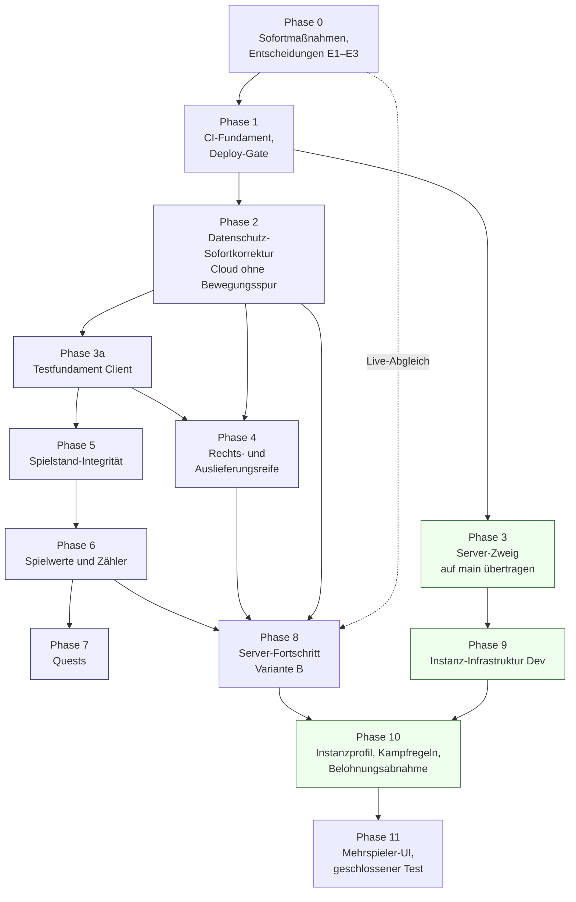

# Ruin Walk – Entwicklungsroadmap

- **Stand:** 19.11.2026 · Grundlage: `docs/analyse/GESAMTANALYSE_2026-11-19.md` (Code-Stand `main` @ `ed05927`)
- **Art:** reine Planung. Nichts davon ist umgesetzt.
- **Entstehung:** Planentwurf der Hauptsitzung, danach kritische Gegenprüfung durch `rw-architekt` (Reihenfolge, Dateikonflikte), `rw-instanzkampf` (Server, eingefrorene Architektur), `rw-backend-security` (Sicherheit, Datenschutz) und `rw-qa` (Tests, Abnahme). Deren Einwände sind eingearbeitet. Neue, selbst nachgeprüfte Befunde sind mit ✔︎ markiert.
- **Begriffe:** „Zweig“ = `nacht/operator-edge-function`. „V2-P-D1…D5“ = Entscheidungen aus `INSTANZKAMPF_ARCHITEKTURBERICHT_V2.md` Abschnitt P. „README-D1…D3/T1“ = offene Kampfregeln in `server/instance/README.md`. „O.3“ = eingefrorene Architekturteile.

---

## A. Zusammenfassung

Ruin Walk hat ein **spielbares, gut getestetes Solo-Spiel** und einen **lokal stark getesteten, aber nirgends angebundenen Mehrspieler-Prototyp**. Der Plan zieht nicht einfach Funktionen vor, sondern behebt zuerst drei Dinge, die sonst jede spätere Arbeit belasten:

1. **Arbeits- und Auslieferungsgrundlage:**
   - Eine gemeinsame CI mit Deploy-Gate.
   - Der Server-Zweig muss einmal sauber auf `main` übertragen werden. Sonst entsteht doppelte Arbeit an CI, Tests und `rwi`-SQL.
2. **Daten, die heute nicht in die Cloud gehören oder nicht vertrauenswürdig sind:**
   - **Neu belegt ✔︎:** Der Cloud-Spielstand enthält eine **grobe Bewegungsspur der letzten 13 Stunden** und die Heimatregion.
     - `S.cd` speichert je besiegtem oder gesammeltem Objekt die Rasterzelle (ca. 165 m) mit Zeitstempel: Objekt-IDs `'m'+key`, `'n'+key+'_'+i`, `index.html:1137-1150`, `:1461`, `:1587`.
     - Hochgeladen wird der ganze Spielstand (`:2515`), mit Sicherungskopien bis 30 Tage.
     - Das widerspricht dem eigenen Datenschutzplan.
   - Dazu kommen Cheat-Werkzeuge, die für jeden Spieler erreichbar sind.
3. **Testbarkeit des echten Spielablaufs:**
   - Die Browser-Tests laufen immer mit dem Testhaken. Dabei sind Kontolöschung an, Tutorial aus und Sync-Zeiten verkürzt (`tests/harness.js:22`, `index.html:2297`, `:2894`).
   - Zufall (`Math.random` 20×) und Uhr (`Date.now` 87×) lassen sich nicht steuern.
   - Damit sind Balancing und Live-Verhalten heute nicht belastbar prüfbar.

**Ablauf des Plans:**
- **Solo-Spiel:** Erst die Spielwerte, dann die Quests. Beide Schritte ändern nur den Client.
- **Server-Fortschritt nach Variante B (Ledger):** Er braucht stabile Werte und saubere Daten.
- **Mehrspieler-Strang:** Er läuft parallel dazu nur auf Dev. Erst wenn Fortschritt und Instanzprofil stehen, kommen Mehrspieler-UI und ein geschlossener Test.

---

## B. Entwicklungsphasen

Phasen werden nur dann parallel bearbeitet, wenn sie keine gemeinsamen Dateien schreiben (Matrix in D). `index.html` ist der Engpass. Alle Phasen, die sie ändern, laufen **nacheinander in kleinen PRs**.

### Phase 0 – Sofortmaßnahmen und Grundsatzentscheidungen (Pascal, ohne Code)

**Ziel:** Das heute größte reale Risiko eindämmen und die Entscheidungen treffen, die frühe Phasen blockieren.

**Warum hier:** Die Registrierung beim Live-Supabase ist offen, ohne Datenschutzerklärung und ohne Kontolöschung im Spiel. Der Dashboard-Schalter berührt keine Datei und ist umkehrbar.

**Was sie behandelt:** Widerspruch „Spiel nicht öffentlich“ gegenüber offener Registrierung, unbelegter Live-Stand, mögliche Testpersonendaten auf der Produktion.

**Betroffen:** Supabase-Dashboard, GitHub-Ruleset, keine Repo-Dateien.

**Voraussetzungen:** keine.

**Arbeitspakete:**
1. Entscheidung **E1** (Öffentlichkeit, Registrierung). Bei „aus“ oder „Einladung“: Registrierung im Supabase-Dashboard schließen und das Datum in `docs/` festhalten.
2. Ruleset `protect-main`: Pflicht-Statuschecks (`determinism`, `database`, `bestehende-tests`) prüfen und setzen.
3. Freigabe für einen **lesenden Live-Abgleich**: Schema-Fingerabdruck gegen `schema.sql`, Supabase-Advisors, Auth-Einstellungen (CAPTCHA, SMTP, Passwortregeln, JWT-Laufzeit).
4. Freigabe zur Bereinigung von Testdaten mit Personendaten auf der Produktion (Wegwerfkonto 2, `d3b_test_evt`, laut `D3_PRUEFBERICHT.md` §6).
5. Die 5 offenen Dependabot-Zweige **nicht mergen**. Sie werden nach Phase 1 neu gebündelt.
6. Entscheidungen **E2** und **E3** treffen (sie blockieren Phase 2 und 5).

**Abhängigkeiten:** keine. Paket 3 ist Voraussetzung für Phase 4 (Kontolöschung) und Phase 8 (Migrationen).

**Tests:** keine. Ergebnis des Live-Abgleichs als Bericht ablegen.

**Abschluss:**
- E1–E3 entschieden.
- Registrierungsstatus dokumentiert.
- Pflichtchecks aktiv (Screenshot oder Beschreibung).
- Live-Abgleich durchgeführt oder bewusst verschoben.

**Ermöglicht:** Phase 1, 2, 4.

### Phase 1 – CI- und Arbeitsfundament

**Ziel:** Eine vereinte CI, durch die jede spätere Änderung läuft und ohne grüne Tests nicht live geht.

**Warum hier:**
- Alle späteren Phasen laufen durch diese CI.
- `main` und der Zweig haben CI parallel gehärtet. Echte Konflikte gibt es nur in `instance-tests.yml` und `dependabot.yml`; `pages.yml` ist auf beiden gleich.
- Wird das vorher vereint, ist die Zweig-Übertragung (Phase 3) konfliktfrei.
- Das Gate muss vor der ersten Änderung an `index.html` stehen.

**Was sie behandelt:**
- Deploy ohne Test-Gate.
- Ganzes Repo auf Pages.
- Grafik-Pushes ohne CI.
- Flackernder `status`-Test (die Testuhr gibt es nur auf dem Zweig).
- Veraltete KI-Team-Regeln auf `main`.

**Betroffen:** `.github/workflows/instance-tests.yml`, `pages.yml`, `dependabot.yml`, `tests/cases/status.js`, neues Prüfskript für das Pages-Artefakt, `.claude/`, `docs/ki-team/`.

**Voraussetzungen:** Phase 0 Paket 2 empfohlen; Freigabe für PRs nach `main`.

**Arbeitspakete:**
1. **1a:** Zweig `ccr-2e014f58-1i6nm4` nach `main`: Agentenregeln, Abgleich-Hook, Doku.
   - Erst **nach** Paket 3: Der Zweig enthält 18 Grafikentwürfe unter `kunst/`, die sonst auf Pages landen.
2. **1b, CI-PR:**
   - `instance-tests.yml` aus der `main`-Fassung plus `figs/**`, `items/**`, `status/**`, `assets/**`, `landingpage.html` im Push-Filter. md5-Reproduzierbarkeitsschritt bleibt.
   - Testuhr in `status.js` aus dem Zweig übernehmen (Commit `d627058`).
3. **Deploy-Gate in `pages.yml`:**
   - Auslöser `workflow_run` von `instance-tests` mit den Bedingungen `conclusion=='success'`, `event=='push'`, `head_branch=='main'`.
   - Checkout auf `workflow_run.head_sha`, damit genau der getestete Stand deployt wird.
   - `workflow_dispatch` bleibt.
4. **Pages-Artefakt aus einem Staging-Verzeichnis mit Positivliste:** `index.html`, `landingpage.html`, `sprites*.js`, `pxdom.js`, `figs/`, `items/`, `status/`, `assets/`, reservierter Ordner `vendor/` für Leaflet (Phase 4).
5. **Prüfskript:** Es baut das Artefakt, schließt `.claude/`, `docs/`, `supabase/`, `server/`, `marketing/`, `tests/` aus und löst jedes `src`/`href` aus `index.html` auf (inkl. `figs/manifest.js`, `items/manifest.js`).
6. Danach **Dependabot-Majors neu bündeln:** ein PR mit den drei Pages-Actions plus manuellem Probe-Deploy, ein PR für checkout und setup-node.

**Abhängigkeiten:** vor allen Phasen, die Code ändern. Phase 3 setzt auf diese CI-Fassung auf.

**Tests:**
- Statische Prüfung der Gate-Bedingungen (Skript oder actionlint).
- Prüfskript für das Artefakt.
- **Einmaliger dynamischer Nachweis:** ein absichtlich roter Stand löst keinen Deploy aus, danach grün → Deploy, und der SHA wird abgeglichen. Am besten in einem Test-Repo oder Fork, sonst mit ausdrücklicher Freigabe auf `main`.

**Abschluss:**
- Roter Testlauf bedeutet nachweislich kein Deploy.
- Das Artefakt enthält nur die Positivliste, das Spiel lädt alle Ressourcen.
- `status.js` ist in 3 Läufen stabil.
- KI-Team-Regeln auf `main` sind aktuell.

**Ermöglicht:** alle Code-Phasen; Phase 3 ohne CI-Konflikt.

### Phase 2 – Datenschutz-Sofortkorrektur im Client

**Ziel:** Die Cloud speichert keine Bewegungsspur und keine genaue Heimat mehr. Altdaten werden bereinigt.

**Warum hier:**
- Es ist ein laufender Datenabfluss bei echten Konten.
- Eine kleine, abgegrenzte erste Änderung an `index.html`.
- Muss vor jeder Datenschutzerklärung (Phase 4) stehen, sonst beschreibt diese einen falschen Zustand.
- Muss vor der Auswertung von Cloud-Spielständen (Phase 8, B0) stehen.

**Was sie behandelt:** `S.cd`/`S.mh` mit Zellschlüssel und Zeitstempel sowie `S.home` im Cloud-Spielstand und in Sicherungen (`schema.sql:151-167`). Der Test `datenfluss.js` erkennt das nicht, weil er nur nach Koordinaten und lat/lon-Feldern sucht.

**Betroffen:** `index.html` (Cloud-Snapshot `:2515`, `:2570`), `tests/cases/datenfluss.js`, Bereinigungsskript für die Produktion.

**Voraussetzungen:** Phase 1, Entscheidung **E3** (Heimat), Abstimmung mit `rw-gamedesign`. Folge: Monster erscheinen nach einem Gerätewechsel wieder.

**Arbeitspakete:**
1. `cd`/`mh` vom Cloud-Upload ausnehmen; sie bleiben nur lokal.
2. `home` nach E3 behandeln: nur lokal, oder vergröbert.
3. `datenfluss.js` erweitern: Zellschlüssel (`m/n/g…_…`), Heimat und Zeitstempel-Muster.
4. Live-Bereinigung von `character_data` und `character_backups` als Skript mit Bericht, nur mit Freigabe.

**Abhängigkeiten:** vor Phase 4 und Phase 8.

**Tests:**
- `datenfluss.js` erweitert, mit Mutationsprobe: Ausnahme entfernen → Test wird rot.
- `npm test` vollständig.
- Ladetest für Cloud-Stände ohne `cd`/`home`.

**Abschluss:** Kein Zellschlüssel und keine Heimat im hochgeladenen JSON (Test), alte Stände laden, Bereinigung live durchgeführt und berichtet.

**Ermöglicht:** Phase 4, Phase 8.

### Phase 3 – Server-Zweig auf `main` übertragen (läuft parallel zu Phase 2, 4–7)

**Ziel:** Ein einziger Stand des Instanzkampfs auf `main`, Supabase-tauglich.

**Warum hier:**
- Der Zweig driftet seit dem 18.11.
- Er enthält:
  - den digest-Fix (ohne ihn läuft `rwi` auf Supabase nicht)
  - die Profilableitung aus `public.characters`
  - Worker-Kern und Lösch-Trigger
  - 25 Tests und die Dev-Installation
- Er berührt `index.html` nicht und kann deshalb parallel zur Client-Arbeit laufen.

**Was sie behandelt:** Zweig-Drift, `digest()` unqualifiziert, `eligible()` nur über `rwi.players`, Endlosschleife bei Engine-Fehlern, überflüssiger Zweig `nacht/supabase-integration`.

**Betroffen:** `server/instance/**`, `supabase/dev/**`, `supabase/functions/**`, `supabase/config.toml`, `supabase/tests/run.sh`, `supabase/tests/10_tests.sql` (Strukturtest), `docs/*` des Zweigs.

**Voraussetzungen:** Phase 1 (vereinte CI), Freigabe **F1** (Übertragung nach `main`; Änderungen nur an nicht eingefrorenen Teilen), Bearbeitung ausschließlich durch `rw-instanzkampf`.

**Arbeitspakete:**
1. Commits **in Originalreihenfolge** auf aktuellen `main` übertragen. Die SQL-Commits bauen aufeinander auf: `4e85377` → `8744b31` → `668de0e` → `b53647d` → `15f5d2e`.
2. CI-Commit `2cd72e5` des Zweigs verwerfen; er ist das Gegenstück zu `ee0e1e4`. Zweigeigene CI-Teile (PG-16/17-Matrix, `run-all-db.sh`) in die vereinte CI ergänzen. **md5-Schritt auch in `run-all-db.sh`.**
3. SQL nicht von Hand mischen; `rollback_dev.sql` enthält Prüfsummen.
4. Strukturtest `10_tests.sql:504` mit den `group_*`-Wrappern abstimmen.
5. Lösch-Trigger gegen `delete_account` testen, mit Sperrreihenfolge gegen den Watchdog (K.2).
6. `terminate_stuck` → `technical_end` für Freigabephase 2 technisch sperren, bis V2-P-D1 entschieden ist.
7. Port-Doppelung `eventende.mjs` und `produktion.mjs` (54397) beheben.
8. Doku-Widersprüche des Zweigs bereinigen: Checkliste B/F, V2 A.5 zum stuck-Beschluss.
9. Nach Abschluss: Wissensbasis und Skills (`references/supabase-integration.md`, `ruinwalk-tests`, `rw-qa`) korrigieren.
10. `nacht/supabase-integration` aufgeben (Freigabe).

**Abhängigkeiten:** nach Phase 1. Voraussetzung für Phase 9.

**Tests:**
- Volle Instanz-Pflichtliste plus `run-all-db.sh` auf PG16 und PG17.
- Determinismus in Node, Bun und Deno (CI).
- md5-Reproduzierbarkeit.
- `supabase/tests/run.sh` in beiden Modi.
- Testanzahl nach dem Merge ≥ Summe beider Stände vorher.

**Abschluss:** ein Stand auf `main`, alle Suites grün, nichts übersprungen; eingefrorene Teile laut O.3 unverändert (Prüfung durch `rw-instanzkampf`); Doku widerspruchsfrei.

**Ermöglicht:** Phase 9 (Dev-Infrastruktur), Phase 8 (Profil liest `public.characters`).

### Phase 3a – Testfundament im Client (nach Phase 2, vor allen weiteren Änderungen an `index.html`)

> Nummerierung „3a“, weil sie im Client-Strang direkt auf Phase 2 folgt, während Phase 3 parallel im Server-Strang läuft.

**Ziel:** Echter Spielablauf, Zufall und Zeit sind testbar; das Ist-Verhalten ist festgehalten.

**Warum hier:** Die Phasen 4–7 ändern Kernlogik. Ohne diese Grundlage gehen Rückschritte unbemerkt durch, und Balancing ist nicht messbar.

**Was sie behandelt:**
- Testhaken und Funktionsschalter sind gekoppelt (`harness.js:22`).
- Kein Seed, keine Uhr im Client.
- `playwright:*` ohne Lockfile, System-Chrome statt Playwright-Chromium (`harness.js:12`).
- 11 harte Wartezeiten.
- Testlücken bei Quests, UPQ, `useSkill`, Shop, Reparatur, Aufstieg, `SECRET`, Monster-, Set- und Boss-Effekten.
- Attrappe weicht vom Schema ab.
- Zwei wirkungslose SQL-Tests.

**Betroffen:** `tests/**`, `tests/fake_supabase.js`, `package.json` + Lockfile, `index.html` (nur Testhaken-Vertrag, Seed- und Uhr-Einspeisung), `supabase/tests/10_tests.sql`.

**Voraussetzungen:** Phase 1, 2.

**Arbeitspakete:**
1. **Live-Modus im Harness:** „Testhaken an“ von Funktionsschaltern trennen. Tests können den echten Ablauf prüfen (Kontolöschung aus, Tutorial an, normale Sync-Zeiten).
2. **Steuerbarer Zufall und Zeit:** Seed und Uhr per `addInitScript`, ohne Änderung der Spiellogik.
3. **Stabiler Testhaken-Vertrag:** Liste der Exporte mit Test „jeder Schlüssel definiert“. `useSkill` aufnehmen.
4. `package-lock.json`, `npm ci` in CI, Playwright-Chromium statt System-Chrome.
5. Harte Wartezeiten durch Uhr oder Zustandssignal ersetzen.
6. Charakterisierungstests (Ist-Verhalten) für alle oben genannten Lücken.
7. Vertragstest Attrappe ↔ `schema.sql`: tabellengetrieben je RPC und Fehlercode, gegen lokales PG und gegen die Attrappe. Grenze dokumentieren: PostgREST/JWT bleibt ungeprüft.
8. `10_tests.sql:280` (`where false`) und `:409` (`or true`) reparieren.

**Abhängigkeiten:** vor Phase 4–7.

**Tests:** alle neuen Tests mit Mutationsprobe; 3 Wiederholungsläufe ohne Flackern.

**Abschluss:**
- Jede genannte Funktion hat mindestens einen positiven und einen negativen Test.
- Live-Modus-Test vorhanden.
- Vertragstest grün, Abweichungen der Attrappe behoben.
- `npm test` mit fester Playwright-Version.

**Ermöglicht:** sichere Wertänderungen (Phase 6), Kontolöschung und Cheat-Abgrenzung testbar (Phase 4/5).

### Phase 4 – Rechts- und Auslieferungsreife

**Ziel:** Das Spiel erfüllt die Mindestanforderungen für Nutzer mit Konto.

**Warum hier:**
- Braucht Phase 2 (sonst falsche Datenschutzerklärung) und Phase 3a (Live-Modus-Test für die Kontolöschung).
- Bestehende Konten verarbeiten weiter Daten, auch bei geschlossener Registrierung.

**Was sie behandelt:** fehlende Rechtstexte, Kontolöschung nicht bedienbar, Drittanbieter ohne Einwilligung, Leaflet ohne Integritätsschutz, keine CSP, Spiel-Links auf der Landingpage, Registrierungsformular bei geschlossener Registrierung.

**Betroffen:** `index.html`, `landingpage.html`, `vendor/leaflet/`, `tests/harness.js` (Leaflet-Umleitung), neue Rechtstext-Seiten, `supabase/schema.sql` (nur bei Paket 7).

**Voraussetzungen:** Phase 2, 3a; E1; **Inhalte der Rechtstexte von Pascal (E4)**; Live-Abgleich aus Phase 0 für `delete_account`.

**Arbeitspakete:**
1. **Leaflet lokal einbinden** (mit Lizenz) statt über unpkg.
   - Entfernt Lieferkettenrisiko und IP-Übertragung zugleich.
   - Harness im selben PR anpassen, mit Mutationsprobe: Stub entfernen → Test rot.
2. **CSP als Meta-Tag** (Pages kann keine Header setzen). `connect-src` auf Supabase, Overpass und Kacheln begrenzen. Hash des Inline-Skripts wird beim Deploy erzeugt und geprüft.
3. **Impressum und Datenschutzerklärung:** Empfänger OSM-Kacheln, Overpass, Supabase; Auftragsverarbeitung; keine Bewegungsdaten mehr. Verlinkung aus Spiel und Landingpage; Test, dass beide im Artefakt sind.
4. **Kontolöschung im Spiel freischalten** (`DEL_ON`, `index.html:2297`). Live-Prüfung mit Testkonto nur mit Freigabe.
5. Bis dahin: dokumentierter Ablauf für Löschanfragen von Hand.
6. **Registrierung:** Formular ausblenden oder klare Meldung bei geschlossener Registrierung, Test gegen die Attrappe.
7. Bei geschlossener Registrierung: `username_available` für `anon` sperren (Migration + Rollback + Tests).
8. Spiel-Links der Landingpage nach E1 (`landingpage.html:37`, `:45`, `:71`).

**Abhängigkeiten:** nach Phase 2, 3a. `index.html` im Wechsel mit Phase 5, nicht gleichzeitig.

**Tests:**
- Live-Modus-Test der Kontolöschung mit Mutationsprobe (`DEL_ON` aus → rot).
- Artefakt-Test für Rechtstexte und `vendor/`.
- Datenfluss-Test: keine Anfrage an unpkg.
- Mobile-Prüfung.

**Abschluss:**
- Rechtstexte erreichbar.
- Kontolöschung im echten Ablauf getestet.
- Keine Drittanbieter-Skripte.
- CSP aktiv.
- Landingpage gemäß E1.

**Ermöglicht:** jede Öffnung für weitere Spieler; Auswertung echter Spielstände in Phase 8.

### Phase 5 – Spielstand-Integrität

**Ziel:** Spielstände sind versioniert und von Test- und Cheat-Ständen unterscheidbar.

**Warum hier:**
- Vor der Wertänderung (Phase 6): Diese braucht Migrationen alter Stände.
- Vor dem Server-Ledger (Phase 8): B0 würde sonst Cheat-Stände beobachten.

**Was sie behandelt:**
- Kein Versionsfeld; `sanitize` reicht unbekannte Felder durch (`:844`).
- Cheats über Testmodus oder `?dev=1` (`:571`, `:1924`, `:1942`).
- `S.test` wird beim Ausschalten zurückgesetzt (`:2910`).
- Kein Mehr-Tab-Schutz für lokale Plätze (`:2746`).
- `stunId` nicht gespeichert, `sanitize` prüft den Pfad nicht.

**Betroffen:** `index.html` (`def`, `sanitize`, Testmodus, Entwicklerwerkzeuge), `supabase/schema.sql` (klebriger Merker), Tests.

**Voraussetzungen:** Phase 3a; Entscheidung **E2** (Testmodus für Spieler).

**Arbeitspakete:**
1. Versionsfeld im Spielstand plus Migrationsregister (je Version eine Funktion), unbekannte Felder verwerfen.
2. Entwicklerwerkzeuge (Material, Klassenwechsel, Aufstieg) **nur mit Testhaken oder auf localhost**. `?dev=1` ist kein Schutz, weil ihn jeder setzen kann. Testmodus selbst nach E2.
3. **Klebriger Testmodus-Merker auf dem Server:** `save_character` übernimmt einen einmal gesetzten Merker. Migration + Rollback + Tests.
4. Mehr-Tab-Schutz für lokale Plätze; gleiche Stelle wie das Versionsfeld.
5. `stunId` mit `S.stun` speichern, Pfad-zu-Klasse-Prüfung in `sanitize`.

**Abhängigkeiten:** nach Phase 3a, vor Phase 6 und 8.

**Tests:**
- Ladetests: ohne Versionsfeld, unbekanntes Feld, zu hohe Version.
- Cheat-Aktion ohne Freischaltung wirkungslos, mit Mutationsprobe.
- Merker bleibt nach dem Ausschalten und kommt in der Cloud an (SQL- und Client-Test).

**Abschluss:** alle alten Spielstände laden (gespeicherte Referenz-Spielstände im Repo), Cheats nicht mehr für Spieler erreichbar, Merker serverseitig wirksam.

**Ermöglicht:** Phase 6, Phase 8 (B0).

### Phase 6 – Spielwerte und Fortschrittszähler

**Ziel:** Eine stabile Werte-Basis. Messbare Zähler für Quests und Aufstieg.

**Warum hier:**
- Belohnungen (Quests, Instanzen) und Ledger-Regeln (Phase 8 deckelt XP über `m.xp` je Stufe) bauen auf diesen Werten auf.
- Werden sie später geändert, müssen Quest-Belohnungen und Ledger-Regeln nachgezogen werden: doppelte Arbeit.

**Was sie behandelt:**
- XP-Umkehr (`mobOf`, `:1111` ✔︎).
- Verkaufswert +40 % je Upgrade-Stufe (`:1106` ✔︎).
- Diebstahl 6 % des Vermögens (`:1355` ✔︎).
- Reparatur teurer als Neuware.
- Gebietsboss solo kaum schaffbar.
- Schwache Heiler-Pfade.
- 8 reine Verkaufsmaterialien.
- Lücke Level 25–44.
- Tote Daten.
- Falsche Texte (q3, Respawn, Klassenwechsel, Konflikt-Hilfe `:2473`).

**Betroffen:** `index.html` (Werte, Formeln, Texte, `S.stats`), Balancing-Export, Tests.

**Voraussetzungen:**
- Phase 5.
- Entscheidungen **E5** (Gebietsboss, Heiler, geheime Bedingungen).
- **Kennzahl-Korridore vorab von `rw-gamedesign` festgelegt**, z. B.: XP je Lebenspunkt monoton steigend; Zeit bis Sieg unter Zeit bis Niederlage beim Referenzbuild; Verhältnis Münzquellen zu -senken.

**Arbeitspakete:**
1. Gewollte Delta-Liste je Wertänderung: Was ändert sich, alles andere bleibt gleich.
2. XP-Formel, Verkaufswert, Diebstahl-Obergrenze, Reparaturpreis.
3. Gebietsboss und Heiler nach E5.
4. **Lokale Zähler** in `S.stats` (Siege je Monsterart, Gebietsstufe, Lebensraum) mit Startwerten für Quests und `checkQuests` nach `craftGear`. **Kein Ledger-Format auf Vorrat**: Das legt Phase 8 fest.
5. Texte und tote Daten.

**Abhängigkeiten:** nach Phase 5; vor Phase 7 und 8.

**Tests:**
- Balancing-Export vorher und nachher, JSON-Diff als Artefakt.
- Korridore als automatische Tests.
- Invarianten: Rüstung und Krit ≤ 75 %, Verkauf < Kauf.
- Charakterisierungstests nur entlang der Delta-Liste angepasst.
- Ladetest alter Stände.

**Abschluss:** alle Korridore grün, Delta-Liste vollständig belegt, keine ungewollte Abweichung im Export.

**Ermöglicht:** Phase 7, Phase 8, Belohnungsrahmen für Phase 10.

### Phase 7 – Solo-Inhalte: Quests

**Ziel:** Spielfortschritt nach q4.

**Warum hier:** Braucht Zähler und stabile Werte (Phase 6). Größter direkter Spielernutzen ohne Server.

**Was sie behandelt:** nur 4 Quests, Lebenszeit-Zähler, kein Test für Ablauf und Belohnung.

**Betroffen:** `index.html` (Quest-Daten und -Logik; neue Quest-Daten möglichst als eigene Datei, siehe Technische Entscheidung T5), Tests, Mobile.

**Voraussetzungen:** Phase 6, Entscheidung **E6** (Quest-Ausrichtung).

**Arbeitspakete:**
1. Einsteigerkette ab q5 laut `docs/quests/BESTANDSAUFNAHME.md`, Pfad 1.
2. Kleine UI-Punkte, sofern nicht parallel an `index.html` gearbeitet wird: Tippflächen ≥ 40 px, Gebietsname sichtbar, Tutorial-Text, Wake Lock, Logogröße.
3. Wiederkehrende Aufgaben **erst nach E6**. Mit Serverzeit erst nach Phase 8.

**Abhängigkeiten:** nach Phase 6. Parallel zu Phase 8 möglich, solange Phase 8 `index.html` nicht berührt.

**Tests:**
- Quest-Ablauf je Quest, Fall „erfahrener Charakter“ (Startwert), doppelte Abgabe, Belohnung.
- Prüfskript des Skills `ruinwalk-ki-inhalte` gegen die echten Spieldaten.
- Mobile-Prüfung bei 320/360/390/412 px.

**Abschluss:** alle Quests mit positiven und negativen Tests, 0 Mobile-Befunde, Belohnungen in den Korridoren aus Phase 6.

### Phase 8 – Serverseitiger Fortschritt (Variante B)

**Ziel:** Der Server kennt einen **anerkannten** Fortschritt (Level, Klasse, Pfad, Stufe) und begrenzt Missbrauch.

**Warum hier:**
- Voraussetzung für Instanzprofil, Belohnungen, Ranglisten und Handel.
- Braucht saubere Daten (Phase 2, 5), stabile Werte (Phase 6) und den Datenschutz-Rahmen (Phase 4).

**Was sie behandelt:**
- Server speichert jeden Inhalt ungeprüft (Level 9999, `10_tests.sql:239`).
- Keine Ratenbegrenzung.
- `create_character` übernimmt freie Daten.
- Unbegrenzte Lösch-Sicherungen.
- Kein Index auf `audit_log`.
- Unbestätigte Konten ohne Aufräumjob.

**Betroffen:** `supabase/schema.sql` + Migrationen, `supabase/tests/`, `tests/fake_supabase.js`, `index.html` (nur Import-Weg und gegebenenfalls Ereignis-Meldung, B2).

**Voraussetzungen:**
- Phase 0 (Live-Abgleich), Phase 2, 4, 5, 6.
- **Migrations- und Rollback-Dateien für `perf_fixes` und `s1` nachgetragen.**
- Freigabe je Live-Migration (F3).

**Arbeitspakete:**
1. **B0 (beobachten):** anerkannter Stand aus vorhandenen Cloud-Spielständen nur innerhalb der Datenbank berechnet, ohne Export, ohne Wirkung. Ledger mit Kaskade beim Löschen und Aufbewahrungsfrist.
2. **B1 (Import):** plausible Bestandscharaktere anerkennen (`source='imported'`). Auffällige werden nicht bestraft, nur nicht für Instanzen anerkannt.
3. **B2 (Ereignisse):** Ledger-Format festlegen und auf die Zähler aus Phase 6 abbilden; XP-Deckel je Monsterstufe, Stundenrate.
4. **Ratenbegrenzung in Postgres:** Zählertabelle mit festen Fenstern, Upsert, Aufräumen. `username_available` dafür `volatile`. Obergrenze für `delete`-Sicherungen je Konto.
5. `create_character` mit Startstand **und** eigenem Import-Weg für lokale Charaktere. Sonst bricht der Upload (`index.html:2391`, `:2449`).
6. Index `audit_log(account_id)`, Aufräumjob für unbestätigte Konten.

**Abhängigkeiten:** nach Phase 6; vor Phase 10.

**Tests:**
- Migrationen mit Rollback in beiden Rechte-Modi.
- Missbrauchsfälle (Level 9999, Stufe 3 ohne Stufe 2, zu schnelle XP).
- Ratenbegrenzung mit gesteuerter Uhr.
- Mutationsprobe je Regel.
- Vertragstest der Attrappe nachziehen.
- **Integrationstest gegen `ruinwalk-dev`** (PostgREST/JWT) vor jeder Live-Migration (Freigabe F2).

**Abschluss:**
- B0 → B1 → B2 je mit eigenem Bericht.
- Gefälschte Stände sind nicht „anerkannt“.
- Grenzen aktiv.
- Live-Fingerabdruck = `schema.sql`.

**Ermöglicht:** Phase 10.

### Phase 9 – Instanzkampf-Infrastruktur auf Dev (parallel zu Phase 4–8, nach Phase 3)

**Ziel:** Kämpfe laufen auf `ruinwalk-dev` vollständig serverseitig, ohne Client und mit Testcharakteren.

**Warum hier:** Unabhängig vom Client-Strang und vom Ledger. `derive_profile` arbeitet mit Testcharakteren. Phase-0-Messungen entscheiden die Engine-Ablage (V2-P-D3).

**Was sie behandelt:**
- Kein Taktgeber (`dispatch_due`, Cron/pg_net, `resolve-round`).
- Keine Belohnungszustellung (Lease/ack).
- Keine Allowlist, keine Sperren, kein `ops_freeze_instance`.
- Messungen fehlen.

**Betroffen:** `server/instance/**`, `supabase/dev/**`, `supabase/functions/**`. Ausschließlich `rw-instanzkampf`, streng nacheinander.

**Voraussetzungen:** Phase 3; Freigabe der Dev-Installation (F4).

**Arbeitspakete:**
1. Dev-Installation nach Checkliste C/D; echte Pfade gegen GoTrue/PostgREST (E).
2. Phase-0-Messungen; Entscheidung D3 nach den Schwellen in T7.
3. Taktgeber mit automatischem `start_fight`.
4. Belohnungsmechanik Lease/ack (C.2); **Abnehmer offen lassen** (Client `S.rcl` oder Ledger-Ereignis), bis Phase 8 B2 steht.
5. Teilnehmer-Allowlist, Konto- und Instanzsperre, `ops_freeze_instance`, Überwachung (V2 I.1 Nr. 8).
6. Jede neue `rwi`-Funktion bekommt eine Rechteklasse in `05_produktion.sql`.

**Abhängigkeiten:** nach Phase 3; vor Phase 10. Falls die Messungen D3 scheitern lassen → Entscheidung **E9**.

**Tests:**
- Instanz-Pflichtliste, md5-Reproduzierbarkeit, Determinismus in 3 Laufzeiten.
- Lease/ack: doppelte Zustellung, Absturzfälle.
- Messbericht.

**Abschluss:** Gruppe → Kampf → Belohnungsanspruch auf Dev durchgelaufen; Not-Aus und Überwachung getestet; D3 belegt entschieden.

**Ermöglicht:** Phase 10.

### Phase 10 – Instanzprofil, Kampfregeln, Belohnungsabnahme

**Ziel:** Instanzkämpfe nutzen anerkannte Charakterwerte und vollständige Kampfregeln.

**Warum hier:**
- Braucht Phase 8 (anerkannter Fortschritt) und Phase 9 (lauffähige Infrastruktur).
- Die Profil- und Regeländerung ändert die Golden-Referenz. Deshalb nur **einmal**, gebündelt.

**Was sie behandelt:**
- Client und Engine rechnen mit unvereinbaren Werten.
- Das eingefrorene Profil (V2 B.2) sieht Level und Ausrüstung vor, die Umsetzung leitet nur Klasse, Pfad und Stufe ab.
- Offene Kampfregeln README-D1–D3, T1, B1, E1, W1.
- Herkunftsnachweis für Gegenstände (`item_seen`) fehlt.

**Betroffen:** `server/instance/engine/**`, `content.mjs`, `sql/05_produktion.sql`, Golden-Referenz, Ledger-Anbindung.

**Voraussetzungen:** Phase 8 und 9; Entscheidungen **E7** (V2-P-D1/D2) und **E8** (Ausrüstung im Profil); Belohnungsobergrenzen **E10**.

**Arbeitspakete:**
1. Profil aus dem anerkannten Fortschritt (Phase 8); Ausrüstung nach E8 (aus `character_data` über die Positivliste).
2. Formeln für Ausrüstung und Krit **zusammen** mit README-D1–D3 und B1 in **einer** Änderung, neue `ENGINE_VERSION`, Golden-Referenz bewusst neu.
3. Belohnungsabnehmer festlegen: Freigabephase 2 laut V2 B.6/I.1 Nr. 7 **nur Kampf-EP und Münzen**, keine Gegenstände.
4. Fingerabdruck `item_seen` als Entscheidungsgrundlage für V2-P-D5 (vor Freigabephase 3).
5. Minimale Dungeon-Inhalte (Gegner je Kampf).

**Abhängigkeiten:** nach Phase 8, 9; vor Phase 11.

**Tests:**
- Neue Golden-Referenz mit Begründung.
- Vertragstest Engine ↔ Client-Werte (V2 I.1 Nr. 2).
- Determinismus, Belohnungsgrenzen.

**Abschluss:** Vertragstest grün, Golden-Referenz versioniert, Belohnungen innerhalb der Grenzen.

**Ermöglicht:** Phase 11.

### Phase 11 – Mehrspieler-UI und geschlossener PvE-Test

**Ziel:** Ein Gruppen-Dungeon ist auf dem Handy spielbar; geschlossener Test (Freigabephase 2).

**Warum hier:** Erst jetzt sind Server, Profil, Regeln und Belohnungen belastbar.

**Was sie behandelt:** Es gibt keine Mehrspieler-UI; `othersInFight(){return 0;}` (`index.html:1617` ✔︎).

**Betroffen:** neue Client-Datei für Mehrspieler (siehe T5), Einhängepunkt in `index.html`, Tests.

**Voraussetzungen:** Phase 10; Entscheidung **E11** (Gruppenfindung); restliche Punkte aus V2 I.1; Messungen wiederholt im Projekt des Tests.

**Arbeitspakete:** Beitreten, Bereitschaft, Rundenplanung, Ansicht per Polling über `group_view`/`group_heartbeat`; Vertragstest Client ↔ `group_*`; Mobile-Prüfung; geschlossener Test mit Fehlerprotokoll.

**Tests:** Vertragstest, Polling-Tests, Mobile-Prüfung, Lasttest mit der erwarteten Spielerzahl.

**Abschluss (messbar):**
- 0 Fehler der Schwere 1.
- Mindestens 20 Kämpfe mit 2–4 Spielern ohne Abweichung zwischen Client und Server.
- Alle Belohnungen genau einmal zugestellt.
- Not-Aus erprobt.

### Bewusst zurückgestellt (mit Grund)

| Thema | Grund / frühester Zeitpunkt |
|---|---|
| Weltboss als Ereignis | braucht Phase 11; Eventende-Logik ist vorhanden |
| Handel, Ranglisten | erst nach Phase 8; für Handel ggf. Variante A oder V2-P-D5 |
| Premium / Platz 3 mit Zahlung | Produkt- und Rechtsfrage; braucht Phase 4 und Zahlungsweg |
| Schutz gegen gefälschte Position | vor Ranglisten oder Weltboss mit Wettbewerb |
| NPCs, Geschichte, Orte/POIs, Attribute/Talente, Ziel nach Level 50 | nach Phase 7, wenn die Werte stabil sind |
| PWA, Offline | nach Phase 4; berührt CSP und Auslieferung |
| Login über PKCE, Tokens nicht in `localStorage` | nach Phase 4 (CSP senkt das Risiko vorher) |
| Gesamt-Modularisierung von `index.html` | nicht geplant, siehe T5 |

---

## C. Abhängigkeiten

**Zwingende Reihenfolgen (mit Begründung):**

| Vorher | Nachher | Warum |
|---|---|---|
| Phase 1 | jede Code-Phase | ohne Gate geht jede Änderung ungeprüft live; CI-Konflikt mit dem Zweig nur einmal lösen |
| Phase 1 (Artefakt-Positivliste) | Merge von `ccr-…` nach `main` | sonst landen Grafikentwürfe und KI-Team-Dateien auf Pages |
| Phase 2 | Phase 4 | Datenschutzerklärung muss den echten Zustand beschreiben |
| Phase 2, 5 | Phase 8 (B0) | B0 darf weder Bewegungsdaten noch Cheat-Stände auswerten |
| Phase 3a | Phase 4–7 | Kontolöschung und Cheats nur im Live-Modus testbar; Balancing nur mit Seed messbar |
| Phase 5 | Phase 6 | Wertänderungen brauchen versionierte Migration alter Stände |
| Phase 6 | Phase 7, 8 | Quest-Belohnungen und Ledger-Deckel bauen auf den Werten auf, sonst doppelte Arbeit |
| Phase 3 | Phase 9 | digest-Fix und Profilableitung nur auf dem Zweig |
| Phase 8, 9 | Phase 10 | Profil braucht anerkannten Fortschritt; Regeln brauchen lauffähige Infrastruktur |
| E8 | Phase 10 | Profilfelder bestimmen die Golden-Referenz; nur einmal neu bauen |

**Gemeinsam zu entwickeln (nicht trennen):**
- Ausrüstungs- und Krit-Formeln in der Engine **mit** README-D1–D3 und B1: eine Golden-Referenz, eine Engine-Version.
- Deploy-Gate **mit** erweitertem Pfadfilter: sonst gehen Grafik-Pushes nie live.
- Leaflet lokal **mit** Harness-Anpassung: sonst testen die Karten-Tests still echtes Leaflet.
- Versionsfeld **mit** Mehr-Tab-Schutz: gleiche Code-Stelle.
- `create_character` mit Startstand **mit** Import-Weg: sonst bricht der Upload lokaler Charaktere.

---

## D. Parallelisierbare Arbeiten

**Zwei Stränge laufen ohne gemeinsame Dateien parallel:**
- **Client-Strang:** Phase 2 → 3a → 4/5 → 6 → 7. Alles in `index.html`, `tests/`, `landingpage.html`.
- **Server-Strang:** Phase 3 → 9. Alles in `server/instance/**`, `supabase/dev|functions/**`.

Sie treffen sich in Phase 8, 10 und 11.

**Dateikonflikt-Matrix** (x = schreibt)

| Datei / Bereich | P1 | P2 | P3 | P3a | P4 | P5 | P6 | P7 | P8 | P9 | P10 | P11 |
|---|---|---|---|---|---|---|---|---|---|---|---|---|
| `index.html` | – | x | – | x (Haken) | x | x | x | x | x (Import) | – | – | x (Einhängepunkt) |
| `landingpage.html` | – | – | – | – | x | – | – | – | – | – | – | – |
| `.github/workflows/*`, `dependabot.yml` | x | – | x (Ergänzung) | x (`npm ci`) | – | – | – | – | – | – | – | – |
| `tests/cases/**`, `harness.js` | x (status) | x | – | x | x | x | x | x | – | – | – | x |
| `tests/fake_supabase.js`, `package.json` | – | – | – | x | x | – | – | – | x | – | – | – |
| `supabase/schema.sql`, `10_tests.sql` | – | – | x (Test 504) | x (2 Tests) | x (revoke) | x (Merker) | – | – | x | – | – | – |
| `supabase/dev`, `functions`, `run.sh` | – | – | x | – | – | – | – | – | – | x | – | – |
| `server/instance/**` | – | – | x | – | – | – | – | – | – | x | x | – |
| `.claude/`, Wissensbasis | x (1a) | – | x (danach) | – | – | – | – | – | – | – | – | – |

**Folgerungen:**
- **Sicher parallel:**
  - Phase 3 neben Phase 2 und 3a.
  - Phase 9 neben Phase 4–8.
  - Phase 7 neben dem Server-Teil von Phase 8.
- **Nie gleichzeitig:**
  - Alle Phasen, die `index.html` schreiben: Phase 4 und 5 abwechselnd in kleinen PRs.
  - Alle Phasen, die `supabase/schema.sql` schreiben: Phase 3a/4/5/8 nacheinander, jede mit eigener Migration.
  - `server/instance/**` nur durch `rw-instanzkampf`, nacheinander.
- **Agentenzuordnung:**
  - Client-Strang: `rw-gamedesign`, `rw-mobile-ux`, `rw-welt-ki` nacheinander, nicht gleichzeitig in `index.html`.
  - Server-Strang: `rw-instanzkampf`.
  - Schema: `rw-backend-security`.
  - Jede Phase: `rw-qa`.
  - Nach Phase 1, 3, 4: `rw-projektpflege`.

---

## E. Risiken und kritische Voraussetzungen

| Risiko | Wirkung | Gegenmaßnahme im Plan |
|---|---|---|
| Rechtstexte hängen an Pascals Inhalten (E4) | Phase 4 und jede Öffnung blockiert | Phase 0: Registrierung schließen; manueller Löschablauf |
| Falsche Konfliktlösung in `instance-tests.yml` bei Phase 3 | CI für Spielcode fehlt still; md5-Prüfung verloren | Phase 1 vereint CI vorher; Abnahme „Pfadfilter und md5 vorhanden“ |
| Live-Schema weicht von `schema.sql` ab (`perf_fixes`/`s1` ohne Dateien) | Migrationen in Phase 4/5/8 schlagen fehl oder beschädigen Daten | Live-Abgleich in Phase 0; Migrationsdateien vor Phase 8 |
| Kein Integrationstest gegen echtes Supabase | Fehler bei PostgREST/JWT erst live | Vertragstest (3a) plus Integrationstest gegen Dev vor jeder Live-Migration (F2) |
| Phase-0-Messungen scheitern | Taktgeber-Variante unklar; externer Worker berührt O.3 | Schwellen vorab festgelegt (T7); Rückfall nur mit E9 |
| Abweichung des Profils von V2 B.2 | doppelter Neubau von Profil und Golden-Referenz | E8 vor Phase 10; Formeln und Regeln gebündelt |
| `index.html` als Engpass | Wartezeiten, Merge-Konflikte | kleine PRs, strikte Reihenfolge; neue Systeme in eigenen Dateien (T5) |
| Balancing ohne vorher festgelegte Korridore | Abnahme nicht objektiv | Korridore vor Phase 6 durch `rw-gamedesign` |
| Testhaken-Abhängigkeit (`__RW` über Closure-Variablen) | Auslagern in Dateien bricht 20 Testdateien | Testhaken-Vertrag in Phase 3a |
| Deno lokal nicht vorhanden | Determinismus nur in CI prüfbar | CI-Pflichtlauf; Engine-Änderungen nur per PR |
| Ungeklärter k2-Deadlock (einmalig auf PG16) | zufällig rote CI | beobachten; kein Abschalten; bei Wiederholung Ursachenanalyse |
| Bestehende Cloud-Spielstände mit Cheats | B1 klassifiziert falsch | B1 bestraft nicht, erkennt nur nicht an; Merker aus Phase 5 |

---

## F. Offene Entscheidungen (nur Pascal)

Nur Fragen zu Spielgestaltung, Produktzielen, Spielerlebnis oder Recht. Alle technisch begründbaren Fragen sind unter „Technische Entscheidungen“ (unten) beantwortet.

**E1 – Öffentlichkeit und Registrierung** · blockiert: Phase 0, Teile von Phase 4
- **Worum es geht:** Ob neue Spieler sich registrieren können, solange die Rechtstexte fehlen. Heute ist das Spiel samt Registrierung erreichbar, obwohl du „nicht öffentlich“ entschieden hast.
- **Möglichkeiten:**
  - (a) Registrierung **aus**: sicher, umkehrbar; keine neuen Tester.
  - (b) **Nur auf Einladung** (Dashboard oder Allowlist im Trigger): Tester möglich; Allowlist braucht eine Migration.
  - (c) **Offen lassen**: rechtliches Risiko bis Phase 4.
- **Empfehlung:** (a) sofort, später (b).
- **Folge:** Bestehende Konten laufen weiter; Kontolöschung und Datenschutzerklärung bleiben deshalb nötig.

**E2 – Testmodus für Spieler** · blockiert: Phase 5
- **Worum es geht:** Mit dem Testmodus kann man ohne GPS per Tippen auf die Karte spielen. Heute schaltet er auch Cheats frei. Die Cheats nehme ich technisch heraus (T4). Offen ist, ob Spieler den Testmodus selbst behalten.
- **Möglichkeiten:**
  - (a) **Entfernen** für Spieler: fair, einfach; kein Spielen ohne GPS.
  - (b) **Behalten, aber ohne Belohnungen** (Erkundungsdemo): niedrige Hürde zum Ausprobieren; zusätzlicher Code.
  - (c) **Behalten mit Belohnungen, gekennzeichnet**: Spaß ohne GPS; diese Stände zählen nie für Mehrspieler.
- **Und:** Wie willst du selbst auf dem Handy live testen? Das bestimmt den Entwicklerzugang.

**E3 – Heimat in der Cloud** · blockiert: Phase 2 (teilweise)
- **Worum es geht:** Die Heimatregion (ca. 2×3 km) steuert die Gebietsstufen und ist ein Hinweis auf den Wohnort.
- **Möglichkeiten:**
  - (a) **Nur lokal**: datensparsam; nach einem Gerätewechsel neu setzen, wegen der Sperre erst nach 7 Tagen wieder verlegbar.
  - (b) **Vergröbert in der Cloud** (z. B. 10×10 km): Gerätewechsel ohne Neusetzen; weniger genaue Gebietsstufen.
  - (c) **Wie heute**: nicht empfohlen.
- **Empfehlung:** (a).

**E4 – Inhalte der Rechtstexte** · blockiert: Phase 4
- Für das Impressum brauche ich deine Angaben: Name, ladungsfähige Anschrift, Kontakt.
- Für die Datenschutzerklärung brauche ich die Rolle von Supabase (Auftragsverarbeitung) und die Kontaktadresse.
- Ich kann Texte entwerfen, aber keine Rechtsberatung ersetzen.

**E5 – Spielgestaltung: Werte** · blockiert: Phase 6 (Teilpakete)
- **Gebietsboss:**
  - Solo-Inhalt: Leben senken oder Teilfortschritt nach Ohnmacht.
  - Gruppeninhalt: bleibt schwer bis Phase 11, aber dann hängt der Berserker-Aufstieg Stufe 3 an Mehrspieler.
- **Heiler-Pfade:** sicherer, aber langsamer (mehr Überleben), oder Unterstützung für Gruppen?
- **Geheime Bedingungen „10 Siege nachts“ und „3 Ohnmachten“:**
  - Behalten: besonderer Reiz.
  - Ersetzen: kein Anreiz, nachts draußen zu spielen oder zu sterben.
  - Empfehlung: ersetzen.
- Nicht blockierend, später: Boss-Sets klassengebunden droppen? Verwendung der 8 Verkaufsmaterialien? Attribute/Talente und Ziel nach Level 50?

**E6 – Quest-Ausrichtung** · blockiert: Phase 7
- **Hauptgeschichte:** stärkere Bindung, höherer Inhaltsaufwand.
- **Sandbox-Aufgaben:** flexibel, weniger Tiefe.
- **Beides.**
- Zusätzlich: Tages- und Wochenaufgaben gewünscht? NPC-Questgeber gewünscht? (Fragen 1–7 aus `docs/quests/BESTANDSAUFNAHME.md`.)

**E7 – Fairnessregeln im Instanzkampf (V2-P-D1, D2)** · blockiert: Phase 10, Freigabephase 2
- **D1, was Spieler bei einem technischen Abbruch bekommen:**
  - (a) nur bereits Gebuchtes, ohne Nachteil (empfohlen, entspricht „kein Verschulden“)
  - (b) wie eine Niederlage (trifft Spieler für Betriebsfehler)
  - (c) Entschädigung
- **D2 (T1), Störungsfenster:** Zählen Ausfälle des Servers nicht als Abwesenheit des Spielers?
  - Ja: fair, im Prototyp schon gebaut.
  - Nein: einfacher, aber Spieler werden bei Server-Aussetzern entfernt.
- Die Messungen aus Phase 9 liefern dazu Daten.

**E8 – Zählt Ausrüstung im Instanzkampf?** · blockiert: Phase 10
- Der eingefrorene Bericht V2 (B.2) sieht Level **und** Ausrüstung im Profil vor; die Umsetzung leitet nur Klasse, Pfad und Stufe ab.
- **Ja:** Spieler erleben Fortschritt auch im Dungeon; mehr Balancing-Aufwand, Ausrüstung bleibt fälschbar bis V2-P-D5.
- **Nein:** Gleichheit in der Gruppe; Abweichung vom eingefrorenen Bericht, braucht deine Freigabe.

**E9 – Rückfall „externer Worker“** · nur falls die Messungen in Phase 9 scheitern
- Berührt den eingefrorenen Punkt O.3/2 („die Datenbank löst aus“).
- Alternative: Engine in SQL (aufwendiger, bleibt in der Architektur).

**E10 – Zahlen mit Spielwirkung (aus V2-P-D4)** · vor Phase 10/11
- Belohnungsobergrenzen je Kampf und Tag.
- Länge des Beobachtungszeitraums.
- Zeit H bis zum Schließen hängender Instanzen (hängt an deiner Erreichbarkeit).

**E11 – Wie finden sich Gruppen?** · blockiert: Phase 11
- **Am Ort (GPS):** passt zum Spiel; braucht Spieler in der Nähe.
- **Lobby:** einfach; ortsunabhängig.
- **Einladung (Code/Link):** Freunde; kein Zufallszusammenspiel.

**Freigaben** (keine Entscheidungen, aber deine Zustimmung nötig, laut Projektregeln):
- **F1:** Übertragung des Server-Zweigs nach `main`; Aufgabe von `nacht/supabase-integration`.
- **F2:** lesender Live-Abgleich; Integrationstests gegen `ruinwalk-dev`.
- **F3:** jede Migration und Datenbereinigung auf der Produktion.
- **F4:** Dev-Installation.
- **F5:** PRs nach `main` und Ruleset-Einstellungen.

### Technische Entscheidungen (von mir begründet getroffen)

| # | Entscheidung | Begründung |
|---|---|---|
| T1 | **Serverseitiger Fortschritt nach Variante B (Ledger, B0→B1→B2)** | A würde den Echtzeitkampf im Client durch Serversimulation ersetzen und den lokalen Modus aufheben; beides widerspricht bestehenden Vorgaben. B ist schrittweise, rückwirkungsfrei (B0) und kompatibel. |
| T2 | **Server-Zweig übertragen statt neu bauen**, in Originalreihenfolge; CI-Commit des Zweigs verwerfen | Inhalt geprüft und getestet; nur CI kollidiert; Neubau wäre reine Doppelarbeit. |
| T3 | **Deploy-Gate über `workflow_run` mit drei Bedingungen; Artefakt über Positivliste** | Kleinste Änderung ohne Eingriff in `instance-tests.yml`; deployt genau den getesteten Commit. |
| T4 | **Entwicklerwerkzeuge nur mit Testhaken oder auf localhost; klebriger Testmodus-Merker auf dem Server** | `?dev=1` kann jeder setzen; ein reiner Client-Merker lässt sich entfernen. |
| T5 | **Keine Gesamt-Modularisierung; neue Systeme (Quest-Daten, Mehrspieler-UI) als eigene Dateien** | Modularisierung bricht den Testhaken (20 Testdateien) und blockiert alle Client-Arbeit, ohne Spielernutzen; neue Dateien entlasten den Engpass ohne Risiko. |
| T6 | **Leaflet lokal + CSP-Meta-Tag** statt nur SRI | Behebt Lieferkettenrisiko **und** Datenübertragung an unpkg; CSP begrenzt Abfluss von Tokens. |
| T7 | **V2-P-D3 nach Messung mit festen Schwellen:** Zustellkette p95 ≤ 5 s, p99 ≤ 15 s (Lease 30 s); Kaltstart p95 ≤ 2 s; warm p95 ≤ 500 ms; Engine-CPU ≤ 25 % des Edge-Limits; pg_net-Verlust ≤ 0,1 % bei ≥ 10.000 Aufrufen; Cron-Takt 15–30 s ohne Überlappung | Objektiv entscheidbar; liegt sicher unter den Fristen der eingefrorenen Architektur. Schwellen sind ein Vorschlag von `rw-instanzkampf`, nicht aus V2 belegt. |
| T8 | **V2-P-D4 technische Teile** (Dauerlauf-Grenzen, Lease, Intervalle) aus den Messungen; Spielzahlen bleiben E10 | Rein betriebliche Größen. |
| T9 | **V2-P-D5 (Herkunft von Gegenständen) erst vor Freigabephase 3**; Fingerabdruck `item_seen` in Phase 10 | Phase 2 verteilt keine Gegenstände; Daten zuerst sammeln. |
| T10 | **Ratenbegrenzung in Postgres** (Zählertabelle); bei geschlossener Registrierung zuerst `username_available` für `anon` sperren | Eine Edge Function davor hilft nicht, weil PostgREST die RPC weiter direkt erreichbar macht; der Revoke ist die einfachste Lösung. |
| T11 | **Ereignismodell nicht auf Vorrat**: Phase 6 baut nur lokale Zähler, Phase 8 legt das Ledger-Format fest | B0/B1 brauchen keine Client-Ereignisse; ein Format vor B2 legt Details zu früh fest. |
| T12 | **Versionsfeld + Migrationsregister im Spielstand** | Jede spätere Wertänderung braucht sichere Migration alter Stände. |
| T13 | **Belohnungen in Freigabephase 2 nur Kampf-EP und Münzen** | Vorgabe V2 B.6/I.1 Nr. 7; Gegenstände erst mit Herkunftsnachweis. |
| T14 | **Dependabot-Majors gebündelt nach Phase 1** | Pages-Actions werden von keinem PR-Lauf geprüft; gemeinsam mit Probe-Deploy. |

---

## G. Erster Umsetzungsschritt

**Phase 1, Paket 1b+3+4 als ein CI-PR gegen `main`:**
- vereinte `instance-tests.yml` mit Grafik- und Landingpage-Pfaden, md5-Schritt erhalten
- Testuhr in `tests/cases/status.js`
- Deploy-Gate in `pages.yml` über `workflow_run` mit den drei Bedingungen und Checkout auf `head_sha`
- Pages-Artefakt aus Positivliste, dazu das Prüfskript

**Warum vor allem anderen:**
1. **Es macht jede folgende Änderung sicher.** Heute geht jeder Push auf `main` sofort live, auch wenn Tests rot sind. Alle weiteren Phasen ändern Spiel, Schema oder Server.
2. **Es verhindert Doppelarbeit.** Der Server-Zweig hat seine eigene CI-Fassung. Wird die CI vorher vereint, ist die Übertragung des Zweigs (Phase 3) konfliktfrei, und die Testuhr muss nicht doppelt gebaut werden.
3. **Es ist Voraussetzung für weitere Merges.** Die Positivliste verhindert, dass beim Merge von `ccr-…` Entwürfe und KI-Team-Dateien auf der Spiel-Domain landen.
4. **Es enthält einen nötigen Fix.** Mit dem Gate würde der flackernde `status`-Test Deploys zufällig blockieren; deshalb gehört die Testuhr in denselben PR.
5. **Kein Spielcode, kein Schema.** `index.html`, `fmtS` und `schema.sql` bleiben unverändert; das Ergebnis ist objektiv prüfbar.

**Parallel dazu (ohne Code, nur du):** Phase 0, also E1, Registrierung im Dashboard, Pflichtchecks im Ruleset, Freigabe des Live-Abgleichs, E2, E3.

---

## H. Definition des Projektfortschritts

Eine Phase gilt erst als **abgeschlossen**, wenn **alle** Punkte erfüllt und im Abschlussbericht der Phase belegt sind:

1. **Messbare Abnahme:** Jedes Abnahmekriterium der Phase hat einen Befehl oder Nachweis mit erwartetem Ergebnis (z. B. „`npm test` → 0 rot“, „roter Lauf → kein Deploy“).
2. **Tests:**
   - Alle betroffenen Suites lokal **und** in CI grün.
   - Nichts übersprungen, abgeschaltet oder aufgeweicht.
   - 3 Wiederholungsläufe ohne Flackern.
3. **Mutationsprobe:** Jede neue Schutzregel wurde absichtlich entfernt, der Test wurde rot, danach wiederhergestellt. Der Arbeitsbaum ist danach sauber.
4. **Kompatibilität:** Alte Spielstände (Referenzstände im Repo) laden; bei Cloud-Änderungen auch Cloud-Stände.
5. **Datenbank:** Migration **und** Rollback getestet, `schema.sql` aktualisiert, beide Rechte-Modi grün, Live-Einspielung nur mit Freigabe und Fingerabdruck danach.
6. **Mobile:** Bei UI-Änderungen `npm test` plus Mobile-Prüfung (320–412 px) ohne Befund.
7. **Ehrlicher Bericht:** Getrennt nach „lokal / gegen Attrappe / gegen Dev / gegen Produktion / nicht geprüft“.
8. **Doku und Wissensbasis:** Betroffene Docs, Skills und Agenten-Texte aktualisiert (`rw-projektpflege`); keine widersprüchlichen Statusangaben.
9. **Abgleich:** Fachlich betroffene Agenten haben geprüft; Abgleich-Zeile im Commit.
10. **Grenzen:** Eingefrorene Architektur (O.3) unverändert oder ausdrücklich freigegeben; keine Secrets; kein Push auf `main` ohne PR.
11. **Rollback-Weg:** beschrieben (Revert-PR genügt dank Gate; bei DB das Rollback-Skript).

Eine Folgephase **darf beginnen**, wenn ihre Vorgänger laut Tabelle C abgeschlossen **und** die blockierenden Entscheidungen (F) getroffen sind. Parallel laufende Phasen dürfen keine Dateien aus der Matrix in D gemeinsam schreiben.

---

## Anhang – Eingesetzte Agenten und Skills

- **Analyse (Gesamtanalyse):** `rw-architekt`, `rw-gamedesign`, `rw-welt-ki`, `rw-backend-security`, `rw-instanzkampf`, `rw-qa`, `rw-mobile-ux`.
- **Gegenprüfung dieser Roadmap:** `rw-architekt` (Reihenfolge, Dateikonflikte), `rw-instanzkampf` (Zweig-Übertragung, eingefrorene Teile, D1–D5, Messschwellen), `rw-backend-security` (Datenschutz, neue Bewegungsspur-Feststellung, Produktionsänderungen), `rw-qa` (Testvoraussetzungen, Abnahme, Definition of Done).
- **Skills:** `ruinwalk-projektwissen`, `ruinwalk-instanzkampf`, `ruinwalk-balancing`, `ruinwalk-tests`, `ruinwalk-ablauf`.
- **Keine neuen Agenten oder Skills erstellt, keine externen Skills bezogen.** Die vorhandenen zehn Fachagenten deckten alle benötigten Fachgebiete ab. Neue Dateien hätten der Vorgabe „nur die Roadmap-Datei kommt hinzu“ widersprochen.
