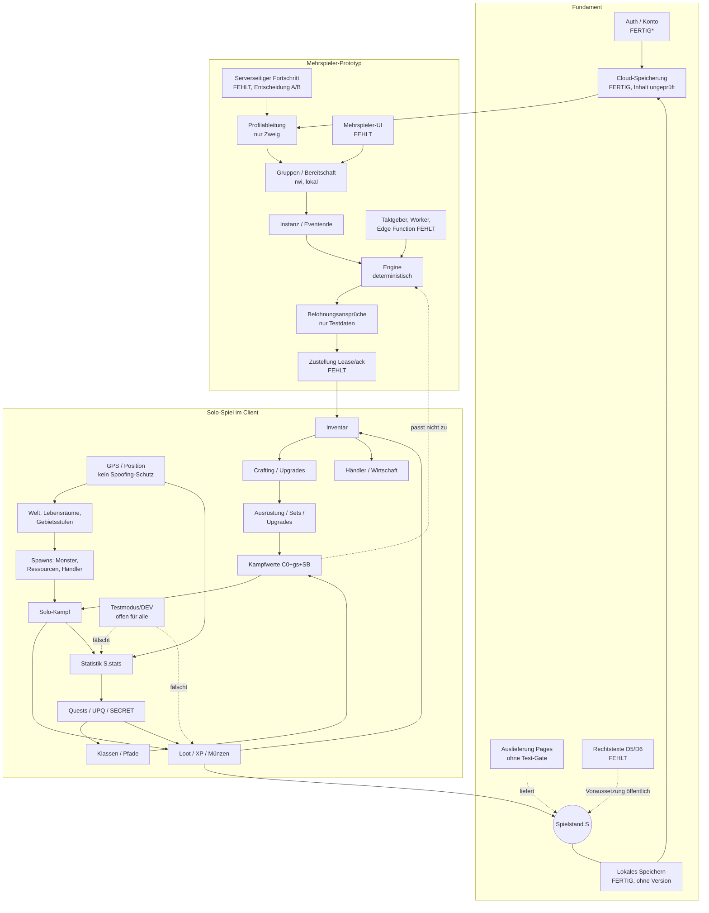

# Ruin Walk – Technische Gesamtanalyse und Entwicklungsgrundlage

- **Erstellt:** 19.11.2026 (Claude Code, Hauptsitzung mit 7 Fachagenten)
- **Analysierter Stand:** `main` @ `ed05927` (Repository `LuckyOne2k/ruinwalk`)
- **Abgelegt auf:** Zweig `ccr-2e014f58-1i6nm4` (nicht auf `main`)
- **Art:** reine Bestandsaufnahme – keine Code-, Test-, Schema- oder Einstellungsänderungen. Tests liefen auf einer Kopie von `main` außerhalb des Repositorys.
- **Zeilenangaben** beziehen sich auf `main` @ `ed05927`. Mit ✔︎ markierte Befunde wurden von der Hauptsitzung zusätzlich selbst nachgeprüft.
- **Statuswerte:** FERTIG · TEILWEISE · IN ARBEIT / UNVOLLSTÄNDIG · NICHT VORHANDEN · NICHT NACHWEISBAR
- **Stufen:** K = Konzept · B = Implementierung begonnen · T = technisch implementiert · I = integriert · S = serverseitig abgesichert · N = durch Tests nachgewiesen

**Ausgangszustand vor der Analyse:** `main` @ `ed05927`; Arbeitsordner `ruinwalk-ci` sauber und inhaltsgleich mit `main`. Im Hauptordner (Zweig `ccr-…`) war nur `docs/quests/BESTANDSAUFNAHME.md` ungetrackt (unverändert). Die ungetrackten Charakter-Entwürfe wurden vorher auf ausdrückliche Anweisung von Pascal gelöscht (nicht Teil der Analyse).

**Transparenz zu Nebenwirkungen:** Ein Agent hat zur Konfliktprüfung `git merge-tree --write-tree` ausgeführt. Dadurch liegen unreferenzierte Git-Objekte in `/home/user/ruinwalk-ci/.git`; Zweige, Index und Dateien blieben unberührt. Hilfsdateien (Spieldaten-Export, Screenshots, Testlogs) lagen nur im Scratchpad.

---

## A. Gesamtzustand

**Wie weit ist Ruin Walk?**
- **Solo-Spiel im Browser:** spielbar und technisch recht reif. Vorhanden sind:
  - Karte mit GPS
  - prozedurale Welt mit Lebensräumen aus OpenStreetMap und Gebietsstufen
  - Echtzeitkampf mit 50 Monstern und Gebietsboss-Mechaniken
  - 4 Grundklassen mit 12 Pfaden, Fähigkeiten, 10 Ausrüstungsplätzen, Sets, Upgrades bis +10 und Runen
  - Crafting, Händler und Loot
  - lokales Speichern mit Sicherungskopien, Konto mit Cloud-Speicherung, Konfliktlösung und Tab-Sperre
  - Das steckt alles in einer Datei: `index.html` mit 3.108 Zeilen. Seit dem 15.11. wurde daran nichts mehr geändert.
- **Mehrspieler (Gruppen, Dungeons, Weltboss):** Es gibt einen sorgfältig gebauten und lokal stark getesteten Server-Prototyp in `server/instance/`. Er ist **nicht live, nicht in Supabase eingespielt und nicht im Spiel eingebunden** (`othersInFight(){return 0;}` in `index.html:1617` ✔︎). Die Weiterentwicklung liegt auf dem ungemergten Zweig `nacht/operator-edge-function`, der Konflikte mit `main` hat.

**Belastbar fertig:**
- Solo-Kampf, Ausrüstung, Crafting, Welt und GPS
- lokales Speichern, Cloud-Sync und Konto (getestet nur gegen eine Supabase-Attrappe)
- Supabase-Schema mit Zugriffsregeln (RLS)
- Engine und Datenbanklogik des Instanzkampfs (nur lokal)

**Unfertig:**
- **Quests:** nur 4 Stück, danach „Neue folgen bald!“
- **Wirtschaft:** hat Balancing-Lücken
- **Kontolöschung:** im Live-Spiel ausgeblendet
- **Platz 3 (Premium):** ohne Zahlungsweg
- **Instanzkampf:** ohne Taktgeber, Belohnungszustellung und Client

**Wichtige fehlende Grundlagen:**
1. **Kein serverseitiger Spielfortschritt:** Der Server speichert jeden Spielstand ungeprüft. Das ist die Grundvoraussetzung für jede Mehrspieler-, Ranglisten- oder Handelsfunktion.
2. **Cheat-Werkzeuge für alle Spieler offen:**
   - Der Testmodus-Schalter steht im Menü (`index.html:1924` ✔︎).
   - Er schaltet `DEV()` frei (`:571` ✔︎). Damit gibt es +100.000 Münzen, freien Klassenwechsel und Teleport.
3. **Auslieferung ungeschützt:**
   - Pages deployt ohne Test-Gate und veröffentlicht das ganze Repo einschließlich `.claude/`, `docs/`, `supabase/` und `server/` (`pages.yml:30-32` ✔︎).
   - Das Spiel samt **Live-Registrierung** liegt direkt unter der Haupt-URL. Das widerspricht der Entscheidung „Spiel noch nicht öffentlich“.
4. **Rechtliches:**
   - Kein Impressum und keine Datenschutzerklärung (D6 offen).
   - Drittanbieter werden ohne Einwilligung geladen: unpkg, OpenStreetMap, Overpass, Google Fonts.
   - Die Kontolöschung ist im Live-Spiel nicht erreichbar (`DEL_ON=!!window.__RW_TEST`, `:2297` ✔︎).

### Testergebnisse (ausgeführt auf einer Kopie von `main`)

| Suite | Ergebnis |
|---|---|
| `npm test` (Spiel in Chromium) | ✅ 229/229 |
| Supabase-Schema, Modus „neu“ und „legacy“ | ✅ 245/245 und 245/245 ¹ |
| Engine: golden / combat / struktur / trennung / offen | ✅ 12/12 · 38 · 57 · 12 · Statusliste ok |
| Instanz-DB: run / fenster / gruppe / eventende / semantik / produktion | ✅ 43 · 39 · 157 · 32 · 27 · 222 |
| Determinismus | ✅ Node = Bun (gleicher Digest); Deno lokal nicht installiert, nicht geprüft |
| Dungeon-Simulation + Reproduzierbarkeit | ✅ Replay 12/12 bitgleich; zwei Läufe mit gleichem Seed md5-identisch |
| `k2-compare skip 15` und `… nosweep` | ✅ jeweils 15 Durchläufe, 0 Deadlocks ² |

¹ `run.sh` scheiterte zuerst an Dateirechten im Scratchpad: Postgres durfte den Ordner nicht lesen. Derselbe Ablauf wurde mit Eingabe über stdin wiederholt, die Testlogik blieb unverändert.
² Der Deadlock vom CI-Lauf `44279099804` ist damit nicht ausgeschlossen, nur nicht reproduziert.

**Was die grünen Tests nicht beweisen:**
- Kein Test verbindet das Spiel mit dem echten Supabase. Die Cloud-Tests laufen gegen `tests/fake_supabase.js`, und diese Attrappe weicht belegt vom echten Schema ab (Details in C).
- Zwei SQL-Tests sind wirkungslos: `10_tests.sql:280` endet auf `where false`, `:409` auf `or true` (✔︎).

---

## B. Systemübersicht

| System | Status | Erreicht |
|---|---|---|
| Client-Architektur (`index.html`, Sprites, Grafiken) | FERTIG | K B T I · N teilweise |
| Charakterplätze, Erstellen, Löschen | TEILWEISE (Platz 3 nicht freischaltbar) | K B T I · S nur Cloud-Regeln · N |
| Klassen und Fähigkeiten | FERTIG (Funktion), Fähigkeiten ungetestet | K B T I · N kaum (`useSkill` ohne Test) |
| Pfade, Klassenaufstieg, geheime Bedingungen | FERTIG (nur Client) | K B T I · N nein |
| Attribute und Talente | NICHT VORHANDEN | – |
| Ausrüstung, Sets, Upgrades, Runen | FERTIG | K B T I N · Set-Effekte im Kampf ungetestet |
| XP-Kurve, Level-Cap 50 | FERTIG, Balance fehlerhaft (XP-Umkehr) | K B T I N |
| Solo-Kampf und Monster | FERTIG | K B T I · N teilweise |
| Gebietsboss-Mechaniken | FERTIG, solo kaum schaffbar | K B T I · N nur Datenkonsistenz |
| Inventar, Items, Crafting | FERTIG | K B T I N |
| Händler, Wirtschaft, Loot | TEILWEISE (Senken und Quellen unausgewogen, Kauf/Reparatur ungetestet) | K B T I · N dünn |
| Quests (`QUESTS`, 4 Stück) | TEILWEISE | K B T I · N nein |
| Klassenquests (`UPQ`) | FERTIG (nur Client) | N nein |
| NPCs und Dialoge | NICHT VORHANDEN (nur Händler ohne Dialog) | – |
| Geschichte und Lore im Spiel | NICHT VORHANDEN | K offen |
| Welt, GPS, Lebensräume, Gebietsstufen, Spawns | FERTIG (nur Client) | K B T I N |
| Erkundung, Orte, POIs, Ruinen | NICHT VORHANDEN | nur Doku |
| Tag/Nacht | TEILWEISE (nur ein Zähler) | – |
| Schutz gegen gefälschte Position | NICHT VORHANDEN | – |
| Testmodus und Entwicklerwerkzeuge | FERTIG, aber **für alle offen** | – |
| Lokales Speichern | FERTIG (ohne Versionsfeld, ohne Mehr-Tab-Schutz für lokale Plätze) | K B T I N |
| Cloud-Sync | FERTIG technisch; Inhalt ungeprüft | S teilweise · N nur Attrappe |
| Auth (Registrierung, Login, Reset) | TEILWEISE (Betriebsreife live nicht nachweisbar) | K B T I · N nur Attrappe |
| Kontolöschung | TEILWEISE (Server laut Doku live, Client ausgeblendet) | S · N |
| Supabase-Schema `public` und RLS | FERTIG | K B T I S N (lokal mit nachgebauter Supabase-Umgebung) |
| Ratenbegrenzung auf dem Server | NICHT VORHANDEN | – |
| Serverseitiger Spielfortschritt | NICHT VORHANDEN | Konzept nur auf dem Zweig |
| Stand der Live-Datenbank | NICHT NACHWEISBAR (nur Doku) | – |
| Instanzkampf-Engine | FERTIG (Prototyp) | K B T N |
| Gruppen, Bereitschaft, Instanzen (`rwi`) | FERTIG (Prototyp, lokal) / Bereitschaft TEILWEISE | T S N lokal |
| Claim/Commit, Watchdog, Eventende | FERTIG (Prototyp, lokal) / Watchdog TEILWEISE | T S N lokal |
| Taktgeber, Worker, Edge Function | `main`: NICHT VORHANDEN · Zweig: IN ARBEIT | – |
| Belohnungszustellung ins Inventar | NICHT VORHANDEN | K |
| Dungeon-Inhalte, Weltboss als Ereignis | NICHT VORHANDEN | K |
| Mehrspieler-UI im Client | NICHT VORHANDEN | – |
| Oberfläche und Mobile | FERTIG (kleine Mängel) | N teilweise |
| PWA und Offline | NICHT VORHANDEN | – |
| CI (`instance-tests.yml`) | FERTIG | – |
| Deployment (`pages.yml`) | TEILWEISE (kein Test-Gate, veröffentlicht alles) | – |
| Datenschutz, Rechtstexte (D5/D6) | NICHT VORHANDEN | K |
| Premium und Zahlung | NICHT VORHANDEN (nur Platzhalter) | K |
| Client-Modularisierung | NICHT VORHANDEN (nur Analyse auf Zweig) | K |

---

## C. Detaillierte Bestandsaufnahme

### 1. Architektur und Client
- **Aufbau von `index.html`:** CSS 9–180, HTML 182–239, externe Skripte 240–250, ein großer Inline-Block 251–3106. Die Abschnitte im Inline-Block:
  - Konstanten 265, Ausrüstung 420, Klassen 691, Pfade 724
  - Spielstand 833, Welt 983, Gebietsstufen 1082, Karte 1163
  - Kampf/Bossmechaniken 1466, Quests 1722, Menüs 1754
  - Konto 2063, Cloud 2401–2739, Takt 3058, Testhaken 3095
- **Spielzustand:** globales Objekt `S` (`:886`), Standardwerte in `def()` (`:834`).
- **Takte:** 1-Sekunden-Takt mit Speichern alle 5 s (`:3071-3083`), dazu zwei 250-ms-Takte (`:1549`, `:3084`).
- **Abhängigkeiten nach außen:**
  - Leaflet 1.9.4 von unpkg, **ohne Integritätsprüfung (SRI)** (`:8`, `:240`). Ohne unpkg startet das Spiel nicht (`:256`).
  - OpenStreetMap-Kacheln und Overpass. Für Overpass gibt es eine Ausweichlösung `fbHab`.
  - Supabase über einen eigenen `fetch`-Client (`:2092`). Im Client steht nur der öffentliche Schlüssel (`:2066`).
- **Problem:** Ein Monolith ohne Module. Jede Funktion berührt dieselbe Datei, parallele Arbeit erzeugt Konflikte. Ein Modularisierungsplan liegt auf dem Zweig `analyse/client-modularisierung` (ES-Module ohne Build-Schritt, 14 Schritte), umgesetzt ist nichts.

### 2. Speichersystem
**Lokal:**
- Drei Plätze plus Sicherungskopie `_bak` und `_corrupt` (`:268-275`). Vor dem Schreiben wird der alte Stand gesichert (`:925-944`). Bei defekten Ständen gibt es saubere Ausweichwege (`:893-909`).
- **Problem:** Der Spielstand hat **kein Versionsfeld**. Migrationen laufen nur über tolerante Bereinigung (`sanitize`, `:842-883`). Unbekannte Felder werden durchgereicht (`:844`).
- **Problem:** Lokale Plätze haben keinen Mehr-Tab-Schutz (`:2746`). Der Test hält dieses Verhalten sogar als gewollt fest.

**Cloud:**
- Optimistische Version (`p_expected_version`), Erkennen einer verlorenen Antwort per Fingerabdruck, Konfliktdialog, Kopien vor jedem Überschreiben, Tab-Sperre (`:2401-2754`). Tests: 84 Fälle, alle gegen die Attrappe.
- **Problem:** Die Attrappe weicht vom echten Schema ab. Fehlende Prüfungen in der Attrappe:
  - `email_not_verified` bei save und move
  - `invalid_name` und `invalid_slot`
  - die Größengrenze aus `schema.sql:51`
- **Problem:** Der Hilfetext „Auflösung folgt in einem späteren Update“ (`:2473`) widerspricht dem vorhandenen Knopf „Konflikt lösen“ (`:2163`).

### 3. Charaktere, Klassen, Pfade, Fortschritt
**Charaktere:**
- 2 freie Plätze. Platz 3 öffnet sich nur mit `?dev=1` (`:1942`); `ENT.third_character_slot:false` (`:1941`).
- Die Startausstattung ist bewusst leer. Die erste Waffe kommt über Crafting oder den Händler.

**Klassen und Pfade:**
- Wanderer plus 4 Klassen ab Level 5. Je 3 Fähigkeiten ab Level 5/8/12 (`:692-722`).
- 12 Pfade mit je 3 Stufen ab Level 15/30/50 (`:725-776`). Aufstieg über Klassenquests `UPQ` und geheime Bedingungen `SECRET` (`:789-814`).

**Fortschritt:** Bedarf je Level = Level × 40 XP, insgesamt 49.000 XP bis Level 50 (`:956`). Ab Level 50 verfallen XP.

**Belegte Balancing-Probleme:**
- **XP-Umkehr:** Schwache Normalmonster bringen in höheren Gebietsstufen mehr XP pro Lebenspunkt als starke (`mobOf`, `:1111` ✔︎). Auf Stufe 5:
  - Kanalratte 1,20 XP je Leben
  - Wildkeiler 0,32 XP je Leben
  - Seltene Monster bringen weniger als ein Rohling.
- **Heiler-Pfade:** Priester und Naturheiler haben auf Stufe 1 keinen Schadensfaktor (`:767`, `:773`). Der Ritter schlägt den Priester auf Stufe 2 in Schaden, Leben und Verteidigung.

**Keine Tests für:** Klassenwahl, Aufstieg (`canUp`), `SECRET`, `useSkill`. `useSkill` ist auch nicht über den Testhaken erreichbar.

### 4. Kampf, Monster, Gebietsbosse
- Echtzeit, Rüstung höchstens 75 %, Krit höchstens 75 %. Lösen vom Kampf nach 150 m oder 60 s ohne Treffer. Ohnmacht kostet XP, Werkzeug und 3 min Erschöpfung (`:1618-1639`).
- 50 Monster (`:333-389`), 5 Gebietsboss-Mechaniken (`:1467-1549`).
- **Problem:** Gebietsbosse sind solo kaum schaffbar. Rechnung mit Ausrüstung, Gebietsstufe 4:

  | Build | Zeit bis Sieg | Zeit bis Niederlage |
  |---|---|---|
  | Krieger | 121 s | 44 s |
  | Priester (Stufe 2) | 195 s | 23 s |

  Nach einer Ohnmacht hat der Boss wieder volles Leben (`:1622`). Der Aufstieg zum Berserker auf Stufe 3 verlangt aber einen Gebietsboss-Kill (`:791`).
- **Ungetestet:** Monster-Spezialeffekte (Dieb, Saugen, Dornen …), `reactDo`, `bossTick`, Set-Effekte im Kampf.

### 5. Ausrüstung, Inventar, Crafting, Wirtschaft
- 10 Plätze, Stufen I/II/III ab Level 1/10/25, 5 Qualitäten, Upgrades +10 mit 100 % bis 5 % Erfolgschance, 10 Boss-Sets und 36 Pfad-Sets (`:420-676`).
- **Belegte Probleme:**
  - **Verkaufswert:** steigt je Upgrade-Stufe um 40 % (`:1106` ✔︎). Erst upgraden, dann verkaufen wird so zur Münzquelle.
  - **Diebstahl:** Diebe stehlen 6 % des **gesamten** Vermögens (`:1355` ✔︎). Bei 25 Gold sind das rund 15.000 Kupfer pro Treffer.
  - **Reparatur:** teurer als eine neue Axt (`:677`).
  - **8 Monster-Materialien** sind nur verkäuflich, in keinem Rezept.
  - **Lücke:** zwischen Level 25 und 44 keine neue Ausrüstungsstufe.
  - **Boss-Sets** droppen klassenunabhängig, für 3 von 4 Klassen also nur Verkaufsware.
  - **Tote Daten:** `CHASE_MULT`, `lkOf`, `eqLook`.
- **Ungetestet:** Kaufen, Reparatur, Erschöpfung abkürzen, Drop-Raten.

### 6. Welt, GPS, Erkundung
**Was vorhanden ist:**
- Raster mit ca. 165-m-Zellen, deterministisches Erscheinen von Ressourcen, Monstern und Händlern je Zelle (`:1137-1156`).
- Ein Gebietsboss je Region ab Gebietsstufe 4.
- Lebensräume aus Overpass mit Zwischenspeicher. Gebietsstufen aus einem Wellenfeld plus Heimat-Schutzring (`:1090-1103`).
- GPS mit Ausfall- und Verweigerungsbehandlung (`:1227-1239`). Laufstrecke mit Genauigkeitsfilter (`:1184-1191`).

**Was fehlt:**
- Orte, POIs, Entdeckungen, Belohnung für Strecke
- Schutz gegen gefälschte Position: `onPos` übernimmt jede Koordinate (`:1217-1223`)
- Offline-Betrieb

**Kleinere Probleme:**
- Gebietsnamen erscheinen nur als Tooltip, also nie auf dem Handy (`:1121`).
- Sichtbarer echter Ortsname „Augsburg“ im Startdialog (`:233`).
- Tutorial-Text „oben rechts“ stimmt bei schmalen Geräten nicht (`:2889` gegenüber `:27`).

### 7. Quests, NPCs, Geschichte
Quests sind im Entwurf `docs/quests/BESTANDSAUFNAHME.md` beschrieben (ungetrackt im Arbeitsordner, nicht im Repository); der Agent hat ihn gegen `main` bestätigt. Kurz:
- 4 lineare Quests. Sie zählen Lebenszeit-Statistiken statt Fortschritt seit Annahme.
- Kein Test für Ablauf oder Belohnung. q3-Text falsch („Bogen“). `checkQuests` fehlt nach `craftGear`.
- Nach q4 kommt nichts.

NPCs sind nur Händler mit Zufallsnamen (`:678`). Es gibt keine Dialoge, keinen Questgeber und keine Geschichte im Spiel.

### 8. Backend, Auth, Sicherheit
**Schema `public`:**
- 6 Tabellen, RLS überall, Rechte erst entzogen und dann gezielt vergeben (`schema.sql:354-392`).
- SECURITY-DEFINER-Funktionen mit festem `search_path`. Die Identität kommt immer aus `auth.uid()`.
- Wächter-Trigger für Name, Platz und Konto.

**`save_character` prüft** (`:277-300`):
- Anmeldung und bestätigte E-Mail
- dass ein JSON-Objekt kommt
- Eigentum
- Version
- Platz 3

**Nicht geprüft wird der Inhalt.** Ein Test belegt, dass Level 9999 gespeichert wird (`10_tests.sql:239`). Der Server leitet nur Level (begrenzt 1..50) und Klasse für die Anzeige-Spalten ab.

**Problem: keine serverseitige Ratenbegrenzung.**
- `username_available` ist anonym aufrufbar, Benutzernamen lassen sich durchprobieren.
- Speichern und Löschen lassen sich beliebig wiederholen. Jede Löschung erzeugt eine bis zu 1 MB große Sicherung, die 30 Tage bleibt.

**Auth:**
- Login verlangt eine bestätigte E-Mail. Passwort-Reset gibt neutrale Meldungen.
- Tokens liegen in `localStorage`. Zusammen mit Leaflet ohne SRI und ohne CSP ist das ein Angriffsweg über die Lieferkette.
- Der Login-Link kommt im Adress-Hash statt über PKCE (`:2761-2777`).

**Live-Stand:** **NICHT NACHWEISBAR**, nur aus der Doku abgeleitet.
- Laut Doku eingespielt: Phase 1, perf_fixes, s1, D3. Für perf_fixes und s1 fehlen eigene Migrations- und Rollback-Dateien.
- Laut `D3_PRUEFBERICHT.md:68-71` könnten auf Produktion noch Testdaten liegen, darunter Testpersonendaten.
- Dashboard-Einstellungen (SMTP, CAPTCHA, Passwortregeln) sind unbelegt.

**Weitere Kleinigkeiten:** Für `audit_log(account_id)` fehlt ein Index. Die zwei wirkungslosen SQL-Tests siehe A.

### 9. Instanzkampf (Gruppen, Dungeons, Weltboss)
**Auf `main`:**
- Die Engine ist rein und deterministisch, mit eigenem Zufall per HMAC und nur Ganzzahl-Rechnung.
- Schema `rwi`:
  - Gruppen mit Warteliste, Bereitschaft, Instanzen
  - Claim/Commit/Lease, Wanduhr, Störungsfenster, Watchdog
  - Weltboss-Eventende, Wiederbelebung
  - Sicherheitsgrenze über `public.group_*`-Wrapper
- Alles lokal gegen echtes Postgres getestet.

**Belegte Probleme auf `main`:**
1. **Läuft so nicht auf Supabase:** `digest()` wird unqualifiziert aufgerufen (`01_proto.sql:93`, `03_windows.sql:91`, `04_gruppe.sql:332`). Auf dem Zweig ist das behoben.
2. **Echte Charaktere können nicht beitreten:** `eligible()` liest nur `rwi.players` (`04_gruppe.sql:43`). Die Ableitung des Profils aus `public.characters` gibt es nur auf dem Zweig.
3. **Kein Taktgeber:** Niemand ruft im Betrieb `start_fight` oder die Rundenauflösung auf. Es gibt kein `dispatch_due`, kein Cron und keine Edge Function `resolve-round`.
4. **Belohnungen nur als Testdaten** (`{"test":true}`). Zustellung mit Lease und Bestätigung sowie Auszahlung ins Inventar fehlen.
5. **Zwei Kampfsysteme passen nicht zusammen:**
   - Der Client rechnet Werte aus Level, Ausrüstung, Sets und Energie.
   - Die Engine nutzt feste Klassenwerte (`content.mjs:14-19`) ohne Level, Ausrüstung und Energie.
   - Auch Namen und Bedeutung von Fähigkeiten weichen ab, z. B. „Heiliger Schild“.
6. **Inhalte:** nur ein Testboss, keine Dungeon-Inhalte, kein Weltboss als Ereignis.

**Zweig `nacht/operator-edge-function`** (25 Commits vor, 13 hinter `main`):
- Enthält:
  - digest-Fix, Profilableitung, Worker-Kern und `report_failure`
  - Hüllen für den Worker, Lösch-Trigger
  - Edge Function `operator` und Dev-Installationsskripte
  - 25 neue Tests, Status-Test mit Testuhr
- Nicht installiert, nicht bereitgestellt.
- **Konflikte mit `main`** in `dependabot.yml` und `instance-tests.yml`, weil die CI-Härtung zweimal parallel gebaut wurde.
- Dort fehlt die Reproduzierbarkeitsprüfung.
- Doku-Widerspruch: Checkliste B gegenüber F.
- `nacht/supabase-integration` ist vollständig darin enthalten und damit überflüssig.

**Eingefroren (Bericht V2, O.3):**
- Schichtentrennung und ein einziger Auftragsweg
- Claim, Token, Lease, deterministischer Zufall
- Belohnungen mit Lease und Bestätigung
- Profil aus fester Liste
- absolutes Eventende, Freigabephasen

### 10. Oberfläche und Mobile
**Gut:**
- Alle Bildschirme vorhanden, keine toten Knöpfe.
- Überlauf bei 320/360/412 px getestet. Safe Areas, Kampf in der Daumenzone.
- Durchgehend Deutsch.

**Probleme:**
- **Tippflächen unter 40 px**, vor allem das Schließen-Kreuz 33×32 oben rechts in allen Menüs. Der Test prüft nur die Navigationsleiste.
- Zoom gesperrt (`:5`), Schrift teils 9–11 px.
- Das Logo hat 506 KB.
- Kein Manifest, kein Service Worker.
- Wake Lock nach Tab-Wechsel verloren (`:1247`).
- Veraltete Texte: „Klassenwechsel kommen später“ (`:1823`), Respawn-Angabe unter „Über“ (`:1933`).

### 11. Tests, CI, Deployment
**Testmatrix:**
- Stark: Speichern, Cloud, Konto (gegen Attrappe), Zugriffsregeln (SQL), Instanzkampf.
- Fehlend: Quests, Klassenquests, Shop, Reparatur, Fähigkeiten, Aufstieg, Monster-Spezialeffekte, Landingpage.
- **Kein echter Integrationstest** Client ↔ Supabase.

**Qualität:**
- `status.js` ist auf `main` zeitabhängig und kann flackern. Die Testuhr gibt es nur auf dem Zweig.
- 11 harte Wartezeiten in den Browser-Tests.
- Zwei Instanztests nutzen denselben Port, das kollidiert bei paralleler Ausführung.
- Kein `package-lock.json`, und `package.json` verlangt `"playwright":"*"`.

**CI:**
- Gut gehärtet: minimale Rechte, PRs ohne Pfadfilter, Actions auf SHAs angeheftet.
- Pushes, die nur `figs/`, `items/`, `status/` oder `assets/` ändern, lösen keinen Lauf aus.

**Deployment:**
- `pages.yml` läuft parallel zu den Tests, ohne Abhängigkeit. Ein roter Test stoppt keinen Deploy.
- `path: '.'` veröffentlicht alles. Laut Action-Definition v3.0.1 sind nur `.git` und `.github` ausgeschlossen, also auch `.claude/`.

**Dependabot:** Seit dem Merge liegen 5 Major-Updates als Zweige vor: checkout v7, setup-node v7, configure-pages v6, deploy-pages v5, upload-pages-artifact v5. Die drei Pages-Actions prüft kein PR-Lauf. Ein Bruch fiele erst beim Deploy auf.

**Ruleset:** `protect-main` ist eingerichtet (PR-Pflicht, kein Force-Push, keine Löschung). Ob Pflicht-Statuschecks gesetzt sind, ist **nicht belegt**.

### 12. Doku und Wissensbasis: Widersprüche
- **CI-Beschreibung veraltet** in der Wissensbasis, im Test-Skill, in `rw-qa` und im Abschlussbericht (z. B. „index.html löst keinen CI-Lauf aus“). Agenten handeln danach.
- **Statusköpfe veraltet:** `PHASE3_PLAN.md` („nichts implementiert“), `PLAN_D4_*`, `SUPABASE_TESTBERICHT.md`, `INSTANZKAMPF_ARCHITEKTURBERICHT*.md`.
- **`BESTANDSAUFNAHME_SPIEL.md`** widerspricht dem Code: kein Tutorial, Schwierigkeit nicht an die Welt gekoppelt, Ressourcen ohne Lebensraum.
- **Namenskollision:** „D1–D6“ steht einmal für Datenschutz, einmal für Instanzkampf-Entscheidungen, einmal für Kampfregeln.
- **`INSTANZKAMPF_PLAN.md`** wird zitiert, existiert aber nicht.
- **KI-Team auf `main` veraltet:** Es fehlen `rw-pixelart`, `rw-projektpflege`, der Abgleich-Hook und die Kontextsicherung. Diese liegen nur auf dem Zweig `ccr-…`, der ohne Konflikte mergebar wäre.

---

## D. Abhängigkeiten und Zusammenhänge

**Die wichtigsten Verbindungen:**

| # | Verbindung | Was ausgetauscht wird | Was zuerst stehen muss | Folge bei falscher Reihenfolge | Stand |
|---|---|---|---|---|---|
| 1 | Auth → Cloud-Speicherung → jede Serverfunktion | `auth.uid()`, Profil per Trigger, `character_data` als JSON | Auth und Konto | ohne Konto kein Server-Spiel | funktioniert (nur gegen Attrappe getestet) |
| 2 | Spielstand → serverseitiger Fortschritt → Instanzprofil, Ranglisten, Handel | Level, Klasse, Pfad, Ausrüstung, Inventar | **Entscheidung A/B und Bau eines vertrauenswürdigen Fortschritts** | Jede Mehrspieler-Belohnung baut auf fälschbaren Daten auf (Testmodus-Cheats landen in der Cloud) | fehlt |
| 3 | Klasse, Pfad, Ausrüstung, Sets → Kampfwerte (Client) bzw. Engine-Profil | `C0()`, `gs()`, `SB()` gegenüber festen Werten in `content.mjs` | Entscheidung, ob Level und Ausrüstung in Instanzen zählen | Spieler erleben „mein Level zählt nicht“; jede spätere Änderung erzwingt eine neue Golden-Referenz | widersprüchlich |
| 4 | Kampf, Sammeln, GPS → `S.stats` → Quests, UPQ, SECRET → Aufstieg | Lebenszeit-Zähler | Zähler mit Startwerten und weiteren Zählern (Siege je Monsterart) | Neue Quests sind sofort erfüllt; Ziele nicht messbar | teilweise |
| 5 | Kampfformeln → Monsterskalierung → Ausrüstung/Upgrades → Münzen/Loot → Quest-Belohnungen | Werte | Reihenfolge exakt so | Belohnungen auf instabile Wirtschaft geeicht müssen erneut angepasst werden | XP-Umkehr und Verkaufswert offen |
| 6 | Gruppe → Instanz → Taktgeber → Engine → Belohnung → Inventar | Roster, Runden, Ansprüche | Zweig-Merge (digest-Fix, Profilableitung) → Dev-Installation → Taktgeber → Zustellung | Ohne Zweig-Merge läuft nichts auf Supabase | lokal, ohne Verbindung |
| 7 | Kontolöschung ↔ `rwi`-Lösch-Trigger | Kaskade über `profiles`/`characters` | Tests der Trigger gegen `delete_account` | Eingriff in die produktive Löschkette | nur Zweig |
| 8 | Deploy ↔ Tests | keiner | Test-Gate | Rote Änderungen gehen live | fehlt |
| 9 | `public` ↔ `rwi`-Wrapper | `group_*` in `public` | Anpassung des Strukturtests `10_tests.sql:504` | Schema-Tests brechen beim gemeinsamen Einspielen | nicht abgestimmt |

**Blockierende Abhängigkeiten:**
- Verbindung 2 blockiert alle Mehrspieler-Belohnungen, Ranglisten und Handel.
- Zweig-Merge (digest-Fix, Profilableitung) blockiert jede Supabase-Installation von `rwi`.
- Rechtstexte und die Entscheidung zur Öffentlichkeit blockieren den öffentlichen Start.

**Konflikte bei paralleler Entwicklung:**
- `index.html` ist ein Monolith. Gleichzeitige Arbeit an Balancing, Quests, UI und später Mehrspieler-UI erzeugt Merge-Konflikte.
- Eine Modularisierung würde ihrerseits mit allem kollidieren.
- CI-Dateien sind bereits doppelt geändert (`main` gegenüber Zweig).
- `server/instance/sql/0*` ändern Zweig und eingefrorene Architektur zugleich. Nur `rw-instanzkampf` sollte daran arbeiten, nacheinander.

---

## E. Risiken und technische Schulden (priorisiert)

| Prio | Befund | Art | Folge |
|---|---|---|---|
| 1 | Spiel mit Live-Registrierung frei unter der Pages-URL, ohne Impressum und Datenschutzerklärung, Drittanbieter ohne Einwilligung, Kontolöschung nicht bedienbar | belegt | rechtliches Risiko (DSGVO/TMG), Widerspruch zu „nicht öffentlich“ |
| 2 | Deploy ohne Test-Gate, ganzes Repo öffentlich auf Pages (inkl. `.claude/`, `docs/`, `marketing/meta/config.json` mit IDs, ohne Tokens) | belegt | fehlerhafte Stände gehen live; unnötige Angriffs- und Imagefläche |
| 3 | Testmodus und `?dev=1` öffnen Cheats für alle; Ergebnisse gehen ungekennzeichnet in die Cloud | belegt | Datenbasis für jede spätere Mehrspieler-/Ranglistenfunktion unbrauchbar |
| 4 | Kein serverseitiger Spielfortschritt, keine Plausibilität, keine Ratenbegrenzung (`username_available` anonym, Löschungen erzeugen große Sicherungen) | belegt | Manipulation, Missbrauch, Speicherverbrauch |
| 5 | Attrappe weicht vom echten Schema ab; kein Integrationstest | belegt | Cloud-Fehler würden erst live auffallen |
| 6 | Zweig `nacht/operator-edge-function` driftet (Konflikte, fehlende Reproduzierbarkeitsprüfung, Doku-Widersprüche) | belegt | wachsender Merge-Aufwand, Gefahr verlorener Arbeit |
| 7 | Doppelte, unvereinbare Kampfsysteme (Client gegenüber Engine) | belegt | Designbruch, teure Nacharbeit |
| 8 | Balancing: XP-Umkehr, Upgrade-dann-Verkaufen, Diebstahl 6 %, Gebietsboss solo kaum schaffbar, Heiler schwach | belegt | Spielgefühl; Quest-Belohnungen schwer einzuordnen |
| 9 | Leaflet ohne SRI und CSP, Tokens in `localStorage` | Risiko | Kontoübernahme bei kompromittiertem CDN |
| 10 | Spielstand ohne Versionsfeld; lokale Plätze ohne Mehr-Tab-Schutz | belegt | schwierige Formatänderungen; Überschreiben zwischen Tabs |
| 11 | Dependabot-Majors für Pages ungeprüft | Risiko | Deploy bricht erst auf `main` |
| 12 | Flackernder `status`-Test, harte Wartezeiten, `playwright:*` ohne Lockfile, wirkungslose SQL-Tests | belegt | trügerische Sicherheit, zufällig rote CI |
| 13 | Veraltete Doku und Wissensbasis (CI, Statusköpfe, D-Kürzel) | belegt | Agenten und Entscheidungen beruhen auf falschen Annahmen |
| 14 | Testdaten mit Personendaten eventuell noch live | nicht nachweisbar | Datenschutz |
| 15 | Monolith `index.html` | belegt | Parallelarbeit, Wartbarkeit |
| 16 | Akku: GPS mit hoher Genauigkeit, 1-s- und 250-ms-Takte | Risiko, nicht gemessen | Spielerlebnis unterwegs |

---

## F. Fehlende Grundlagen

1. **Freigabefähige Auslieferung:** Test-Gate, begrenztes Pages-Artefakt, Entscheidung zur Öffentlichkeit. Voraussetzung für jede weitere sichere Änderung.
2. **Rechtliche Mindestbasis:** Impressum, Datenschutzerklärung, Leaflet lokal oder mit SRI, Kontolöschung im Spiel. Voraussetzung, solange die Registrierung offen ist.
3. **Vertrauenswürdige Datenbasis:**
   - Testmodus abgegrenzt, Versionsfeld im Spielstand.
   - Danach **serverseitiger Fortschritt** nach Variante A oder B. Voraussetzung für Instanz-Belohnungen, Ranglisten, Handel und Premium.
4. **Belastbare Testbasis:**
   - Vertragstest Attrappe ↔ Schema
   - Tests für Quests, Fähigkeiten, Shop und Aufstieg
   - Testuhr und Lockfile
   - Voraussetzung für Balancing- und Quest-Umbau ohne Rückschritte.
5. **Messbare Spielfortschritte:** Quest-Startwerte und zusätzliche Zähler (Siege je Monsterart, Gebietsstufe, Lebensraum). Voraussetzung für mehr Quests und Inhalte.
6. **Stabile Werte-Basis:** XP-Formel, Wirtschaft, Gebietsboss. Voraussetzung für Belohnungsrahmen bei Quests und Instanzen.
7. **Mehrspieler-Infrastruktur:**
   - Zweig-Merge, Dev-Installation, Phase-0-Messungen
   - Taktgeber, Belohnungszustellung
   - Entscheidung zum Instanzprofil (zählen Level und Ausrüstung?)
   - Voraussetzung für Dungeons und Weltboss.
8. **Inhalte:** Dungeon-Gegner, Weltboss-Ereignisse, NPCs/Geschichte, Orte. Kommt erst auf die Grundlagen 3–7.

---

## G. Empfohlene Entwicklungsstrategie

Die Reihenfolge ergibt sich aus dem Ist-Zustand:
- Erst die Auslieferung und Datenbasis absichern, weil dort heute reale Risiken bestehen.
- Dann die Testbasis, damit Änderungen am Monolithen sicher werden.
- Dann Solo-Inhalte mit schnellem Spielernutzen.
- Parallel dazu die Zweige zusammenführen.
- Mehrspieler erst, wenn der serverseitige Fortschritt entschieden ist.

### Phase 1: Auslieferung und Öffentlichkeit absichern
- **Ziel:** Nichts geht mehr ungeprüft oder ungewollt live. Rechtlicher Mindeststand ist hergestellt.
- **Warum zuerst:** Das reale Risiko besteht heute schon (Prio 1–3). Der Aufwand ist klein, und jede spätere Änderung profitiert davon.
- **Voraussetzungen:** Entscheidungen H1–H3.
- **Arbeitspakete:**
  1. `pages.yml` erst nach grünem CI laufen lassen. Nur Spieldateien veröffentlichen: `index.html`, `sprites*.js`, `pxdom.js`, `figs/`, `items/`, `status/`, `assets/`, ggf. `landingpage.html`.
  2. Pflicht-Statuschecks im Ruleset prüfen und gegebenenfalls setzen (macht Pascal in den Einstellungen).
  3. Testmodus und Entwicklerwerkzeuge je nach Entscheidung abgrenzen.
  4. Je nach Entscheidung zur Öffentlichkeit: Landingpage als Startseite oder Registrierung serverseitig schließen.
  5. Rechtstexte (D6), Leaflet lokal oder mit SRI (D5), Kontolöschung freischalten.
  6. Die Dependabot-Pages-Majors **gemeinsam** in einem PR mit manuellem Probe-Deploy.
- **Tests:** CI-Lauf mit absichtlich rotem Test, der den Deploy stoppen muss. Test „Cheat-Knöpfe ohne Freischaltung unsichtbar“. Prüfung der Pages-Dateiliste.
- **Abnahme:**
  - Roter Test bedeutet kein Deploy.
  - Auf Pages liegen nur Spieldateien.
  - Cheats sind ohne Freischaltung nicht erreichbar.
  - Rechtstexte sind erreichbar.
- **Ermöglicht:** sicheres Weiterarbeiten an `index.html`.

### Phase 2: Testbasis und Konsolidierung
- **Ziel:** Verlässliche Tests und eine aufgeräumte Zweiglage.
- **Warum hier:** Die Phasen 3–5 ändern Kernlogik und Server. Ohne diese Tests drohen unbemerkte Rückschritte.
- **Arbeitspakete:**
  1. Testuhr in `status.js` übernehmen, harte Wartezeiten ersetzen.
  2. `package-lock.json` mit fester Playwright-Version.
  3. Die zwei wirkungslosen SQL-Tests reparieren, Port-Doppelung beheben.
  4. Vertragstest Attrappe ↔ `schema.sql`, Abweichungen der Attrappe schließen.
  5. Tests für Quests, Klassenquests, Kaufen und Reparatur, `useSkill` (braucht einen Export im Testhaken), Aufstieg und `SECRET`.
  6. CI-Pfadfilter um Grafikordner erweitern.
  7. Zweig `ccr-…` nach `main` (KI-Team-Regeln aktualisieren).
  8. Doku- und Wissensbasis-Korrekturen durch `rw-projektpflege` (CI-Beschreibung, Statusköpfe, D-Kürzel).
- **Abnahme:** Alle Suites grün, mit Mutationsproben für neue Tests. Doku stimmt mit dem Code überein.
- **Ermöglicht:** Phase 3 und Phase 4 parallel.

### Phase 3: Solo-Spiel festigen (nur Client)
- **Ziel:** Stabile Werte und Inhalte nach Level 4, direkt spürbar für Spieler.
- **Warum hier:** Höchster Spielernutzen ohne Serverabhängigkeit. Die Werte-Basis muss vor dem Belohnungsrahmen der Instanzen stehen (Verbindung 5).
- **Voraussetzungen:** Phase 2, Entscheidungen H6–H9.
- **Arbeitspakete, in dieser Reihenfolge:**
  1. Versionsfeld im Spielstand.
  2. XP-Formel, Verkaufswert und Upgrade-Kopplung, Diebstahl-Obergrenze, Reparatur.
  3. Gebietsboss (Teilfortschritt oder Werte) und Heiler-Rolle.
  4. Quest-Grundlage: Startwerte, Zähler je Monsterart, `checkQuests` nach `craftGear`, q3-Text.
  5. Einsteigerkette ab q5 laut Quest-Entwurf, Pfad 1.
  6. UI-Kleinigkeiten: Tippflächen, veraltete Texte, Gebietsname sichtbar, Tutorial-Text.
- **Tests:** Balancing-Export vorher und nachher. Kampf- und Gebietstests. Quest-Ablauf mit Startwert-Fall „erfahrener Charakter“. Mobile-Prüfung.
- **Abnahme:** Kennzahlen im Zielkorridor (von `rw-gamedesign` festgelegt), keine Testregression, alte Spielstände laden.
- **Ermöglicht:** Belohnungsrahmen für Quests und Instanzen, Pfad 2 (wiederkehrende Aufgaben).

### Phase 4: Zweig zusammenführen und Supabase-Grundlage (parallel zu Phase 3 möglich)
- **Ziel:** Der Instanzkampf ist auf `main` auf Supabase-Stand.
- **Warum hier:** Der Zweig driftet weiter. Ohne digest-Fix und Profilableitung ist nichts auf Supabase lauffähig.
- **Voraussetzungen:** H11. Freigabe für Änderungen in `server/instance/` (eingefrorene Teile bleiben unverändert).
- **Arbeitspakete:**
  1. `nacht/operator-edge-function` auf `main` neu aufsetzen oder rebasen. CI-Konflikte lösen, Reproduzierbarkeitsprüfung erhalten.
  2. Strukturtest `10_tests.sql:504` mit den `group_*`-Wrappern abstimmen.
  3. Lösch-Trigger gegen `delete_account` testen.
  4. `nacht/supabase-integration` aufgeben (nur mit Freigabe).
  5. Fehlende Migrationsdateien für perf_fixes und s1 nachtragen.
  6. Live-Fingerabdruck lesend abgleichen und Advisors lesen (nur mit Freigabe).
- **Tests:** alle DB-Suites auf PG16/17, Reproduzierbarkeit, Schema-Tests in beiden Modi.
- **Abnahme:** ein Zweig `main`, alles grün, Doku-Widersprüche des Zweigs bereinigt.
- **Ermöglicht:** Dev-Installation (Phase 6).

### Phase 5: Serverseitiger Spielfortschritt
- **Ziel:** Der Server kennt vertrauenswürdige Werte für Level, Klasse, Pfad und Ausrüstung, und es gibt Ratenbegrenzungen.
- **Warum hier:** Blockiert jede Mehrspieler-Belohnung, Rangliste und Handel (Verbindung 2). Braucht aber die stabilen Werte aus Phase 3.
- **Voraussetzungen:** Entscheidung H4 (Variante A oder B), Phase 3.
- **Arbeitspakete:**
  - Plausibilitätsprüfung oder serverseitige Buchung je nach Variante
  - Ratenbegrenzung (Zähler mit Zeitfenster)
  - Kennzeichnung oder Ausschluss von Test-Ständen
  - Migration und Rollback, Tests in beiden Rechte-Modi
- **Abnahme:** Gefälschter Spielstand wird abgelehnt oder ist nicht wirksam; Mutationsproben.
- **Ermöglicht:** Instanzprofil, Belohnungsauszahlung, später Ranglisten.

### Phase 6: Instanzkampf betriebsfähig machen
- **Ziel:** Ein Dungeon-Kampf läuft auf Dev komplett serverseitig durch.
- **Voraussetzungen:** Phase 4 und 5, Entscheidungen H12–H13, Freigabe der Dev-Installation.
- **Arbeitspakete:**
  1. Dev-Installation nach Checkliste.
  2. Phase-0-Messungen (Cron, pg_net, Latenz).
  3. Taktgeber: `dispatch_due`, Auflösung, automatischer `start_fight`.
  4. Belohnungszustellung mit Lease und Bestätigung ins Inventar, Obergrenzen.
  5. Instanzprofil gemäß Entscheidung, gegebenenfalls neue Golden-Referenz bewusst begründet.
  6. Minimale Dungeon-Inhalte.
- **Abnahme:** End-to-End auf Dev (Gruppe → Kampf → Belohnung im Inventar), Not-Aus, Überwachung.
- **Ermöglicht:** Mehrspieler-UI.

### Phase 7: Mehrspieler-UI und geschlossener Test
- **Ziel:** Spieler können auf dem Handy einer Gruppe beitreten und einen Dungeon spielen.
- Eine Entscheidung zur Modularisierung ist hier sinnvoll, weil das ein großer neuer Bereich in `index.html` wäre.
- **Arbeitspakete:** Beitreten, Bereitschaft, Rundenplanung, Ansicht per Polling, Vertragstest, Mobile-Prüfung. Geschlossener PvE-Test (Freigabephase 2).
- **Abnahme:** geschlossener Test mit 2–4 Spielern ohne kritische Fehler.

**Bewusst später:**
- Weltboss-Ereignisse
- Handel und Ranglisten (erst nach Phase 5 sinnvoll)
- Premium/Platz 3 mit Zahlung
- NPCs und Geschichte, Orte und POIs, Attribute und Talente
- PWA und Offline
- Schutz gegen gefälschte Position (vor Ranglisten)

---

## H. Offene Entscheidungen (nur Pascal)

**Öffentlichkeit und Recht**
1. Soll das Spiel unter der Pages-URL weiter frei erreichbar sein, mit Live-Registrierung? Optionen:
   - a) so lassen
   - b) Landingpage als Startseite, Spiel nicht verlinkt
   - c) Registrierung bis zu den Rechtstexten schließen
2. Kontolöschung schon vor den Rechtstexten freischalten? Wie werden Löschanfragen bis dahin behandelt?
3. Dürfen die Spiel-Links auf der Landingpage bleiben? Bleibt „Augsburg“ als sichtbarer Startort?

**Daten und Fairness**
4. Serverseitiger Fortschritt: Variante A oder B (Zweig-Doku `CHARAKTERFORTSCHRITT_SERVERARCHITEKTUR.md`)?
5. Testmodus im Live-Spiel:
   - a) nur mit `?dev=1`
   - b) bleibt, aber ohne Belohnungen und ohne Cheats
   - c) unverändert bis zu Handel und Rangliste
6. Wie viel Schutz gegen gefälschte Position, und ab wann?

**Spieldesign**
7. Gebietsboss: Solo-Inhalt (dann entschärfen) oder Gruppeninhalt?
8. Rolle der Heiler-Pfade. Geheime Bedingungen „nachts kämpfen“ und „3 Ohnmachten“ beibehalten?
9. Quests: Hauptgeschichte, Sandbox oder beides? Tages- und Wochenaufgaben? NPC-Questgeber? Belohnungsobergrenzen (die 7 Fragen aus dem Quest-Entwurf)?
10. Boss-Sets klassenfremd droppen lassen? Die 8 reinen Verkaufsmaterialien verwenden? Diebstahl deckeln? Attribute/Talente und ein Ziel nach Level 50?

**Mehrspieler und Zweige**
11. Zweig `nacht/operator-edge-function` zusammenführen (neu aufsetzen oder rebasen)? `nacht/supabase-integration` aufgeben?
12. D1–D5 aus Bericht V2, besonders D2 (T1) und D3 (Engine in Edge Function oder in SQL). Variante A1/A2 oder externer Worker?
13. Sollen Level, Ausrüstung und Sets im Instanzkampf zählen? Wie finden sich Gruppen (Ort, Lobby, Einladung)? Welche Dungeon-Inhalte?
14. Bericht V2 A.5 an den stuck-Beschluss anpassen?

**Betrieb**
15. Freigabe zum Aufräumen eventueller Testdaten auf Produktion und auf ruinwalk-dev? Freigabe für einen lesenden Live-Abgleich (Fingerabdruck, Advisors, Dashboard)?
16. PWA/Offline gewünscht? Zoom-Sperre beibehalten? Platz 3 „Premium“ schon sichtbar lassen?
17. Client-Modularisierung: ja, und wann (spätestens vor Phase 7)?

**Technisch klärbar ohne Pascal** (Umsetzung nach Freigabe des Pakets):
- Textfehler: q3, Konflikt-Hilfetext, Respawn-Angabe, Klassenwahl-Hinweis, Tutorial
- Tippflächen, Wake Lock, Logogröße
- tote Daten, `stunId`, `sanitize`-Pfadprüfung
- Testlücken, Lockfile, Ports, wirkungslose SQL-Tests, `audit_log`-Index
- Doku-Korrekturen
- Changelogs der Dependabot-Majors lesen

---

## I. Konkreter nächster Schritt

**Den Pages-Deploy an grüne Tests koppeln und auf die Spieldateien beschränken.** Das ist Phase 1, Paket 1, als PR gegen `main`.

**Warum gerade das:**
- **Es sichert alle weiteren Schritte ab.** Heute geht jede Änderung an `main` sofort live, auch bei roten Tests (`pages.yml` hat keine Abhängigkeit zu den Tests). Jede folgende Phase ändert `index.html` oder den Server. Ohne Gate trifft jeder Fehler sofort echte Konten mit Cloud-Daten.
- **Es verkleinert eine belegte, unnötige Angriffs- und Imagefläche.** `path: '.'` veröffentlicht `.claude/`, `docs/`, `marketing/` und `supabase/` auf der Spiel-Domain.
- **Es ist klein, gut prüfbar und berührt keinen Spielcode.** `index.html`, `fmtS` und `schema.sql` bleiben unverändert. Abnahme: ein absichtlich roter Testlauf darf keinen Deploy auslösen, und auf Pages liegen nur Spieldateien.
- **Es passt zu den offenen Dependabot-Updates.** Die Pages-Actions lassen sich danach gemeinsam und kontrolliert aktualisieren.

Parallel nötig: Pascals Entscheidungen **H1 (Öffentlichkeit und Registrierung)** und **H5 (Testmodus)**. Sie bestimmen die übrigen Pakete der Phase 1.
